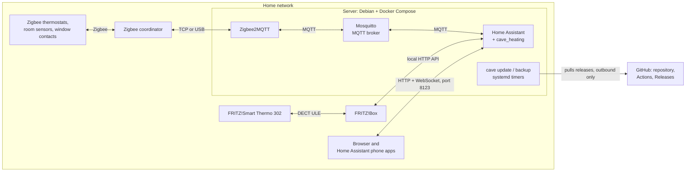
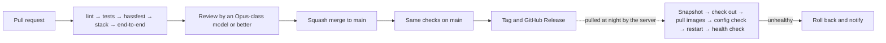

# cave_system — concept

| | |
|---|---|
| Status | Proposed. Becomes binding when this pull request is merged. |
| Date | 2026-11-15 |
| Owner | Max Bielka |
| Owner decisions | Build on Home Assistant. Hot-water radiators only. Everything runs locally. |

How the build is split up is in [work-packages.md](work-packages.md).

## 1. What we are building

A home automation system for a flat in Germany that runs entirely on a small server at home. Heating comes first: every radiator is controlled per room, on a schedule, with pauses while a window is open and a setback while nobody is home. Home Assistant provides the device support, the web UI and the phone apps. This repository provides everything around it: the deployment, the heating logic, the dashboard, simulated devices for testing, and the pipeline that ships tested changes to the server.

Requirements, referenced by ID in the work packages:

| ID | Requirement |
|---|---|
| R1 | **Local.** Every control path works with the internet unplugged. The internet is used only to fetch updates and, optionally, for phone push notifications. |
| R2 | **Heating first.** Per-room radiator control with schedules, window-open pause, away setback, boost, and regulation on a room sensor instead of the sensor next to the hot radiator. |
| R3 | **Connects to every recommended product** in section 3, and each of them has a simulated counterpart in the tests. |
| R4 | **Web UI.** Home Assistant's frontend plus a heating dashboard generated from the room configuration. |
| R5 | **Phone apps.** The official Home Assistant apps for Android and iOS work from day one. A custom app stays possible later (section 7). |
| R6 | **Reproducible.** A fresh server becomes a working system from this repository plus one `.env` file. |
| R7 | **Tested before it reaches home.** Every change runs in CI against the simulated devices. |
| R8 | **Safe self-update.** The server pulls released versions on its own and rolls back if the new version is unhealthy. |
| R9 | **Fails gently.** If the server is down, radiators keep their last setpoint and their built-in frost protection. |

Out of scope for now: underfloor heating, boiler or heat-pump integration, a custom phone app, voice control, and community add-ons installed through HACS. Section 11 says how each could be added later.

## 2. Key decisions

| Topic | Decision | Why | Rejected |
|---|---|---|---|
| Platform | Home Assistant | Owner decision. It runs locally, supports every device in section 3, and has a web UI and phone apps today. | Custom-built system; custom UI on top of Home Assistant. |
| Install type | Home Assistant **Container** under Docker Compose on Debian | The repository can then be the single source of truth: versions are pinned in Git, the exact stack that runs at home is booted in CI, and a release can be rolled back. Container is one of the two install types Home Assistant supports. | Home Assistant OS: an appliance with its own update channel and add-on store, which is convenient by hand but cannot be pinned, tested and rolled back from Git. Core and Supervised: unsupported since release 2025.12. |
| Device network | **Zigbee through Zigbee2MQTT** as the main network; **FRITZ!Box DECT** as a second, fully supported path | Zigbee devices are cheap, vendor-neutral, respond within seconds and expose more control (external temperature input, valve data). The FRITZ! path needs no extra radio and is the fallback where Zigbee does not reach. | FRITZ!Box as the only hub: small, expensive device range and slow command delivery. Thread/Matter: fewer suitable radiator thermostats, and Matter exposes only the basics. |
| Heating logic | A small custom integration, `cave_heating`, configured in YAML and covered by tests | One thermostat per room instead of one per radiator; the logic is reviewable in Git and tested against every Home Assistant upgrade. | Better Thermostat and Versatile Thermostat: capable, but configured through UI dialogs, so the configuration is not reviewable, and they add a third-party update risk. Plain YAML automations: no room-level thermostat entity and no unit tests. |
| Schedules | Home Assistant schedule helpers, one per room | They are edited on a weekly calendar in the web UI and the phone apps, with no redeploy. | Schedules in YAML: not editable in the UI. |
| Deployment | The server **pulls** tagged releases from GitHub | No inbound access to the home network, no credentials for the home in GitHub. | A self-hosted Actions runner or SSH push from GitHub into the home. |
| Versions | Everything pinned; Dependabot proposes upgrades; CI gates them | Upgrades are the main source of breakage for a custom integration. | Floating tags such as `stable` or `latest`. |

Pinned versions at the time of writing: Home Assistant 2026.10.4 (the newest release the test library `pytest-homeassistant-custom-component` 0.13.375 supports; 2026.11.1 is current and follows as soon as the library does), Zigbee2MQTT 2.14.3, Mosquitto 2.0.22, Python 3.14.

## 3. Hardware

Prices are German street prices from mid-November 2026. Sources are listed in section 13.

### 3.1 Recommended products

These are the products the system must connect to (R3). The last column says how each is represented in automated tests.

| Product | Role | Price | Path into Home Assistant | In tests |
|---|---|---|---|---|
| **Sonoff TRV Gen2** (TRV-ZBT) | Radiator thermostat, main pick | €31–35 | Zigbee → Zigbee2MQTT → MQTT discovery | Simulator model `TRV-ZBT` |
| **Sonoff TRVZB** | Radiator thermostat, proven fallback | €25–29 | same | Simulator model `TRVZB` |
| **Bosch Heizkörper-Thermostat II [+M]** (BTH-RA) | Radiator thermostat for quiet rooms | about €63 | same, with the device switched to Zigbee mode | Simulator model `BTH-RA` |
| **FRITZ!Smart Thermo 302** (and the older 301) | Radiator thermostat without an extra radio | €45–55 | DECT ULE → FRITZ!Box → "AVM FRITZ!SmartHome" integration | Fake FRITZ!Box |
| **Sonoff SNZB-02P** | Room temperature and humidity | €10–12 | Zigbee → Zigbee2MQTT | Simulator model `SNZB-02P` |
| **Sonoff SNZB-04P** | Window and door contact | €10–12 | Zigbee → Zigbee2MQTT | Simulator model `SNZB-04P` |
| **SMLIGHT SLZB-06MG24** (Ethernet/PoE) | Zigbee coordinator | €40–45 | TCP → Zigbee2MQTT | Not simulated; Zigbee2MQTT itself is replaced by the simulator |
| **FRITZ!Box** (already owned) | Router, presence, VPN, DECT base | — | "FRITZ!Box Tools" and "AVM FRITZ!SmartHome" integrations | Smart-home API faked; presence replaced by a test entity |

Why these:

- **Sonoff TRV Gen2** is heise's pick for Home Assistant (rated 4.5 of 5 on 1 November 2026): PID regulation, an input for an external room temperature, and three weekly plans stored on the device. It needs Zigbee2MQTT 2.12.1 or newer, which the pinned version satisfies. It only went on sale on 20 August 2026 and there are scattered early reports of connection drop-outs, so **buy one or two first** and check fit and noise on your own valves before equipping every radiator. Sonoff states up to six months on two AA cells.
- **Sonoff TRVZB** is the three-year-old predecessor: larger and louder, but well understood and driven by the same integration. Use it if the Gen2 disappoints.
- **Bosch Thermostat II [+M]** costs twice as much and is the choice where motor noise matters, typically a bedroom. It ships in Matter mode; it is switched to Zigbee on the device and paired with its install code. The Bosch controller is not needed.
- **FRITZ!Smart Thermo 302** talks straight to the FRITZ!Box you own, with DECT range that usually covers a whole flat. Home Assistant polls the FRITZ!Box locally every 30 seconds; a new setpoint reaches the valve after about three minutes (up to fifteen on the older 301). It was rated "gut (1.9)" and price tip by Stiftung Warentest in 2023 as the FRITZ!DECT 302. It is the right choice for a room the Zigbee network does not reach, or if you would rather not run Zigbee at all.
- **One room sensor per room**, placed away from the radiator, is what makes regulation accurate: the thermostat's own sensor sits next to the hot radiator and reads high.
- **A contact on every window that gets opened** lets the heating pause during airing (Stoßlüften) instead of heating the street.
- **A network-attached coordinator** can sit centrally in the flat, away from the server and the router. Battery-powered Zigbee devices do not relay for each other; if a room turns out to be out of reach, add a mains-powered Zigbee plug in between as a relay, or use a FRITZ!Smart Thermo 302 there.

### 3.2 Server

The stack needs about 2 GB of memory and very little CPU. What matters is storage that survives constant database writes.

| Option | Price | Verdict |
|---|---|---|
| **Mini PC with Intel N100 or N150**, 8–16 GB RAM, NVMe SSD | €190–280 new, refurbished business mini PCs from about €150 | **Recommended for a new purchase.** Real SSD, more headroom, 6–8 W idle. |
| **Raspberry Pi 4 or 5 you already own**, 4 GB or more | — | **Fine to start on**, provided it boots from an SSD (USB 3 or NVMe HAT) with the official power supply and a 64-bit OS. SD cards wear out under database writes. |
| Raspberry Pi 5 bought new | about $110 (4 GB) / $175 (8 GB) for the bare board | Not recommended. After this year's memory price rises a complete mini PC costs about the same. The Pi's lower idle draw (about 3 W) saves roughly €14 a year. |
| Home Assistant Green | €179 | Not recommended here. It is an appliance for Home Assistant OS; this design uses Container. |

Both paths run Debian 13 (Raspberry Pi OS Lite 64-bit on the Pi) with Docker Engine and the Compose plugin. All images used are published for x86-64 and ARM64.

### 3.3 Example budget

A three-room flat with four radiators: four Sonoff TRV Gen2 (€140), three SNZB-02P (€36), four SNZB-04P (€48), one coordinator (€45) come to about **€270**, plus about €200 if a mini PC is bought.

### 3.4 Considered and not recommended

| Product | Reason |
|---|---|
| Aqara W600 | Tops several 2026 comparisons, but has open firmware problems that matter here: with an external sensor selected the valve still regulates on the internal one, and under Zigbee2MQTT the valve opening and heating state are not reported. |
| tado° X | Requires the vendor's cloud account. |
| Homematic IP Evo | Excellent regulation and a test winner, but needs its own hub (HCU or CCU3) and a custom integration to run locally. Worth it for a house with underfloor heating, not for radiators in a flat. |
| Eve Thermo | Fully local over Thread/Matter and a good fit for Apple Home. Costs twice as much, and Matter exposes only the basics to Home Assistant. |
| TP-Link Kasa KE100 | Cheap and local, but a proprietary hub family, so it does not double as the network for sensors and later devices. |

### 3.5 Fit and tenancy

- German radiator valves almost always have an M30 × 1.5 thread, which all thermostats above fit directly. Danfoss RA, RAV and RAVL valves need one of the adapters that come in the box.
- Tenants may generally replace the thermostat heads without asking the landlord, because the valve itself is not touched. Keep the original heads and refit them when moving out.

## 4. Architecture



### 4.1 Runtime services

Service names are part of the contract between work packages.

| Compose service | Image | Role | Network |
|---|---|---|---|
| `homeassistant` | `ghcr.io/home-assistant/home-assistant` | Devices, automation, web UI, API. Loads `cave_heating`. | Host network, port 8123 on the LAN |
| `mosquitto` | `eclipse-mosquitto` | MQTT broker with password authentication | Port 1883 on localhost and the Compose network only |
| `zigbee2mqtt` | `ghcr.io/koenkk/zigbee2mqtt` | Zigbee network, pairing, firmware updates. Compose profile `zigbee`, so the stack also starts without a coordinator. | Web UI on port 8080 on the LAN, protected by a token |
| `sim` | built from `sim/` | Simulated devices. Only in the demo and CI overlay `compose.sim.yaml`, never at home. | Compose network, control API on localhost |

Zigbee2MQTT publishes its devices to Home Assistant through MQTT discovery under the prefix `homeassistant`, with device state under `zigbee2mqtt/<name>`.

### 4.2 Code and state are separate

| | Where | Contents |
|---|---|---|
| Code | The repository checkout, mounted **read-only** into the containers | Compose files, `homeassistant/` (`configuration.yaml`, `packages/`, `dashboards/`, `cave/`), `custom_components/cave_heating`, `tools/` |
| State | `CAVE_DATA`, `/var/lib/cave` on the server and `./data` in development; never in Git | Home Assistant's `/config` (`.storage`, database, `secrets.yaml`, automations made in the UI), Zigbee2MQTT's data (network key, device database, coordinator backup), Mosquitto's data |
| Secrets | `.env` on the server, created by `./cave init`, mode 0600 | Generated passwords and tokens, FRITZ!Box credentials |

Because code is read-only and state lives elsewhere, moving the server to another release is a `git checkout` plus a container restart, and a backup is a copy of `CAVE_DATA` and `.env`.

The description of the home itself — rooms and which devices belong to them — is `homeassistant/cave/heating.yaml`. It is code: versioned, reviewed, and the single source for both the heating logic and the generated dashboard.

### 4.3 Repository layout

```
compose.yaml              production stack
compose.sim.yaml          overlay adding simulated devices (demo, CI)
cave                      command-line entry point; commands live in scripts/cave.d/
homeassistant/            tracked Home Assistant configuration
  configuration.yaml
  packages/               notifications and helper entities
  dashboards/heating.yaml generated, do not edit
  cave/heating.yaml       rooms and devices of the real home
custom_components/cave_heating/   the heating integration
sim/                      simulator package, demo home, Dockerfile
tools/                    bootstrap and dashboard generator (run inside the Home Assistant container or in CI)
scripts/                  host provisioning, update, backup, systemd units
tests/                    unit, integration and end-to-end tests
docs/
.github/workflows/
```

### 4.4 The `cave` command

One entry point on the server and in CI: `init` (create data directories and secrets), `up`, `down`, `restart`, `ps`, `logs`, `check` (validate Compose and Home Assistant configuration), `bootstrap` (first-run setup of Home Assistant), `demo` (start with simulated devices), `update`, `backup`, `restore`, `status`, `version`. The host needs only Bash, Git and Docker; anything written in Python runs inside the Home Assistant container.

## 5. Heating logic: `cave_heating`

### 5.1 Configuration

```yaml
# homeassistant/cave/heating.yaml
presence: zone.home            # optional; a count above 0, or "home"/"on", means someone is home
away_delay: "00:30:00"
defaults:
  comfort_temperature: 21.0
  eco_temperature: 17.5
  away_temperature: 16.0
  boost_temperature: 25.0
  boost_duration: "00:30:00"
  override_max: "06:00:00"
  window_open_delay: "00:01:00"
  window_close_delay: "00:02:00"
rooms:
  - id: living_room            # ASCII slug, used in entity IDs
    name: Wohnzimmer           # display name, also the Home Assistant area
    trvs:
      - entity: climate.wohnzimmer_heizung_fenster
        external_temperature: number.wohnzimmer_heizung_fenster_external_temperature_input
      - entity: climate.wohnzimmer_heizung_tuer
    temperature_sensor: sensor.wohnzimmer_temperature
    humidity_sensor: sensor.wohnzimmer_humidity
    windows:
      - binary_sensor.wohnzimmer_fenster_contact
    schedule: schedule.living_room_heating
    comfort_temperature: 21.5  # optional per-room starting values
```

Only `id`, `name` and at least one thermostat are required per room. Everything else is optional, and a room degrades sensibly without it: no schedule means comfort whenever someone is home, no room sensor means the average of the thermostats' own readings, no window contacts means no window pause.

The configuration is validated on load with messages that name the room and field. Entities that do not exist yet, because a device is not paired, put the room into a degraded state with a visible warning; they never stop Home Assistant or the other rooms. `cave_heating.reload` applies configuration changes without a restart.

### 5.2 Entities

Per room, grouped under one device that is placed in the room's area:

| Entity | Purpose |
|---|---|
| `climate.cave_<room>` | The room thermostat. Modes `heat` and `off`. Presets `comfort`, `eco`, `away`, `boost` and `none`, showing what currently determines the target. Current temperature from the room sensor. |
| `number.cave_<room>_comfort_temperature`, `number.cave_<room>_eco_temperature` | The two schedule temperatures, adjustable in the UI. |
| `button.cave_<room>_resume_schedule` | Ends a boost or override. |
| `binary_sensor.cave_<room>_window_open` | True while the window pause is in effect. |
| `sensor.cave_<room>_reason` | Why the room is at its current target: one of the reasons in section 5.3. |

Once for the home:

| Entity | Purpose |
|---|---|
| `select.cave_home_mode` | `auto` (normal), `away` (forced setback, for holidays), `off` (summer). |
| `number.cave_away_temperature` | Setback temperature. |
| `binary_sensor.cave_home_occupied` | Presence after the away delay has been applied. |

Services: `cave_heating.boost` (rooms, optional duration and temperature), `cave_heating.resume_schedule`, `cave_heating.reload`. Entity names ship in English and German.

### 5.3 What a room does

The first matching row wins.

| # | Condition | Radiators | Reason shown |
|---|---|---|---|
| 1 | Home mode is `off` | Off | `summer` |
| 2 | The room is switched `off` | Off | `room_off` |
| 3 | A window contact has been open longer than the open delay, until all have been closed longer than the close delay | Off | `window` |
| 4 | A boost is running | Boost temperature | `boost` |
| 5 | An override is active: a temperature or preset chosen by hand, in the UI or on a thermostat | That temperature | `override` |
| 6 | Away: home mode is `away`, or presence reports nobody home for longer than the away delay | Away temperature | `away` |
| 7 | The schedule is on, or the room has no schedule | Comfort temperature | `comfort` |
| 8 | The schedule is off | Eco temperature | `eco` |

Rules around boost and override:

- A boost ends after its duration. An override ends at the next schedule change, after `override_max`, or when the schedule is resumed by hand, whichever comes first.
- When the home becomes away, a running boost or override is cancelled.
- An override set **while** away is honoured, so the flat can be pre-heated from the phone. It ends when someone arrives or after `override_max`; schedule changes do not end it.
- "Off" leaves frost protection to the thermostat. The room's own target is kept and restored when the pause ends.

### 5.4 How thermostats are driven

- **Only on change.** A thermostat receives a command only when what it should do differs from what it last reported and from what was last sent. Changes arriving together are sent once. This protects batteries.
- **Off** is the thermostat's `off` mode where it has one, otherwise its minimum temperature.
- **Confirmation.** A command counts as confirmed when the thermostat reports the commanded target. If it does not within the timeout — 5 minutes, or 20 minutes for thermostats from the FRITZ!Box integration and any marked `slow: true` — the command is resent up to three times, after which the thermostat is flagged unresponsive, a repair notice is raised, and it is retried every 30 minutes.
- **Changes made on the thermostat.** If a thermostat reports a target that is neither the commanded value nor the value it had before the command, someone turned it by hand. The room adopts that as an override and brings the room's other thermostats to the same target. While the room is paused or off, the thermostat is put back instead.
- **Room temperature to the thermostat.** Where a thermostat lists an `external_temperature` input, the room sensor's reading is written to it when it changes by at least 0.1 K, at most every 5 minutes and at least every 20 minutes. If the room sensor has been silent for an hour the writes stop, and the thermostat falls back to its own sensor by itself.
- **Start-up.** Room state (mode, override, boost end time, temperatures) is restored. Nothing is sent to a thermostat that already matches, and nothing is sent until the thermostat is available.
- **Unavailable devices** are skipped and shown as such, then reconciled when they return.

### 5.5 One brain

Schedules on the devices themselves are switched off, because two schedulers fight each other: Sonoff and Bosch thermostats run in manual mode, and each FRITZ! thermostat gets a FRITZ!Box timetable without switching points. What stays on the devices is what must work without the server: frost protection, the periodic valve exercise, the display and the manual dial.

## 6. Web UI

- **Home Assistant frontend** on port 8123: its own overview dashboards, device pages, history and settings.
- **Heating dashboard**, generated from `homeassistant/cave/heating.yaml` so it cannot drift from the room configuration. One card per room with target, preset, resume button, temperature and humidity history, window state and the reason; a header with home mode, away temperature and who is home; a maintenance view with battery levels, unavailable devices and unconfirmed thermostats. It uses built-in cards only, so there is no third-party frontend code.
- **Schedules** are edited under Settings → Devices & services → Helpers, on a weekly calendar.
- **Zigbee2MQTT's own web UI** on port 8080 is used for pairing and firmware updates.
- **Notifications** for a low battery, a device that has gone silent, a window left open, high humidity (a prompt to air the room) and the result of each self-update, as persistent notifications in the UI and, if configured, on the phone.

## 7. Phone apps and remote access

- **Apps:** the official Home Assistant apps for Android and iOS are free and open source. They show the same dashboards, deliver notifications, and can report the phone's location for presence.
- **Presence without an app:** the FRITZ!Box knows which phones are on the Wi-Fi. The "FRITZ!Box Tools" integration turns that into presence, entirely locally.
- **Remote access without a cloud:** the WireGuard VPN built into the FRITZ!Box. The phone connects to the VPN and the app uses the same address as at home. Connections where the provider gives no public IPv4 address (DS-Lite) need IPv6 on the phone's side.
- **Push notifications** to a phone outside the home travel through Apple's or Google's push service. This is the one place the internet is involved, and nothing depends on it.
- **A custom app later:** Home Assistant exposes a documented WebSocket and REST API with token authentication. The entities and services in section 5.2 are the stable contract; a custom app would be another client of that API and needs no change on the server.

## 8. Simulated devices and testing

No hardware is needed to develop or test, and the same simulators power a demo mode in which the complete UI can be explored before buying anything.

**Simulators** (`sim/`):

- A **Zigbee2MQTT stand-in** that publishes, over MQTT, the same discovery and state messages Zigbee2MQTT publishes for the TRV-ZBT, TRVZB, BTH-RA, SNZB-02P and SNZB-04P, and reacts to the same commands.
- A **fake FRITZ!Box** that implements the login and smart-home HTTP API used by Home Assistant's integration, with FRITZ!Smart Thermo 302 devices and a configurable delay before a setpoint takes effect.
- A simple **room model**, so temperatures move when a valve opens or a window is opened, and a small **control API** for tests and demos: open a window, change a temperature, take a device offline.
- A **demo home** definition used by the simulators, the demo configuration and the end-to-end tests.

**Test levels:**

| Level | Proves | Runs |
|---|---|---|
| Unit | The decision table in 5.3 and the rules in 5.4, with simulated time | Locally and in CI, seconds |
| Integration, in-process | `cave_heating` driving real Home Assistant thermostat entities built from the simulators' messages; the fake FRITZ!Box driven by the real client library | Locally and in CI, under a minute |
| Stack | The Compose file and configuration are valid and Home Assistant boots healthy in the pinned image | CI |
| End-to-end | The complete stack with simulated devices: first-run setup, then scenarios across both device families — schedule, window pause, away, boost, room-sensor feed, slow thermostat, offline device — and a screenshot of the heating dashboard | CI, a few minutes |

**Limit of this approach:** the simulators are models built from documentation and source code. A hardware acceptance checklist covers what only real devices can show — pairing, radio range, coordinator attachment, FRITZ!Box presence — and includes recording the real devices' messages into the simulator fixtures, so the simulators converge on reality.

## 9. CI/CD



- **One pipeline** in GitHub Actions. Checks: Ruff, mypy, yamllint, ShellCheck and actionlint; unit and integration tests; hassfest; the stack check; the end-to-end test.
- **Release:** when the pipeline passes on `main`, it creates a tag `vYYYY.MM.DD.N` and a GitHub Release with generated notes.
- **Deployment:** a systemd timer on the server runs `cave update` at night. It fetches tags and, if there is a newer release, takes a snapshot of the state, checks out the release, pulls images, validates the Home Assistant configuration in the new image, restarts, and verifies that Home Assistant is up and `cave_heating` is loaded. If any step fails it restores the snapshot and the previous release, and reports the outcome as a notification. `CAVE_AUTO_UPDATE=0` switches to manual updates.
- **Upgrades:** Dependabot proposes new versions of the container images, Python packages and Actions weekly. They pass through the same pipeline and review as any other change.
- **Rules:** no direct pushes to `main` after the bootstrap commit. Every change is a pull request with a green pipeline and a review by an Opus-class model or better, then a squash merge.

## 10. Security and privacy

- No port is opened to the internet. Remote access is through the FRITZ!Box VPN.
- The MQTT broker requires a password and listens only on localhost and the internal Compose network. The Zigbee2MQTT UI requires a token.
- Secrets are generated on the server and never committed. Commits and pushes are scanned for secrets.
- Supply chain: pinned image versions, Actions pinned to commit hashes, workflow tokens with the minimum permissions, and a read-only deploy key on the server.
- No vendor cloud is involved. Device data stays in the home.

## 11. Operations and extension points

**Installing:** provision the host with `scripts/provision-host.sh`, clone the repository, run `./cave init`, add the FRITZ!Box credentials and coordinator address to `.env`, then `./cave up` and `./cave bootstrap`. Pair devices, enter them in `homeassistant/cave/heating.yaml`, and release.

**Backup:** `cave backup` runs nightly and before every update. It archives `CAVE_DATA` and `.env` with a retention period, optionally to a second location such as storage attached to the FRITZ!Box. `cave restore` is the documented way back, including onto a new server.

**Later additions, none of which changes the architecture:**

| Addition | How |
|---|---|
| Underfloor heating | Relays on the manifold through Home Assistant; `cave_heating` gains an on/off actuator type next to thermostats. |
| Boiler or heat pump | Local bus adapters that speak MQTT, such as ebusd for Vaillant or EMS-ESP for Bosch and Buderus. |
| Anything else | Home Assistant's own integrations, added in its UI. |
| Custom phone app | A client of Home Assistant's API (section 7). |

## 12. Risks and open points

| Risk | Mitigation |
|---|---|
| Simulators differ from real devices | Hardware acceptance checklist; recording real messages into the fixtures. Until hardware arrives, "connects to" means proven against the simulators and Home Assistant's own integrations. |
| The Sonoff TRV Gen2 is three months old | Buy one or two first. The TRVZB and the FRITZ!Smart Thermo 302 are tested alternatives. |
| A Home Assistant upgrade breaks `cave_heating` | Pinned versions; every upgrade runs the full pipeline. If the integration fails at home, the thermostats remain directly controllable in Home Assistant. |
| A rollback after Home Assistant has migrated its database | The pre-update snapshot is restored together with the previous release. |
| Zigbee range in concrete buildings | Network-attached coordinator placed centrally; relay plugs; FRITZ! thermostats as the alternative. |
| First-run setup relies on Home Assistant's onboarding and config-flow endpoints, which are not a formal public API | Exercised by the end-to-end test on every upgrade. |
| GitHub Actions minutes on a private repository | The pipeline is kept short, superseded runs are cancelled, and usage is checked after the first work packages. |

## 13. Sources

Thermostats and tests
- [heise: the ten best radiator thermostats, 7 Nov 2026](https://www.heise.de/bestenlisten/testsieger/top-10-das-beste-heizkoerperthermostat-im-test-testsieger-heizt-ohne-cloud/1e43f3r)
- [heise: Sonoff TRV Gen2 review](https://www.heise.de/bestenlisten/testbericht/sonoff-trv-gen2-im-test-guenstiges-heizkoerperthermostat-fuer-home-assistant/wh3ff9g)
- [Sonoff TRV Gen2 with Zigbee2MQTT and ZHA](https://localsmarthomeguide.com/articles/sonoff-trv-gen2-home-assistant-setup/)
- [Sonoff TRVZB external temperature sensor, Zigbee2MQTT discussion](https://github.com/Koenkk/zigbee2mqtt/discussions/26308)
- [Bosch Thermostat II [+M]: switching from Matter to Zigbee](https://www.thing-king.de/bosch-heizkoerper-thermostat-ii-m-von-matter-thread-zu-zigbee-umstellen/) and [pairing with Zigbee2MQTT](https://www.thing-king.de/bosch-smart-home-heizkoerper-thermostat-ii-ueber-zigbee2mqtt-mit-home-assistant-verbinden/)
- [Bosch Thermostat II [+M] prices, Geizhals](https://geizhals.de/bosch-smart-home-heizkoerper-thermostat-ii-m-matter-8750002982-a3337738.html)
- [FRITZ!Smart Thermo 302 prices, heise Preisvergleich](https://preisvergleich.heise.de/fritz-fritz-smart-thermo-302-funk-heizkoerperthermostat-20003120-a3712218.html)
- [FRITZ!Smart Thermo 302 with Home Assistant](https://www.einfachgadgets.de/artikel/fritz-smart-thermo-302-home-assistant)
- [FRITZ!DECT 301/302 command delay, simon42 community](https://community.simon42.com/t/dect-301-bzw-302-die-verzoegerungszeit-umgehen/38542)
- [FRITZ! interface documentation](https://fritz.com/en/pages/interfaces)
- [Stiftung Warentest: smart radiator thermostats](https://www.test.de/Heizkoerperthermostat-Test-5115581-0/) and [ADAC summary](https://www.adac.de/rund-ums-haus/energie/versorgung/smarte-heizkoerperthermostate/)
- [Aqara W600: valve opening and heating state not reported, Zigbee2MQTT issue 33428](https://github.com/Koenkk/zigbee2mqtt/issues/33428) and [external sensor does not control the valve, Aqara forum](https://forum.aqara.com/t/w600-external-sensor-does-not-control-valve-firmware-issue/341137)

Sensors and coordinators
- [Sonoff SNZB-02P](https://www.berrybase.de/en/sonoff-snzb-02p-temperature-humidity-sensor-temperatur-luftfeuchte-sensor-zigbee-rund) and [SNZB-04P](https://www.berrybase.de/en/sonoff-snzb-04p-door-window-sensor-tuer-und-fensterkontakt-zigbee) at BerryBase
- [Twelve Zigbee sensors tested](https://smarthome-assistant.info/12-zigbee-sensoren-im-test-marktfuehrer-im-vergleich/)
- [Best Zigbee coordinators for Home Assistant 2026](https://smarthomescene.com/top-picks/best-zigbee-coordinators-for-home-assistant/)
- [SMLIGHT 2026 range guide](https://howmation.com/en_UK/blog/article/smlight-2026-range-guide-choosing-right-zigbee-thread-matter-coordinator)

Server and platform
- [Raspberry Pi 5 or N100 mini PC for Home Assistant, 2026](https://raspberry.tips/en/smart-home/home-assistant-hardware-2026-raspberry-pi-5-or-n100-mini-pc)
- [Home Assistant Green pricing change](https://www.nabucasa.com/news/2026-01-08-green-pricing-change/)
- [Home Assistant: deprecating the Core and Supervised installation methods](https://www.home-assistant.io/blog/2025/05/22/deprecating-core-and-supervised-installation-methods-and-32-bit-systems/)

Tenancy
- [Smart thermostats in a rented flat](https://www.drohnen.de/71799/smartes-heizkoerperthermostat-mietwohnung/)
