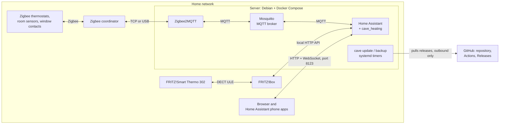

# cave_system — concept

| | |
|---|---|
| Status | Proposed, third revision after review. Becomes binding when this pull request is merged. |
| Date | 2026-11-15 |
| Owner | Max Bielka |
| Owner decisions | Build on Home Assistant. Hot-water radiators only. Everything runs locally. |

How the build is split up is in [work-packages.md](work-packages.md).

## 1. What we are building

A home automation system for a flat in Germany that runs entirely on a small server at home. Heating comes first: every radiator is controlled per room, on a schedule, with pauses while a window is open and a setback while nobody is home. Home Assistant provides the device support, the web UI and the phone apps. This repository provides everything around it: the deployment, the heating logic, the dashboard, simulated devices for testing, and the pipeline that ships tested changes to the server.

Requirements, referenced by ID in the work packages:

| ID | Requirement |
|---|---|
| R1 | **Local.** Every control path works with the internet unplugged. The internet is used only to fetch updates and, optionally, for phone push notifications. |
| R2 | **Heating first.** Per-room radiator control with schedules, window-open pause, away setback and boost. Thermostats that accept an external temperature (Sonoff, Bosch) regulate on the room sensor instead of the sensor next to the hot radiator; FRITZ! thermostats regulate on their own sensor. |
| R3 | **Connects to every recommended product** in section 3. Each has a simulated counterpart, device integration tests exercise each one through Home Assistant, and the same checks can be run against the real device. |
| R4 | **Web UI.** Home Assistant's frontend plus a heating dashboard generated from the room configuration. |
| R5 | **Phone apps.** The official Home Assistant apps for Android and iOS work from day one. A custom app stays possible later (section 7). |
| R6 | **Reproducible.** A fresh server becomes the same working system from this repository, one `.env` file and the latest backup. Without a backup the system still comes up, but devices have to be paired again and schedules start from defaults. |
| R7 | **Tested before it reaches home.** Every change runs in CI against the simulated devices. |
| R8 | **Safe self-update.** The server pulls released versions on its own and rolls back if the new version is unhealthy. |
| R9 | **Fails gently.** If the server is down, radiators keep their last setpoint and their built-in frost protection. A radiator that was off at that moment, because of an open window or a room switched off, stays off with frost protection only. |

Out of scope for now: underfloor heating, boiler or heat-pump integration, a custom phone app, voice control, and community add-ons installed through HACS. Section 11 says how each could be added later.

## 2. Key decisions

| Topic | Decision | Why | Rejected |
|---|---|---|---|
| Platform | Home Assistant | Owner decision. It runs locally, supports every device in section 3, and has a web UI and phone apps today. | Custom-built system; custom UI on top of Home Assistant. |
| Install type | Home Assistant **Container** under Docker Compose on Debian | The repository can then be the single source of truth for the software: versions are pinned in Git, the exact stack that runs at home is booted in CI, and a release can be rolled back. Container is one of the two install types Home Assistant supports. | Home Assistant OS: an appliance with its own update channel and add-on store, which is convenient by hand but cannot be pinned, tested and rolled back from Git. Core and Supervised: unsupported since release 2025.12. |
| Device network | **Zigbee through Zigbee2MQTT** as the main network; **FRITZ!Box DECT** as a second, fully supported path | Zigbee devices are cheap, vendor-neutral, respond within seconds and expose more control (external temperature input, valve data). The FRITZ! path needs no extra radio and is the fallback where Zigbee does not reach. | FRITZ!Box as the only hub: small, expensive device range and slow command delivery. Thread/Matter: fewer suitable radiator thermostats, and Matter exposes only the basics. |
| Heating logic | A small custom integration, `cave_heating`, covered by tests | One thermostat per room instead of one per radiator, and logic that is tested against every Home Assistant upgrade. | Better Thermostat and Versatile Thermostat: capable, but they add a third-party update risk and are configured through UI dialogs. Plain YAML automations: no room-level thermostat entity and no unit tests. |
| Where the home is described | `heating.yaml` — rooms and their devices — is **state on the server**, not a file in Git. It takes effect only through `./cave apply`. | Adding a thermostat is then an edit and one command, taking seconds. In Git it would take a pull request, the pipeline, a release and an update for every change. `apply` validates the file and keeps the last valid version as the one Home Assistant loads, so a typo can never stop Home Assistant. The file is included in every backup. | Tracking the home description in Git; letting Home Assistant include the edited file directly. |
| Schedules | Home Assistant schedule helpers, one per room | They are edited on a weekly calendar in the web UI and the phone apps. | Schedules in YAML: not editable in the UI. |
| Operations tooling | The `cave` command is **Python, standard library only**, running on the server's own Python (3.11 or newer) | Update and rollback must be right the first time, so they need real tests; Python is testable on any machine, and shell written for Debian is not. | Bash scripts. |
| Deployment | The server **pulls** tagged releases from GitHub | No inbound access to the home network, no credentials for the home in GitHub. | A self-hosted Actions runner or SSH push from GitHub into the home. |
| Versions | Everything pinned; upgrades arrive as pull requests; CI gates them | Upgrades are the main source of breakage for a custom integration. | Floating tags such as `stable` or `latest`. |

Pinned versions at the time of writing: Home Assistant 2026.10.4 (the newest release the test library `pytest-homeassistant-custom-component` 0.13.375 supports; 2026.11.1 is current and follows as soon as the library does), Zigbee2MQTT 2.14.3, Mosquitto 2.0.22, Python 3.14 for development and inside the Home Assistant container.

## 3. Hardware

Prices are German street prices from mid-November 2026 unless marked. Sources are listed in section 13.

### 3.1 Recommended products

These are the products the system must connect to (R3). The last column says how each is represented in automated tests.

| Product | Role | Price | Path into Home Assistant | In tests |
|---|---|---|---|---|
| **Sonoff TRV Gen2** (TRV-ZBT) | Radiator thermostat, main pick | €31–35 | Zigbee → Zigbee2MQTT → MQTT discovery | Simulator model `TRV-ZBT` |
| **Sonoff TRVZB** | Radiator thermostat, proven fallback | €25–29 | same | Simulator model `TRVZB` |
| **Bosch Heizkörper-Thermostat II [+M]** (BTH-RA) | Radiator thermostat for quiet rooms | about €63 | same, with the device switched to Zigbee mode | Simulator model `BTH-RA` |
| **FRITZ!Smart Thermo 302** (and the older 301) | Radiator thermostat without an extra radio | €45–55 | DECT ULE → FRITZ!Box → "FRITZ!SmartHome" integration | Fake FRITZ!Box |
| **Sonoff SNZB-02P** | Room temperature and humidity | €10–12 | Zigbee → Zigbee2MQTT | Simulator model `SNZB-02P` |
| **Sonoff SNZB-04P** | Window and door contact | €10–12 | Zigbee → Zigbee2MQTT | Simulator model `SNZB-04P` |
| **SMLIGHT SLZB-06MG24** (Ethernet/PoE) | Zigbee coordinator | €40–45 | TCP → Zigbee2MQTT | Not simulated; Zigbee2MQTT itself is replaced by the simulator |
| **FRITZ!Box** (already owned) | Router, presence, VPN, DECT base | — | "FRITZ!Box Tools" and "FRITZ!SmartHome" integrations | Smart-home API faked; presence replaced by a test entity |

Why these:

- **Sonoff TRV Gen2** is heise's pick for Home Assistant (rated 4.5 of 5 on 1 November 2026): PID regulation, an input for an external room temperature, and three weekly plans stored on the device. It needs Zigbee2MQTT 2.12.1 or newer, which the pinned version satisfies. It only went on sale on 20 August 2026 and there are scattered early reports of connection drop-outs, so **buy one or two first** and check fit and noise on your own valves before equipping every radiator. Sonoff states up to six months on two AA cells.
- **Sonoff TRVZB** is the three-year-old predecessor: larger and louder, but well understood and driven by the same integration. Use it if the Gen2 disappoints.
- **Bosch Thermostat II [+M]** costs twice as much and is the choice where motor noise matters, typically a bedroom. It ships in Matter mode; it is switched to Zigbee on the device and paired with its install code. The Bosch controller is not needed.
- **FRITZ!Smart Thermo 302** talks straight to the FRITZ!Box you own, with DECT range that usually covers a whole flat. Home Assistant polls the FRITZ!Box locally every 30 seconds; a new setpoint reaches the valve after about three minutes (up to fifteen on the older 301). It was rated "gut (1.9)" and price tip by Stiftung Warentest in 2023 as the FRITZ!DECT 302. It is the right choice for a room the Zigbee network does not reach, or if you would rather not run Zigbee at all. It cannot use a Zigbee room sensor; it regulates on its own.
- **One room sensor per room**, placed away from the radiator, is what makes regulation accurate: the thermostat's own sensor sits next to the hot radiator and reads high.
- **A contact on every window that gets opened** lets the heating pause during airing (Stoßlüften) instead of heating the street.
- **A network-attached coordinator** can sit centrally in the flat, away from the server and the router. Battery-powered Zigbee devices do not relay for each other; if a room turns out to be out of reach, add a mains-powered Zigbee plug in between as a relay, or use a FRITZ!Smart Thermo 302 there.

### 3.2 Server

The stack needs about 2 GB of memory and very little CPU. What matters is storage that survives constant database writes.

| Option | Price | Verdict |
|---|---|---|
| **Mini PC with Intel N100 or N150**, 8–16 GB RAM, NVMe SSD | €190–280 new, refurbished business mini PCs from about €150 | **Recommended for a new purchase.** Real SSD, more headroom, 6–8 W idle. |
| **Raspberry Pi 4 or 5 you already own**, 4 GB or more | — | **Fine to start on**, with the official power supply and a 64-bit OS. It works from an SD card; an SSD (USB 3 or NVMe HAT) is the reliability recommendation before relying on it for a winter, because consumer SD cards wear out under database writes. |
| Raspberry Pi 5 bought new | US list price $110 (4 GB) / $175 (8 GB) for the bare board | Not recommended. After this year's memory price rises a complete mini PC costs about the same. The Pi's lower idle draw (about 3 W) saves roughly €14 a year. |
| Home Assistant Green | €179 | Not recommended here. It is an appliance for Home Assistant OS; this design uses Container. |

Both paths run Debian 13 (Raspberry Pi OS Lite 64-bit on the Pi) with Docker Engine, the Compose plugin, Git and the system Python. All images used are published for x86-64 and ARM64.

### 3.3 Example budget

A three-room flat with four radiators: four Sonoff TRV Gen2 (€140), three SNZB-02P (€36), four SNZB-04P (€48), one coordinator (€45) come to about **€270**, plus about €200 if a mini PC is bought.

### 3.4 Considered and not recommended

| Product | Reason |
|---|---|
| Aqara W600 | Tops several 2026 comparisons, but has open firmware problems that matter here: with an external sensor selected the valve still regulates on the internal one, and under Zigbee2MQTT the valve opening and heating state are not reported. |
| tado° X | Requires the vendor's cloud account. |
| Homematic IP Evo | Excellent regulation and a test winner, but needs its own hub (HCU or CCU3) and a custom integration to run locally. Worth it for a house with underfloor heating, not for radiators in a flat. |
| Eve Thermo | Fully local over Thread/Matter and a good fit for Apple Home. Costs twice as much, and Matter exposes only the basics to Home Assistant. |
| TP-Link Kasa KE100 | Cheap and local, but a proprietary hub family, so it does not double as the network for sensors and later devices. |

### 3.5 Fit and tenancy

- German radiator valves almost always have an M30 × 1.5 thread, which all thermostats above fit directly. Danfoss RA, RAV and RAVL valves need an adapter. The Sonoff thermostats include all three; the Bosch includes RA and RAVL; the FRITZ!Smart Thermo 302 includes RA only. Other adapters are bought separately.
- Tenants may generally replace the thermostat heads without asking the landlord, because the valve itself is not touched. Keep the original heads and refit them when moving out.

## 4. Architecture



### 4.1 Runtime services

Service names and ports are part of the contract between work packages.

| Compose service | Image | Role | Network |
|---|---|---|---|
| `homeassistant` | `ghcr.io/home-assistant/home-assistant` | Devices, automation, web UI, API. Loads `cave_heating`. | Host network, port 8123 on the LAN |
| `mosquitto` | `eclipse-mosquitto` | MQTT broker with password authentication | Port 1883 on `127.0.0.1` and on the Compose network only |
| `zigbee2mqtt` | `ghcr.io/koenkk/zigbee2mqtt` | Zigbee network, pairing, firmware updates. Compose profile `zigbee`, so the stack also starts without a coordinator. | Web UI on port 8080 on the LAN, protected by a token |
| `sim` | built from `sim/` | Simulated devices. Only in the overlay `compose.sim.yaml` used by the demo and CI, never at home. | Fake FRITZ!Box on `127.0.0.1:8480`, control API on `127.0.0.1:8481`, MQTT through the Compose network |

Home Assistant runs on the host network and therefore reaches the broker and the simulators through `127.0.0.1`, never by Compose service name.

Zigbee2MQTT publishes its devices to Home Assistant through MQTT discovery under the prefix `homeassistant`, with device state under `zigbee2mqtt/<name>`. The entity IDs Home Assistant derives from it follow Zigbee2MQTT's scheme: the device's friendly name in lower case with spaces as underscores, followed by the property where there is one.

### 4.2 Code and state are separate

| | Where | Contents |
|---|---|---|
| Code | The repository checkout, mounted **read-only** into the containers | `compose.yaml`; `homeassistant/configuration.yaml` and `homeassistant/packages/`; `custom_components/cave_heating/`; `tools/` |
| State | `CAVE_DATA`: `/var/lib/cave` on the server, `./data` in a development checkout; never in Git | Home Assistant's `/config`: `.storage`, the database, `secrets.yaml`, `automations.yaml`, `scripts.yaml`, `scenes.yaml`, **`cave/heating.yaml`** (the description of the home, as edited), **`cave/.applied/heating.yaml`** (the last version that passed validation), **`dashboards/heating.yaml`** (generated from it), and `.cave/token`. Zigbee2MQTT's data: its configuration with the network key, the device database, the coordinator backup. Mosquitto's data. |
| Secrets | `.env` in the checkout on the server, created by `./cave init`, mode 0600, never committed | Generated passwords and tokens, FRITZ!Box credentials |

`/config` is the state directory. The tracked pieces are mounted into it read-only as directories; `configuration.yaml` is the only single-file mount. A changed checkout takes effect when the containers are recreated, which `cave up` and `cave update` do.

Home Assistant does not create the files its configuration includes, so `cave init` creates `secrets.yaml`, empty `automations.yaml`, `scripts.yaml` and `scenes.yaml`, a starter `cave/heating.yaml` with no rooms together with its applied copy, and a placeholder dashboard.

Because code is read-only and state lives elsewhere, moving the server to another release is a `git checkout` plus recreating the containers, and a backup is a copy of `CAVE_DATA` and `.env`.

**The `.env` file.** `./cave init` writes every variable; `.env.example` documents them.

| Variable | Set by | Read by | Meaning |
|---|---|---|---|
| `CAVE_DATA` | init, default as above | Compose, every command | State directory |
| `TZ` | init, default `Europe/Berlin` | all services; `cave bootstrap` for Home Assistant's own time zone, units, country and currency, which are not in `configuration.yaml` | Time zone |
| `COMPOSE_PROFILES` | owner; empty, or `zigbee` once a coordinator is connected | Compose | Whether Zigbee2MQTT runs |
| `CAVE_MQTT_USER`, `CAVE_MQTT_PASSWORD` | init, password generated | Mosquitto's password file, Zigbee2MQTT, bootstrap, simulators | Broker login |
| `CAVE_HA_OWNER_NAME`, `CAVE_HA_OWNER_USER`, `CAVE_HA_OWNER_PASSWORD` | init, password generated | bootstrap | Home Assistant's owner account |
| `CAVE_Z2M_SERIAL_PORT`, `CAVE_Z2M_ADAPTER` | owner | Zigbee2MQTT | Coordinator address (`tcp://<address>:6638` or a `/dev/serial/by-id/` path) and driver (`ember` or `zstack`) |
| `CAVE_Z2M_FRONTEND_TOKEN` | init, generated | Zigbee2MQTT | Token for its web UI |
| `CAVE_FRITZ_HOST`, `CAVE_FRITZ_USER`, `CAVE_FRITZ_PASSWORD` | owner, optional | bootstrap | FRITZ!Box address and login for the two integrations |
| `CAVE_AUTO_UPDATE` | init, default `1` | update timer | `0` means manual updates only |
| `CAVE_BACKUP_DIR`, `CAVE_BACKUP_KEEP`, `CAVE_BACKUP_COPY_TO` | init, defaults `/var/backups/cave`, `14`, empty | backup | Archive directory, number of archives kept, optional second location |
| `CAVE_ALERT_URL` | owner, optional; init writes it empty | `cave watch`, update, backup, restore | Where alerts that do not depend on Home Assistant are posted (4.5). Empty: nothing leaves the server |

### 4.3 Repository layout

```
compose.yaml              production stack
compose.sim.yaml          overlay adding simulated devices (demo, CI)
cave                      command-line entry point
ops/cave_ops/             the cave command: Python, standard library only
  commands/               one module per command
homeassistant/
  configuration.yaml
  packages/               notifications and helper entities
  heating.example.yaml    starter copied to the state directory by cave init
custom_components/cave_heating/   the heating integration
sim/                      simulator package, demo home, Dockerfile
tools/                    bootstrap and dashboard generator; run inside the Home Assistant container
scripts/                  provision-host.sh and systemd units
tests/                    unit, integration and end-to-end tests
docs/
.github/workflows/
```

### 4.4 The `cave` command

One entry point on the server and in CI. It is Python using only the standard library, must run on Python 3.11 or newer, and calls `docker compose` and `git`. Each command is its own module, so work packages add commands without touching each other's files.

| Command | Does | Work package |
|---|---|---|
| `init` | Creates the state directories and the files listed in 4.2, generates secrets, writes `.env` and the broker's password file. Changes nothing when run again. | 2 |
| `up`, `down`, `restart`, `ps`, `logs` | Wrap Compose for the active profiles. | 2 |
| `check` | Validates the Compose file and the Home Assistant configuration in the pinned image. | 2 |
| `version` | Prints the release that is checked out and the image versions. | 2 |
| `apply` | Validates `cave/heating.yaml`. If it is valid: stores it as the applied copy, regenerates the dashboard from it, and tells Home Assistant to reload `cave_heating`. If it is not: reports the errors and changes nothing. | 5 |
| `bootstrap` | First-run setup of Home Assistant (section 8). | 6 |
| `demo` | Starts the stack with simulated devices. | 6 |
| `device-check` | Runs the device checks against a real, paired thermostat, holding it out of the controller's reach meanwhile, and reports pass or fail with timings (section 8). | 7 |
| `update`, `status` | Installs the newest release with rollback; shows what is installed, whether it is healthy, and whether `heating.yaml` has changes that were not applied. | 8 |
| `backup`, `restore` | Archives and restores the state. | 8 |
| `watch` | Run every five minutes by a timer: alerts through `CAVE_ALERT_URL` when the stack has been down for 15 minutes, and when it is back (4.5). | 11 |

Whatever needs Home Assistant's own Python packages runs inside the Home Assistant container, started by the corresponding `cave` command: the bootstrap and the dashboard generator in `tools/`, and the validator that ships with the integration.

### 4.5 Contracts between components

| Contract | Definition |
|---|---|
| Script token | `CAVE_DATA/homeassistant/.cave/token`, seen in the container as `/config/.cave/token`: one line holding a Home Assistant long-lived access token named `cave-scripts`, mode 0600. Created by `cave bootstrap`; read by `apply`, `device-check`, `update`, `status` and the end-to-end tests. |
| Healthy | Every container of the active profiles is running and its Docker health check passes; Home Assistant's own check needs its frontend to answer and the line "Home Assistant initialized" in its log, so it is not healthy while it is still starting. If the script token exists, additionally `GET http://127.0.0.1:8123/api/config` returns 200, reports `state` `RUNNING` and neither `recovery_mode` nor `safe_mode`, and its `components` list contains `cave_heating`. Without the token, recovery mode cannot be told from normal operation. |
| Notifications from scripts | A call to `script.cave_notify` (section 6) over Home Assistant's REST API; if that script does not exist yet, `persistent_notification.create`. Always also a line in the system journal. An outcome of `update`, `backup` or `restore` whose message is a warning also goes out as an alert, below. |
| Alerts without Home Assistant | Only when `CAVE_ALERT_URL` (4.2) is set: an HTTP POST to it with a plain UTF-8 body and the title in a `Title` header (ntfy's format). The text holds the server's name, the command, what happened and the stack's state, in fixed words: no room, device or reading (section 10), never a command's own message. The URL, with any token in it, is never printed or logged, and goes to no proxy and after no redirect. A send takes at most 10 seconds and never changes a command's exit status. Sent by `cave watch` once when an incident (the stack not healthy or stopped, unless stopped on purpose; an interrupted update; a restore stopped half-way) has lasted 15 minutes, and once when the stack is healthy again; it takes no lock, says nothing while another command holds it, and remembers what it sent in `CAVE_DATA/.cave/watch.json`. Sent at once by `update`, `backup` and `restore` for each outcome whose message is a warning; one delivered while the stack is not healthy counts as that incident's alert. |
| Stopped on purpose | `CAVE_DATA/.cave/stopped.json`, written by `down`, by a restore or `--undo` with `--no-start`, and by `init` for a state directory it creates; removed by every start of the stack by `cave` (`up` before it starts). `status` shows it while the stack does not run; `cave watch` raises no alert for a stopped stack while it exists. Like the lock and `.cave/ops`, it is in no snapshot and no backup. |
| Home description | Edited file: `CAVE_DATA/homeassistant/cave/heating.yaml`. Applied copy: `cave/.applied/heating.yaml` next to it, written only through one shared function that validates first, used by `init`, `apply` and `demo`. `cave_heating` reads only the applied copy. |
| Validator | `python -m custom_components.cave_heating.validate <file>`, run in a one-off Home Assistant container with `/config` as the working directory, so it also works while Home Assistant is down. Exit status 0 means valid; otherwise the messages name the room and field. |
| Paths in the Home Assistant container | `/config` is the state directory; the integration is at `/config/custom_components/cave_heating`; `tools/` is at `/cave/tools`. |
| Lock | One lock file, `CAVE_DATA/.cave/lock`, held by `apply`, `bootstrap`, `update`, `backup` and `restore`, so they never overlap. Root and the service user both take it: it needs no write access, and root gives it (and `.cave`) to the owner of `CAVE_DATA`. `apply`, `bootstrap` and `backup` refuse while an update is interrupted or a restore stopped half-way. A command that finds it taken tries for two seconds before it refuses, so that `status` and `cave watch`, which read who holds it without taking it, never make a command refuse; the holder is named only while its process lives. |
| Heating dashboard | YAML mode, URL path `cave-heating`, file `/config/dashboards/heating.yaml`. |
| Home Assistant version | The image tag in `compose.yaml` and the hassfest image tag in the pipeline equal the `homeassistant` version locked in `uv.lock`. A check enforces it. |

## 5. Heating logic: `cave_heating`

### 5.1 Configuration

The description of the home is `cave/heating.yaml` in the state directory. Change it on the server and run `./cave apply`.

```yaml
version: 1
presence:                      # optional; someone is home if any of these says so
  - device_tracker.max_phone
away_delay: "00:30:00"
away_temperature: 16.0         # first-start value, see below
defaults:                      # for every room unless the room sets its own
  comfort_temperature: 21.0    # first-start values, see below
  eco_temperature: 17.5
  boost_temperature: 25.0
  boost_duration: "00:30:00"
  override_max: "06:00:00"
  window_open_delay: "00:01:00"
  window_close_delay: "00:02:00"
rooms:
  - id: living_room            # ASCII slug, fixes the entity IDs
    name: Wohnzimmer           # display name, also the Home Assistant area
    trvs:
      - entity: climate.wohnzimmer_heizung_fenster
        external_temperature: number.wohnzimmer_heizung_fenster_external_temperature_input
        settings:              # device settings the controller sets, see 5.5
          select.wohnzimmer_heizung_fenster_temperature_sensor_select: remote_temperature
          switch.wohnzimmer_heizung_fenster_open_window: "off"
      - entity: climate.wohnzimmer_heizung_tuer
        external_temperature: number.wohnzimmer_heizung_tuer_external_temperature_input
    temperature_sensor: sensor.wohnzimmer_temperature
    humidity_sensor: sensor.wohnzimmer_humidity
    windows:
      - binary_sensor.wohnzimmer_fenster_contact
    schedule: schedule.living_room_heating
  - id: bathroom
    name: Bad
    trvs:
      - entity: climate.bad_heizung      # a FRITZ!Smart Thermo 302
    window_open_delay: "00:05:00"
```

- Per room only `id`, `name` and one thermostat are required. A room without a schedule is at comfort whenever someone is home; without a room sensor it shows the average of its thermostats' own readings; without window contacts it has no window pause. An empty room list is valid.
- `presence` takes one entity or a list. A zone counts as home when its count is above zero, a person or device tracker when it is `home`, anything else when it is `on`.
- **Temperatures are adjusted in the UI, not in this file.** The comfort, eco and away values in the file are used only the first time an entity appears. After that the value set in the UI wins, and a differing value in the file is reported in the log on load.
- A thermostat may be marked `slow: true`. Thermostats from the FRITZ!Box integration are slow by default.
- A thermostat's `settings` block lists device settings for the controller to set, such as which temperature sensor the thermostat regulates on. The option names are those the device shows in Home Assistant; the pairing guide lists them per model.
- An optional `timing:` block overrides the timing values named in sections 5.4 and 5.5. The defaults suit real devices. The demo home sets them to seconds so that end-to-end tests finish quickly.
- `version` is the format of the file. A newer release keeps accepting every earlier version and converts it on load.

**How a change takes effect.** Home Assistant never reads the file you edit. `./cave apply` validates it completely, with messages that name the room and field, and only then stores it as the applied copy. The applied copy is the only file `cave_heating` loads, at start-up and on reload. An invalid edit therefore changes nothing: not now, and not after a restart or an update. Before an update is installed, the applied copy is checked against the new release (section 9). Entities named in the file that do not exist yet, because a device is not paired, are handled as in section 5.4; they never stop Home Assistant or the other rooms.

### 5.2 Entities

The integration sets every entity ID explicitly from the room `id`, so the IDs below are a contract for the dashboard, the tests and any later app. Unique IDs follow the scheme `<room id>_<key>`. The integration is represented by one config entry, which it creates itself the first time Home Assistant starts with `cave_heating:` in its configuration, so that each room is a device placed in its area.

Per room:

| Entity | Purpose |
|---|---|
| `climate.cave_<room>` | The room thermostat. Modes `heat` and `off`. Target in 0.5 K steps from 5 to 30 °C. Presets `comfort`, `eco`, `away`, `boost` and `none`. Attributes `reason`, `override_until` and `boost_until`. |
| `number.cave_<room>_comfort_temperature`, `number.cave_<room>_eco_temperature` | The two schedule temperatures, 5 to 30 °C in 0.5 K steps. |
| `button.cave_<room>_resume_schedule` | Ends a boost or override. |
| `binary_sensor.cave_<room>_window_open` | On while the window pause is in effect. |
| `binary_sensor.cave_<room>_problem` | On when something needs attention. The attribute `thermostats` maps each thermostat to `ok`, `pending`, `unresponsive`, `blocked`, `held`, `unavailable` or `missing`; the attribute `messages` lists what is wrong in words. |
| `sensor.cave_<room>_reason` | Why the room is at its current target: one of the reasons in section 5.3. |

Once for the home:

| Entity | Purpose |
|---|---|
| `select.cave_home_mode` | `auto` (normal), `away` (forced setback, for holidays), `off` (summer). |
| `number.cave_away_temperature` | Setback temperature for the whole home. |
| `binary_sensor.cave_home_occupied` | Presence after the away delay has been applied. |

Services: `cave_heating.boost` (optional duration and temperature) and `cave_heating.resume_schedule`, both called on room thermostats `climate.cave_<room>`, chosen by entity, device or area; a target that is not a room thermostat is refused with a message, not ignored. `cave_heating.reload`, which reads the applied copy again; and `cave_heating.hold` and `cave_heating.release`, which take the thermostat's `entity_id`, and for `hold` an optional duration, described in section 5.5. Entity names ship in English and German.

### 5.3 What a room does

The first matching row wins.

| # | Condition | Radiators | Reason |
|---|---|---|---|
| 1 | Home mode is `off` | Off | `summer` |
| 2 | The room is switched `off` | Off | `room_off` |
| 3 | The window pause is in effect | Off | `window` |
| 4 | A boost or an override is active; if both were set, the later one | Boost temperature, or the chosen temperature | `boost` or `override` |
| 5 | Away: home mode is `away`, or presence reports nobody home for longer than the away delay | Away temperature | `away` |
| 6 | The schedule is on, or the room has no schedule | Comfort temperature | `comfort` |
| 7 | The schedule is off | Eco temperature | `eco` |

The room's target and preset always show the outcome of rows 4 to 7, also while the radiators are off, so the room returns to it when the pause ends.

**Window pause.** It starts when any contact has been open for the room's open delay and ends when all have been closed for the close delay.

**Boost** starts with the preset `boost` or the service and ends after its duration. Its clock keeps running during a window pause.

**Override** starts when a temperature is set by hand in the UI, when one of the presets `comfort`, `eco` or `away` is chosen by hand, or when a thermostat's dial is turned. The latest hand action replaces an earlier boost or override. An override ends at the earliest of:

- `override_max` after it was set;
- the next change of the room's schedule; for an override set while the home was away, the first schedule change after someone is home again, so the flat can be pre-heated from the phone;
- home mode being switched to `away` or `off` by hand;
- the room being switched `off`;
- resuming the schedule: the button, the service, or the preset `none`.

A boost ends on the last three as well. Switching the home mode to `away` or `off` by hand, or the room `off`, also discards dial changes that are still being collected (section 5.5).

Becoming away through presence does **not** cancel a boost or override, because phones drop off the Wi-Fi when they sleep. The cost is bounded by the rules above.

**Hand actions while the radiators are off.** While home mode is `off` or the room is switched `off`, setting a temperature or preset is refused with a message saying why. During a window pause it is accepted and takes effect when the pause ends.

### 5.4 Inputs that are missing, unknown or unavailable

The rule is to fail warm.

| Input | Treated as |
|---|---|
| Window contact | Closed. If it was open when it went silent, or when its entity was removed, the pause continues for `window_unavailable_grace` (30 minutes) and then ends, and the room's problem sensor turns on. Zigbee2MQTT declares a battery device unavailable only after 25 hours without a message, so a contact whose battery dies while the window is open can keep the room off for about a day. The "window left open" notification of section 6 comes long before that. |
| Presence | Home. An entity that becomes unavailable keeps its last reading for `presence_unavailable_grace` (30 minutes) and counts as home after that; without a last reading it counts as home at once. |
| Schedule | On, so the room is at comfort. |
| Room temperature sensor, also when it is stale | The room shows the average of its thermostats' own readings, and the temperature feed stops. |
| Humidity sensor | Not shown. |
| A thermostat | Skipped and brought in line when it returns. If no thermostat of a room is available, the room entity is unavailable. |
| A configured entity that does not exist | As unavailable, with the problem sensor on and a repair notice naming it. |

The room sensor counts as stale when its device has not been heard from for `sensor_stale` (3 hours). Home Assistant does not record a repeated identical value as a new report, so in a steady room the temperature, humidity and battery entities can all look silent although the sensor sends its values every hour. What counts is therefore, where the device has it, the value of Zigbee2MQTT's `last_seen` sensor: the time Zigbee2MQTT last heard the device, which changes with every message. It is taken at most as late as Home Assistant received it, and it is not moved by a restart, after which Home Assistant writes every entity again. Without a value of `last_seen`, the newest report of any entity of the device counts. Zigbee2MQTT enables the `last_seen` sensor of every device it discovers, through `device_options` in `compose.yaml`; `cave_heating` enables that of a room sensor which Home Assistant registered disabled before, which makes Home Assistant reload its MQTT integration once, about 30 seconds later. During that reload every MQTT entity is briefly unavailable and then unknown until Zigbee2MQTT sends the states again, and the rules above apply to it as to any short outage. A thermostat's own reading and FRITZ! devices are not judged by age: a thermostat is used while it is available.

### 5.5 How thermostats are driven

Timing names in `code font` are keys of the `timing:` block with the defaults given.

- **What is wanted from a thermostat** is either *off*, or *heat at a target*. The target is rounded to the thermostat's step, half up, and clamped to its minimum and maximum before it is sent and before it is compared. The step is the thermostat's `target_temp_step`; where it has none, as with FRITZ!, its precision; otherwise 0.5 K.
- **Commands.** Heat is one `climate.set_temperature` call with the target, including `hvac_mode: heat` when the thermostat is not in `heat` already. The mode is never set to `heat` on its own, because a FRITZ! thermostat would then apply the FRITZ!Box's own temperatures. Off is `climate.set_hvac_mode` with `off` where the thermostat has that mode, otherwise its minimum temperature.
- **When a command is sent.** When what is wanted changes. And when a thermostat reports something other than what is wanted, no command for it is waiting for confirmation, and the report is not a hand change. Never otherwise: nothing is sent to a thermostat that already matches. Changes within `debounce` (2 seconds) are sent once.
- **Confirmation.** The targets sent to a thermostat and not yet reported back form a queue. A report whose target has changed and equals a queued target removes the queue up to and including the first such entry. Heat is confirmed when the thermostat reports the mode `heat` (or its only heating mode) and the wanted target and the queue is empty; off is confirmed by the mode `off`, or by the minimum target where there is no such mode. If the thermostat matches what is wanted while entries remain, the command stays pending, and the queue is dropped when the confirmation timeout passes with the thermostat still matching. When a report removes the last queued target and the thermostat does not match what is wanted, it is corrected at once, unless the only difference is the mode and the command still pending sets the mode that would make it match; then that command's confirmation is awaited as usual. If confirmation does not arrive within `confirm_timeout` (5 minutes; `confirm_timeout_slow`, 20 minutes, for slow thermostats), the command is resent, at most `resend_attempts` (3) times. After that the thermostat is `unresponsive`, the problem sensor turns on, a repair notice is raised, and it is retried every `retry_interval` (30 minutes).
- **Refused commands.** If Home Assistant rejects a command — the FRITZ!Box does while its summer or holiday mode or the key lock is active — the thermostat is `blocked`. It is not resent into; it is tried again every `retry_interval`, or sooner when its availability, mode or target changes. A change of a blocked thermostat's target or mode is never adopted as a hand change; it is the trigger to try again.
- **Changes made on the thermostat.** A report is a hand change only if all of this holds: the thermostat is in a heating mode; its reported target has changed compared with its previous report; and the new target is neither the wanted one, nor a queued target, nor the target it last confirmed. A report that removes entries from the queue is not a hand change, so a late report of an earlier command never counts. Hand changes are collected per room: `manual_settle` (45 seconds) after the last one, the target of the thermostat that changed last becomes the room's override, and the room's other thermostats are brought to it. Turning a dial through intermediate values, or two dials at nearly the same time, therefore produces one override and one round of commands. Only the target is adopted; a thermostat that changes its mode on its own is put back. Nothing is adopted while the radiators are off (rows 1 to 3). Hand changes that are still being collected are discarded when the thermostat is held, when the room is switched off, and when the home mode is switched to `away` or `off` by hand; a held thermostat is never the source of an adopted target. For `confirm_timeout` after a start, after a thermostat returns from being unavailable, and after a hold is released, no report from that thermostat is a hand change; this window is `confirm_timeout` for every thermostat, slow ones included. In all these cases a differing thermostat is corrected.
- **Command budget.** At most `command_budget_per_hour` (20) mode and target commands go to one thermostat within an hour. Beyond that they are held until the hour has passed, and the problem sensor turns on. This bounds battery use if a device and the controller ever disagree persistently. The budget limits the rate, not the total: a thermostat whose budget is used up in `budget_exhausted_hours` (3) hours in a row is treated as unresponsive. It is then tried again only every `retry_interval`, and a repair notice is raised. The temperature feed and the device settings are not counted; both are limited by their own rules.
- **Room temperature to the thermostat.** Where a thermostat lists an `external_temperature` input, the room sensor's reading is written to it when it has changed by `feed_threshold` (0.2 K) and `feed_min_interval` (10 minutes) have passed since the last write, and in any case after `feed_max_interval` (25 minutes; Bosch requires a value at least every 30). The feed stops while home mode is `off`, while the room is switched `off`, and while the room sensor is unavailable or stale; the thermostat then falls back to its own sensor by itself. It continues during a window pause. When it starts again it writes at once, unless the last write was less than `feed_min_interval` ago; then the normal rule applies. Only a missing or unavailable input keeps the feed from writing; an input without a value yet is written.
- **Device settings.** Each entry of a thermostat's `settings` block is written once, if the entity's state differs from it, at three moments: when the configuration is loaded; when the thermostat returns from being unavailable; and `confirm_timeout` after the feed has started again. An entity that exists and is available but has no value yet is writable, and differs from every configured value. An entry whose entity is missing or unavailable at one of the three moments is written once as soon as the entity is available. Settings are not watched in between and not resent, so a setting the device changes by itself — a Sonoff switches its sensor selection when the room temperature stops arriving — is never fought. A setting that Home Assistant refuses, for example because the option name is wrong, is reported through the problem sensor.
- **Hold.** While a thermostat is held through `cave_heating.hold`, the controller sends it nothing and adopts nothing from it, and it shows as `held`. The hold ends with `cave_heating.release`, or by itself after its duration, 15 minutes unless another is given, so a check that crashes cannot leave a thermostat outside the controller. A hold lasts at most four hours; a duration of zero is refused. `cave device-check` uses this to test a real thermostat without the controller reacting.
- **Start-up.** Room state (mode, override, boost end time, temperatures) is restored, and so are whether each room's window pause is in effect, since when nobody has been home, and the schedule state under which an override was set. A restored window pause ends by the normal rule once the contact reports. A restored window pause whose contact does not exist yet, or is first heard from as unavailable, is treated like one whose contact went silent while open: it continues for `window_unavailable_grace`, and ends by the normal rule once the contact reports. Nothing is sent to any thermostat before Home Assistant has finished starting. A restart then sends nothing to a thermostat that is where it should be, whatever state the room is in. Nothing is sent to a thermostat that already matches, and nothing is sent until the thermostat is available. If the applied copy is missing or invalid, the integration loads without rooms and raises a repair notice; it never prevents Home Assistant from starting.
- **Reload.** The applied copy is read and validated again. If it is invalid, the running configuration stays in effect and a repair notice is raised.

### 5.6 One brain

Two schedulers fight each other, and device-side automatic functions look like hand changes. So the devices are reduced to what must work without the server: frost protection, the periodic valve exercise, the display and the dial.

| Device | Kept off or neutral | How |
|---|---|---|
| Sonoff TRV Gen2 and TRVZB | On-device schedule; on-device open-window detection; the internal sensor as regulation input where a room sensor exists | The controller holds the mode at `heat`; `settings` entries for the window detection switch and the sensor selection |
| Bosch Thermostat II | On-device schedule; on-device window detection | The controller holds the mode at `heat`; a `settings` entry for the window detection |
| FRITZ!Smart Thermo 302 | The FRITZ!Box timetable | Set up once in the FRITZ!Box so that it does not change the temperature during the day. Its own window detection may stay on in rooms without a contact. |

The pairing guide gives the exact entries per model. A FRITZ! dial turned all the way down reports the mode `off`, which the controller undoes; a room is switched off in the UI instead. What a FRITZ!Box timetable has to look like to stay neutral is confirmed on real hardware (section 12).

## 6. Web UI

- **Home Assistant frontend** on port 8123: its own overview dashboards, device pages, history and settings.
- **Heating dashboard** at `/cave-heating`, generated from the applied `heating.yaml` by `./cave apply`, so it cannot drift from the room configuration. One card per room with target, preset, resume button, temperature and humidity history, window state and the reason; a header with home mode, away temperature and who is home; a maintenance view with the battery levels of all battery-powered devices, unavailable devices and each room's problem sensor. It uses built-in cards only, so there is no third-party frontend code.
- **Schedules** are edited under Settings → Devices & services → Helpers, on a weekly calendar.
- **Zigbee2MQTT's own web UI** on port 8080 is used for pairing and firmware updates.
- **Notifications** for a low battery, a device that has gone silent, a window left open, high humidity (a prompt to air the room), a room's problem sensor, and the result of each self-update and backup. All go through one script, `script.cave_notify` (fields `title` and `message`), which always creates a persistent notification in the UI and also calls the notify action whose full name (for example `notify.mobile_app_pixel_8`) is stored in the helper `input_text.cave_notify_service`; an empty helper means no phone. The helper has no `initial` value, so what the user enters survives restarts and updates.

## 7. Phone apps and remote access

- **Apps:** the official Home Assistant apps for Android and iOS are free and open source. They show the same dashboards and deliver notifications.
- **Presence:** the FRITZ!Box knows which phones are on the Wi-Fi. The "FRITZ!Box Tools" integration exposes each as a device tracker, entirely locally; the trackers for the household's phones are enabled once and listed under `presence`. The apps can report location too, but outside the home that only reaches the server while the phone is connected to the VPN.
- **Remote access without a cloud:** the WireGuard VPN built into the FRITZ!Box. The phone connects to the VPN and the app uses the same address as at home. With a plain `http://` address the app's connection security level must allow it over the VPN: on Android "Most secure" with "VPN connected" as home network, on iOS "Less secure", because iOS recognises the home network only by its Wi-Fi name. Connections where the provider gives no public IPv4 address (DS-Lite) need IPv6 on the phone's side.
- **Push notifications** to a phone outside the home travel through Apple's or Google's push service. This is the one place the internet is involved, and nothing depends on it.
- **A custom app later:** Home Assistant exposes a documented WebSocket and REST API with token authentication. The entities and services in section 5.2 are the stable contract; a custom app would be another client of that API and needs no change on the server.

## 8. Simulated devices and testing

No hardware is needed to develop or test, and the same simulators power a demo mode in which the complete UI can be explored before buying anything.

**Simulators** (`sim/`):

- A **Zigbee2MQTT stand-in** that publishes, over MQTT, the same discovery and state messages Zigbee2MQTT publishes for the TRV-ZBT, TRVZB, BTH-RA, SNZB-02P and SNZB-04P, including the settings entities of section 5.6, and reacts to the same commands. Models are described as data, so a further model is mostly a new description.
- A **fake FRITZ!Box** that implements the session login and the smart-home HTTP API used by Home Assistant's integration, with FRITZ!Smart Thermo 302 devices. Whether a new setpoint is reported at once or only after a delay is configurable, because which of the two a real FRITZ!Box does is not yet confirmed.
- A simple **room model**, so temperatures move when a valve opens or a window is opened, and a small **control API** for tests and demos: open a window, change a temperature, turn a dial, take a device offline.
- A **demo home** used by the simulators, the demo configuration and the end-to-end tests, with timings set to seconds.

**First-run setup.** `cave bootstrap` creates Home Assistant's owner account, sets up the MQTT and FRITZ! integrations, creates a schedule helper with a default timetable for every room that names one, and stores the script token. Running it again changes nothing.

**Test levels:**

| Level | Proves | Runs | Work package |
|---|---|---|---|
| Unit | The decision table in 5.3 and the rules in 5.4 and 5.5, with simulated time. The `cave` commands, with `docker` and `git` replaced by fakes. | Locally and in CI, seconds | 2, 4, 5, 7, 8 |
| Device integration, in-process | Every recommended device through Home Assistant's real MQTT and FRITZ! integrations, fed by the simulators, with `cave_heating` on top: each capability the controller uses on each device, each device's own quirks including both FRITZ! reporting behaviours, and rooms built from each device. The results appear as a device-by-capability matrix in every pipeline run. | Locally and in CI, about two minutes | 7; the simulators' own acceptance tests in 3 |
| Stack | The Compose file and configuration are valid and Home Assistant boots healthy in the pinned image | CI | 2 |
| End-to-end | The complete stack with simulated devices: first-run setup, then scenarios across both device families — schedule, window pause, away, boost, room-sensor feed, slow thermostat, offline device | CI, a few minutes | 6 |
| Browser | The heating dashboard loads in a browser with no error cards; a screenshot is kept | CI | 9 |
| Real hardware | `cave device-check` asks a real, paired thermostat the same questions as the device integration tests and measures how long it takes to answer | On the server, on demand | 7 |

**Limit of this approach:** the simulators are models built from documentation and source code. Once devices are bought, `cave device-check` runs the device checks against each real thermostat, and a hardware acceptance checklist covers what only a person can verify — pairing, radio range, coordinator attachment, FRITZ!Box presence, and the open points of section 12. The checklist includes recording the real devices' messages into the simulator fixtures, so the simulators converge on reality.

## 9. CI/CD

```mermaid
flowchart LR
  pr["Pull request"] --> checks["lint → tests → hassfest → stack → end-to-end"]
  checks --> review["Review by an Opus-class model or better"]
  review --> merge["Squash merge to main"]
  merge --> main["Same checks on main"]
  main --> rel["Tag and GitHub Release"]
  rel -. "pulled at night by the server" .-> pre["Before touching anything:<br/>pull images, validate with the new release"]
  pre --> upd["Stop → snapshot → check out → start → health check"]
  upd -- "unhealthy" --> rb["Restore snapshot and previous release, notify"]
```



- **One pipeline** in GitHub Actions. Checks: Ruff, mypy, yamllint, ShellCheck and actionlint; the unit tests and the device integration tests; hassfest; the simulator image; the stack check; the end-to-end test.
- **Release:** when the pipeline passes on `main`, it creates a tag `vYYYY.MM.DD.N` and a GitHub Release with generated notes.
- **Deployment:** a systemd timer on the server runs `cave update` at night. Holding the lock, it fetches tags and looks for a newer release. Then, in this order:
  1. *Before anything is touched.* It checks that the running stack is healthy and does not update an unhealthy one. It exports the new release into a temporary directory, pulls the new images named there, and validates both the Home Assistant configuration and the applied `heating.yaml` with the new release in the new image. A failure here costs no downtime.
  2. *The switch.* It stops the stack, takes a snapshot of the state, which is consistent because nothing is writing, checks out the release, starts the stack, and waits for it to be healthy as defined in 4.5.
  3. *If the switch fails.* It stops the stack, restores the snapshot and the previous release, and starts that. If even that is not healthy, it leaves the previous release running and says so.

  Every outcome is reported as a notification. A release that failed is remembered and not tried again until a newer one appears or `cave update --force` is run. `CAVE_AUTO_UPDATE=0` switches to manual updates.
- **Upgrades:** Dependabot proposes new versions of the Python packages, Actions and the other container images weekly. The Home Assistant image is excluded from Dependabot: it must match the Home Assistant version the tests run against (4.5), so both are raised together in one pull request, and every level of testing then runs against the same Home Assistant.
- **Rules:** no direct pushes to `main` after the bootstrap commit. Every change is a pull request with a green pipeline and a review by an Opus-class model or better, then a squash merge. GitHub does not offer branch protection for a private repository on the free plan, so these rules are conventions followed by whoever works on the repository, not something GitHub enforces.

## 10. Security and privacy

- No port is opened to the internet. Remote access is through the FRITZ!Box VPN.
- The MQTT broker requires a password and listens only on localhost and the internal Compose network. The Zigbee2MQTT UI requires a token.
- Secrets are generated on the server and never committed: `.env` and the state directory are outside version control. On the development machine a hook scans commits and pushes for secrets.
- Supply chain: pinned image versions, Actions pinned to commit hashes, workflow tokens with the minimum permissions, and a read-only deploy key on the server.
- No vendor cloud is involved. Device data stays in the home.

## 11. Operations and extension points

**Installing:** provision the host with `scripts/provision-host.sh`, clone the repository, run `./cave init`, add the FRITZ!Box credentials and the coordinator address to `.env`, then `./cave up` and `./cave bootstrap`. Pair the devices, describe the rooms in `cave/heating.yaml`, and run `./cave apply`.

**Backup:** `cave backup` runs nightly. It archives `CAVE_DATA` and `.env` without stopping anything, using the database's own online backup so the copy is consistent, keeps a set number of archives, and can copy them to a second location such as storage attached to the FRITZ!Box. `cave restore` is the documented way back, including onto a new server.

**Later additions, none of which changes the architecture:**

| Addition | How |
|---|---|
| Underfloor heating | Relays on the manifold through Home Assistant; `cave_heating` gains an on/off actuator type next to thermostats. |
| Room-sensor regulation for thermostats without an input, such as FRITZ! | A slow, bounded correction of the setpoint in `cave_heating`. |
| Boiler or heat pump | Local bus adapters that speak MQTT, such as ebusd for Vaillant or EMS-ESP for Bosch and Buderus. |
| Anything else | Home Assistant's own integrations, added in its UI. |
| Custom phone app | A client of Home Assistant's API (section 7). |

## 12. Risks and open points

| Risk | Mitigation |
|---|---|
| Simulators differ from real devices | `cave device-check` on each real thermostat; the hardware acceptance checklist; recording real messages into the fixtures. Until hardware arrives, "connects to" means proven against the simulators and Home Assistant's own integrations. |
| Not confirmed without hardware: whether the FRITZ!Box reports a new setpoint before the valve has it; what a neutral FRITZ!Box timetable looks like; what the FRITZ!Box reports during its own window detection; whether and when a Sonoff switches away from the external temperature, and whether it returns by itself when the feed resumes; what a Sonoff reports while its own frost protection is heating | Listed on the hardware acceptance checklist. The fake FRITZ!Box supports both reporting behaviours, and the controller is tested against both. Device settings are written again after the feed resumes, which covers a Sonoff that does not return by itself. |
| The Sonoff TRV Gen2 is three months old | Buy one or two first. The TRVZB and the FRITZ!Smart Thermo 302 are tested alternatives. |
| Adopting changes made on a thermostat is the most delicate rule | Only a changed report that matches nothing the controller sent counts; anything else that differs is corrected; the command budget bounds the damage if a device behaves unexpectedly. |
| A release changes the format of `heating.yaml` | The file carries a version, every earlier version stays accepted, and the update checks the applied copy against the new release before it stops anything. |
| A Home Assistant upgrade breaks `cave_heating` | Pinned versions; every upgrade runs the full pipeline against one Home Assistant version. If the integration fails at home, the thermostats remain directly controllable in Home Assistant. |
| A rollback after Home Assistant has migrated its database | The snapshot taken with the stack stopped is restored together with the previous release. |
| Zigbee range in concrete buildings | Network-attached coordinator placed centrally; relay plugs; FRITZ! thermostats as the alternative. |
| First-run setup relies on Home Assistant's onboarding and config-flow endpoints, which are not a formal public API | Exercised by the end-to-end test on every upgrade. |
| GitHub Actions minutes on a private repository | The pipeline is kept short, superseded runs on pull requests are cancelled, and usage is checked after the first work packages. |

## 13. Sources

Thermostats and tests
- [heise: the ten best radiator thermostats, 7 Nov 2026](https://www.heise.de/bestenlisten/testsieger/top-10-das-beste-heizkoerperthermostat-im-test-testsieger-heizt-ohne-cloud/1e43f3r)
- [heise: Sonoff TRV Gen2 review](https://www.heise.de/bestenlisten/testbericht/sonoff-trv-gen2-im-test-guenstiges-heizkoerperthermostat-fuer-home-assistant/wh3ff9g)
- [Sonoff TRV Gen2 with Zigbee2MQTT and ZHA](https://localsmarthomeguide.com/articles/sonoff-trv-gen2-home-assistant-setup/)
- [Sonoff TRVZB external temperature sensor, Zigbee2MQTT discussion](https://github.com/Koenkk/zigbee2mqtt/discussions/26308)
- [Bosch Thermostat II [+M]: switching from Matter to Zigbee](https://www.thing-king.de/bosch-heizkoerper-thermostat-ii-m-von-matter-thread-zu-zigbee-umstellen/) and [pairing with Zigbee2MQTT](https://www.thing-king.de/bosch-smart-home-heizkoerper-thermostat-ii-ueber-zigbee2mqtt-mit-home-assistant-verbinden/)
- [Bosch Thermostat II [+M] prices, Geizhals](https://geizhals.de/bosch-smart-home-heizkoerper-thermostat-ii-m-matter-8750002982-a3337738.html)
- [FRITZ!Smart Thermo 302 prices, heise Preisvergleich](https://preisvergleich.heise.de/fritz-fritz-smart-thermo-302-funk-heizkoerperthermostat-20003120-a3712218.html)
- [FRITZ!Smart Thermo 302 with Home Assistant](https://www.einfachgadgets.de/artikel/fritz-smart-thermo-302-home-assistant)
- [FRITZ!DECT 301/302 command delay, simon42 community](https://community.simon42.com/t/dect-301-bzw-302-die-verzoegerungszeit-umgehen/38542)
- [FRITZ! interface documentation](https://fritz.com/en/pages/interfaces)
- [Bosch Thermostat II package contents](https://www.bosch-smarthome.com/de/de/produkte/heizung/heizkoerper-thermostat/) and [FRITZ!Smart Thermo 302 package contents](https://fritz.com/en/products/fritz-smart-thermo-302)
- [Stiftung Warentest: smart radiator thermostats](https://www.test.de/Heizkoerperthermostat-Test-5115581-0/) and [ADAC summary](https://www.adac.de/rund-ums-haus/energie/versorgung/smarte-heizkoerperthermostate/)
- [Aqara W600: valve opening and heating state not reported, Zigbee2MQTT issue 33428](https://github.com/Koenkk/zigbee2mqtt/issues/33428) and [external sensor does not control the valve, Aqara forum](https://forum.aqara.com/t/w600-external-sensor-does-not-control-valve-firmware-issue/341137)

Sensors and coordinators
- [Sonoff SNZB-02P](https://www.berrybase.de/en/sonoff-snzb-02p-temperature-humidity-sensor-temperatur-luftfeuchte-sensor-zigbee-rund) and [SNZB-04P](https://www.berrybase.de/en/sonoff-snzb-04p-door-window-sensor-tuer-und-fensterkontakt-zigbee) at BerryBase
- [Twelve Zigbee sensors tested](https://smarthome-assistant.info/12-zigbee-sensoren-im-test-marktfuehrer-im-vergleich/)
- [Best Zigbee coordinators for Home Assistant 2026](https://smarthomescene.com/top-picks/best-zigbee-coordinators-for-home-assistant/)
- [SMLIGHT 2026 range guide](https://howmation.com/en_UK/blog/article/smlight-2026-range-guide-choosing-right-zigbee-thread-matter-coordinator)

Server and platform
- [Raspberry Pi 5 or N100 mini PC for Home Assistant, 2026](https://raspberry.tips/en/smart-home/home-assistant-hardware-2026-raspberry-pi-5-or-n100-mini-pc)
- [Home Assistant Green pricing change](https://www.nabucasa.com/news/2026-01-08-green-pricing-change/)
- [Home Assistant: deprecating the Core and Supervised installation methods](https://www.home-assistant.io/blog/2025/05/22/deprecating-core-and-supervised-installation-methods-and-32-bit-systems/)

Tenancy
- [Smart thermostats in a rented flat](https://www.drohnen.de/71799/smartes-heizkoerperthermostat-mietwohnung/)
