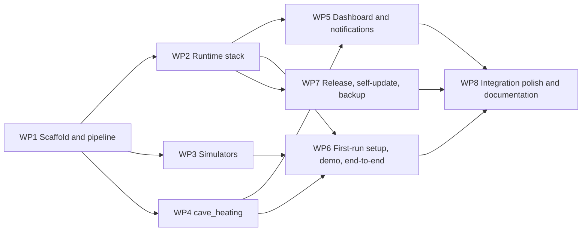

# cave_system — work packages

This splits the [concept](concept.md) into eight work packages. Each is implemented by a coding agent on its own branch, reviewed by a second agent, and merged only after that review.

## How a work package is delivered

1. **Implement.** The implementer works on branch `wp/<number>-<slug>` created from the current `main`, reads the concept and its work package, and builds exactly the deliverables listed.
2. **Verify.** `make check` passes locally. It covers everything that can run on the development machine: linting, type checking and the tests. Docker is not available there, so hassfest and anything that needs containers are verified by the pipeline on the pull request.
3. **Pull request.** One pull request per work package, with a description that states what was built, how it was verified, and every deviation from the concept. A deviation that changes a contract (concept sections 4.1, 4.2, 4.4, 4.5, 5.1 and 5.2) updates the concept in the same pull request.
4. **Review.** A reviewer running on an Opus-class model or better reviews the pull request against the concept and the acceptance criteria, runs the checks itself, and posts a review comment that starts with `VERDICT: APPROVE` or `VERDICT: REQUEST CHANGES`. GitHub does not allow approving one's own pull request, so the verdict comment is the approval record.
5. **Fix and re-review** until the verdict is APPROVE and the pipeline is green on the latest commit, rebased on the current `main`.
6. **Merge.** Squash merge. Nobody merges their own work package.

GitHub offers no branch protection for a private repository on the free plan, so these rules are conventions that everyone working on the repository follows.

### Definition of done, for every work package

- All acceptance criteria are met and demonstrated in the pull request.
- The pipeline is green and the review verdict is APPROVE.
- Tests assert behaviour, not just that code runs. A test that cannot fail does not count.
- No secrets, no commented-out code, no `TODO` without an explanation of what is missing and why.
- Every new command, variable or configuration key is documented where a user would look for it.
- Nothing outside the work package's own paths is changed, except the shared files named in its section.

## Overview

| # | Work package | Depends on | Implementer | Reviewer | Why this level |
|---|---|---|---|---|---|
| 1 | Scaffold and pipeline foundation | — | Sonnet 5.5, high effort | Opus 5.5, high | Conventional tooling, but everything else builds on it |
| 2 | Runtime stack and host provisioning | 1 | Sonnet 5.5, high | Opus 5.5, high | Compose, configuration and a small command-line tool; careful rather than hard |
| 3 | Device simulators | 1 | Opus 5.5, high | Opus 5.5, high | Protocol fidelity decides what the tests are worth |
| 4 | `cave_heating` integration | 1 | Opus 5.5, extra-high | Fable 5.2, high | The control logic; timing, state and Home Assistant internals |
| 5 | Dashboard and notifications | 2, 4 | Sonnet 5.5, high | Opus 5.5, high | Generator plus configuration |
| 6 | First-run setup, demo mode, end-to-end tests | 2, 3, 4 | Opus 5.5, high | Opus 5.5, high | Crosses every component and uses Home Assistant internals |
| 7 | Release, self-update and backup | 2 | Opus 5.5, high | Opus 5.5, high | Rollback must be right the first time |
| 8 | Integration polish and documentation | 5, 6, 7 | Sonnet 5.5, high | Opus 5.5, high | Wiring and prose, checked against the real commands |

Work packages 2, 3 and 4 run in parallel, as do 5, 6 and 7 once their dependencies are merged.

### Shared files

Several work packages add to the same files. To keep that mechanical:

- **`.github/workflows/ci.yml`** only lists jobs. Each larger check lives in its own reusable workflow file (`stack.yml`, `e2e.yml`, `release.yml`) and is added to `ci.yml` as a short calling job, which must also be added to the `needs` and the result check of `ci-ok`. Whoever merges second adds their job next to the first.
  - The `release` job is the exception: it has `needs: ci-ok`, runs only for pushes to `main`, and `ci-ok` does not depend on it. Its calling job sets `permissions: contents: write`, because a reusable workflow cannot raise the read-only default.
  - Superseded runs are cancelled for pull requests only, never on `main`.
- **The `cave` command** discovers its commands from `ops/cave_ops/commands/`, one module per command. A work package adds modules there and does not edit other commands.
- **`.env.example` and the `init` command** are written once, in WP2, for the complete variable table in concept section 4.2, including the variables only later work packages read. Later work packages do not need to change them.
- **`pyproject.toml` and `uv.lock`**: add dependencies to the dev group, then run `uv lock`. After a rebase, regenerate the lock file instead of merging it by hand.
- **`homeassistant/configuration.yaml`** is written once in WP2 with the hooks later work packages need: packages are loaded from a directory, the heating dashboard is registered as in concept section 4.5, and `cave_heating` reads `cave/heating.yaml`.

---

## WP1 — Scaffold and pipeline foundation

**Goal.** A repository where `make check` and the pipeline work, so every later work package starts from working tooling.

**Deliverables**

- `pyproject.toml` and `uv.lock`: Python 3.14.2 or newer, managed with uv. Dev dependencies include pytest, pytest-cov, `pytest-homeassistant-custom-component` 0.13.375 (which pins Home Assistant 2026.10.4), Ruff, mypy and yamllint. ShellCheck and actionlint come from packages uv can install, so no system packages are needed.
- `custom_components/cave_heating/` as a minimal integration that Home Assistant loads: `manifest.json`, `__init__.py` with a permissive configuration schema, `const.py`. It accepts any `cave_heating:` configuration without validating it yet. A test proves Home Assistant sets it up.
- `Makefile` with `setup`, `lint`, `format`, `typecheck`, `test` and `check`. `check` is everything that can run locally; hassfest runs only in the pipeline.
- Lint configuration: Ruff for linting and formatting; mypy in strict mode for `custom_components`, `sim` and `tools`, arranged so that `ops/` can later be checked against Python 3.11; yamllint rules that accept Home Assistant's `!include` and `!secret` tags; ShellCheck; actionlint. All of them skip `.venv`, `.claude` and `data`.
- `.github/workflows/ci.yml`: runs on pull requests and on pushes to `main`; cancels superseded runs for pull requests only; jobs `lint`, `test`, `hassfest` and `ci-ok`. Actions are pinned to full commit hashes with the version in a comment. The default token permission is read-only.
- `.github/dependabot.yml` for Actions, Python packages, Compose images and Dockerfiles: weekly, grouped, with the Home Assistant image excluded (concept section 9).
- `.github/PULL_REQUEST_TEMPLATE.md`, `.editorconfig`, and `CLAUDE.md` with the commands and the delivery rules from this document, kept short.
- A developer section in `README.md`.

**Acceptance**

- `make setup && make check` passes on a clean clone on macOS and on Linux.
- The pipeline is green on the pull request, including hassfest.
- The pull request shows that a failing test and a lint error each make `make check` fail, and that `ci-ok` fails when any job it depends on fails.

**Paths:** repository root files, `.github/`, `custom_components/cave_heating/` (skeleton only), `tests/` (skeleton).

---

## WP2 — Runtime stack and host provisioning

**Goal.** `./cave init && ./cave up` turns a clean checkout into a running, healthy Home Assistant with the broker, on a Debian server or a Raspberry Pi.

**Deliverables**

- **The `cave` command** as in concept section 4.4: the executable `cave`, the package `ops/cave_ops/` using only the standard library and running on Python 3.11 or newer, command discovery from `ops/cave_ops/commands/`, and the commands `init`, `up`, `down`, `restart`, `ps`, `logs`, `check`, `version` and `help`. Calls to `docker` and `git` go through one small runner so tests can replace it. With an older Python it stops with a clear message.
- **`init`** creates the state directories and every file listed in concept section 4.2, generates passwords and tokens, writes `.env` (mode 0600) for the complete variable table in that section, and writes the broker's password file. Run again, it changes nothing and prints nothing alarming.
- **`compose.yaml`** with the services `homeassistant`, `mosquitto` and `zigbee2mqtt` exactly as in concept section 4.1: pinned versions, health checks, restart policies, log rotation, and the read-only code mounts and state directories of section 4.2.
- **`homeassistant/configuration.yaml`**: packages loaded from `packages/`; the heating dashboard registered as in section 4.5; `cave_heating: !include cave/heating.yaml`; recorder retention; the UI-managed `automations.yaml`, `scripts.yaml` and `scenes.yaml` included from the state directory.
- **`homeassistant/heating.example.yaml`**: a commented starter with the defaults from concept section 5.1 and an empty room list, copied to the state directory by `init`.
- **`mosquitto/mosquitto.conf`** (password authentication, persistence, listeners as in section 4.1) and **`zigbee2mqtt/configuration.template.yaml`**: Home Assistant discovery on; availability on with a timeout for battery devices of a few hours instead of the default 25; `last_seen` enabled; coordinator address, driver and UI token from the environment. `init` copies it into the state directory, where Zigbee2MQTT keeps writing to it.
- **`.env.example`** documenting every variable of the table in section 4.2.
- **A version check**, part of `make check`: the Home Assistant image tag in `compose.yaml` equals the `homeassistant` version locked in `uv.lock`.
- **`scripts/provision-host.sh`** for Debian 13 and Raspberry Pi OS 64-bit: installs Docker Engine and the Compose plugin from Docker's package repository, Git and Python; creates the service user, `/opt/cave` and `/var/lib/cave`. Idempotent, with a `--dry-run` mode.
- **Tests** in `tests/ops/` for the commands, with the runner replaced by a fake, run against both Python 3.11 and 3.14. Ruff and mypy check `ops/` against Python 3.11.
- **`.github/workflows/stack.yml`** and its calling job: `./cave init`, `./cave check`, `./cave up` without the `zigbee` profile, wait until healthy as in section 4.5, assert from the log that `cave_heating` was set up and that no errors were logged apart from an explicit, commented allow-list, then `./cave down`.
- **`docs/install.md`**, first version.

**Acceptance**

- The `stack` job proves a healthy boot from a clean checkout with no interaction.
- `docker compose config` is valid with and without the `zigbee` profile; the shell script passes ShellCheck.
- No secret is tracked; a second `./cave init` is a no-op, asserted by a test.
- The tests pass on Python 3.11 and 3.14.

**Paths:** `compose.yaml`, `cave`, `ops/`, `tests/ops/`, `scripts/provision-host.sh`, `homeassistant/`, `mosquitto/`, `zigbee2mqtt/`, `.env.example`, `docs/install.md`, `.github/workflows/stack.yml`. Shared: `ci.yml`, `Makefile`, `pyproject.toml`.

---

## WP3 — Device simulators

**Goal.** Software stand-ins for every recommended device (concept sections 3.1 and 8), faithful enough that Home Assistant's own integrations accept them.

**Deliverables**

- Package `sim/cave_sim` with:
  - a **Zigbee2MQTT stand-in** for the models TRV-ZBT, TRVZB, BTH-RA, SNZB-02P and SNZB-04P: discovery messages, state, availability and command handling, derived from Zigbee2MQTT's source and documentation at the pinned version, with the reference noted next to each model. Models are described as data. The thermostat models include the settings entities the concept's `enforce` blocks refer to (sensor selection, window detection) and the external temperature input. Entity IDs come out as Zigbee2MQTT's scheme produces them (concept section 4.1). Message fixtures are laid out so that recordings from real devices can replace the hand-built ones, and a documented way to make such a recording is included;
  - a **fake FRITZ!Box**: the session login with the PBKDF2 challenge–response, and the smart-home commands that `pyfritzhome` and Home Assistant's `fritzbox` integration use, with FRITZ!Smart Thermo 302 devices. It can report a new setpoint at once or only after a configurable delay, and it can refuse commands the way a real box does while its summer or holiday mode or the key lock is active;
  - a **room model** in which temperature follows valve opening and open windows;
  - a **control API** over HTTP: open or close a window, set a room or outdoor temperature, take a device offline, change the FRITZ! behaviour, turn a thermostat's dial, read device state.
- `sim/demo/home.yaml`: a demo home of three rooms that between them use every simulated model and both device families.
- `python -m cave_sim`, configured through the environment; `sim/Dockerfile`; `compose.sim.yaml` adding the `sim` service with the ports of concept section 4.1.
- Tests in `tests/sim/`:
  - the fake FRITZ!Box driven by the real `pyfritzhome` client: log in, list devices, set and read back a target temperature, observe both reporting behaviours and a refused command;
  - the discovery messages fed into Home Assistant's real MQTT integration in-process, asserting that the expected climate, sensor, binary sensor, number, select and switch entities appear with the expected entity IDs, and that a command issued through Home Assistant changes the simulated device;
  - the room model and the control API.
- `sim/README.md`: every MQTT topic and HTTP endpoint implemented, and the known differences from real devices.

**Acceptance**

- The tests above pass locally and in the pipeline.
- Every model in concept section 3.1 that is marked as simulated has a model here and is used in the demo home.

**Paths:** `sim/`, `tests/sim/`, `compose.sim.yaml`. Shared: `pyproject.toml`, `uv.lock`.

---

## WP4 — `cave_heating` integration

**Goal.** The heating logic of concept section 5, complete and tested.

**Deliverables**

- The integration in `custom_components/cave_heating/`: the configuration schema and validation of section 5.1 including `presence` lists, `enforce`, `slow` and the `timing` block; the entities and services of section 5.2 with exactly the entity IDs and unique IDs given there; the decision table and rules of section 5.3; the input handling of section 5.4; the thermostat handling of section 5.5.
- The YAML configuration is imported into a single config entry so that each room is a device in its Home Assistant area. The file stays the source of truth and is re-read by `cave_heating.reload`, which keeps the running configuration when the new one is invalid.
- The decision logic of sections 5.3 and 5.4 is a pure module without Home Assistant imports. A separate controller applies section 5.5.
- State restore after a restart, the problem sensor and repair notices, diagnostics, English and German translations, strict typing.
- Tests in `tests/cave_heating/`:
  - unit tests with simulated time for every row and rule of sections 5.3 and 5.4;
  - integration tests with fake thermostat entities for every rule of section 5.5: rounding and clamping to a thermostat's step and range; the command form for heat and off; confirmation, resend and `unresponsive`; a refused command and `blocked`; a slow thermostat whose late report of an earlier command must not count as a hand change; a dial turned through intermediate values; two dials turned within seconds of each other; a dial turned during a window pause; the command budget; the temperature feed with its limits and its pause; enforced settings; restore after restart without adopting; reload with a valid and an invalid file; a file with no rooms; a file that names entities which do not exist.

**Acceptance**

- The pull request contains a table mapping every row and rule of sections 5.3, 5.4 and 5.5 to the tests that prove it.
- A test asserts the exact entity IDs of section 5.2.
- Line coverage of the package is at least 90 %.
- hassfest passes; there is no blocking I/O in the event loop.
- Configurations with no rooms and with missing entities load without errors, the latter with the problem sensor on.

**Paths:** `custom_components/cave_heating/`, `tests/cave_heating/`. Shared: `pyproject.toml`, `uv.lock`.

---

## WP5 — Dashboard and notifications

**Goal.** The heating dashboard of concept section 6, generated from the room configuration with one command, and the notifications.

**Deliverables**

- `tools/render_dashboard.py`: reads a `heating.yaml` and writes the dashboard with the room view and the maintenance view. Output is deterministic. Built-in cards only, enforced by an allow-list of card types.
- The `apply` command (`ops/cave_ops/commands/apply.py`): validates `cave/heating.yaml` with the integration's own schema, regenerates `dashboards/heating.yaml` in the state directory, and calls `cave_heating.reload` using the script token of concept section 4.5. Without a token it says that Home Assistant has to be restarted instead. An invalid file changes nothing.
- `homeassistant/packages/cave_notifications.yaml`: `script.cave_notify` and `input_text.cave_notify_service` as described in concept section 6, and the notifications for a low battery, a device unavailable for too long, a window left open, high humidity and a room's problem sensor.
- Tests in `tests/tools/` and `tests/ops/`: golden-file tests for the generator, including the demo home and a home with no rooms; a test that fails when a card type outside the allow-list is produced; tests for `apply` with a fake Home Assistant, covering the valid, the invalid and the no-token case.

**Acceptance**

- `make check` passes with the new tests.
- The `stack` job still passes with the package loaded, and additionally shows that `./cave apply` produces a dashboard file for the starter configuration.

**Paths:** `tools/render_dashboard.py`, `ops/cave_ops/commands/apply.py`, `tests/tools/`, `tests/ops/` (apply only), `homeassistant/packages/`. Shared: `stack.yml`, `pyproject.toml`, `uv.lock`.

---

## WP6 — First-run setup, demo mode and end-to-end tests

**Goal.** A fresh stack sets itself up without clicking, a demo with simulated devices starts with one command, and the pipeline proves the whole system end to end.

**Deliverables**

- `tools/bootstrap.py` and the `bootstrap` command, run inside the Home Assistant container: creates the owner account from `.env`; sets up the MQTT integration, handling a config flow that opens with a menu; sets up the FRITZ!SmartHome integration and FRITZ!Box Tools when credentials are present; creates a schedule helper with a default timetable for every room that names one; stores the script token as in concept section 4.5. Running it again changes nothing.
- The `demo` command: the stack with `compose.sim.yaml`, a state directory of its own, the demo home's `heating.yaml` with timings in seconds, and the bootstrap run against the simulators. If Home Assistant's FRITZ! integration does not accept an address with a port, the fake FRITZ!Box is published on its own loopback address on port 80 instead, and concept section 4.1 is updated.
- `sim/demo/heating.yaml`: the `cave_heating` configuration for the demo home.
- `tests/integration/`, in-process: `cave_heating` driving the thermostat entities that Home Assistant builds from the simulators' messages, for both device families, and a test that every entity named in the demo `heating.yaml` is one the simulators produce.
- `tests/e2e/`: against the running demo stack, through Home Assistant's API and the simulators' control API, the scenarios of concept section 8: schedule, window pause, away, boost, room-sensor feed, a slow FRITZ! thermostat, an offline device. Both device families are covered.
- `.github/workflows/e2e.yml` and its calling job. Home Assistant and simulator logs are uploaded as artifacts when the job fails.
- `docs/demo.md`.

**Acceptance**

- The `e2e` job passes three times in a row on the final commit and takes no more than about ten minutes.
- A second `cave bootstrap` is a no-op, asserted by a test.
- No scenario relies on fixed sleeps; each waits for a condition with a timeout.

**Paths:** `tools/bootstrap.py`, `ops/cave_ops/commands/bootstrap.py`, `ops/cave_ops/commands/demo.py`, `sim/demo/heating.yaml`, `tests/integration/`, `tests/e2e/`, `.github/workflows/e2e.yml`, `docs/demo.md`. Shared: `ci.yml`, `compose.sim.yaml`, `pyproject.toml`, `uv.lock`.

---

## WP7 — Release, self-update and backup

**Goal.** A green `main` becomes a release, and the server installs releases by itself without ever being left broken (concept sections 9 and 11).

**Deliverables**

- `.github/workflows/release.yml` and its calling job, wired as described under "Shared files": creates the tag `vYYYY.MM.DD.N` and a GitHub Release with generated notes, and does nothing if the commit is already released.
- The `update` and `status` commands. `update` follows the order of concept section 9 exactly: fetch tags; if a newer release exists, pull its images while the old stack runs; stop; snapshot; check out; validate the configuration in the new image; start; wait for healthy as in section 4.5. On any failure it restores the snapshot and the previous release, starts that, and verifies it. It reports through the notification contract of section 4.5, holds a lock against concurrent runs, keeps the last two snapshots, and honours `CAVE_AUTO_UPDATE=0` for timer-started runs only.
- The `backup` and `restore` commands: archive the state directory and `.env` without stopping the stack, using the SQLite online backup for Home Assistant's database; keep `CAVE_BACKUP_KEEP` archives; optionally copy to `CAVE_BACKUP_COPY_TO`; restore onto a fresh host.
- systemd service and timer units for update and backup in `scripts/systemd/`, installed by `scripts/provision-host.sh`.
- Tests in `tests/ops/`, with the runner replaced by a fake and real temporary directories and Git repositories: no new release; a successful update; a failed image pull, after which nothing was stopped; a failed configuration check and a failed health check, after each of which the previous release and the snapshot are back and running; a refused concurrent run; backup retention; a backup-and-restore round trip including the database.
- `docs/operations.md`.

**Acceptance**

- The tests pass on Python 3.11 and 3.14.
- After the merge, the pipeline on `main` creates a release. This is checked on GitHub, not assumed.

**Paths:** `ops/cave_ops/commands/update.py`, `status.py`, `backup.py`, `restore.py` and helpers they need, `scripts/systemd/`, `tests/ops/` (these commands), `.github/workflows/release.yml`, `docs/operations.md`. Shared: `ci.yml`, `scripts/provision-host.sh`.

---

## WP8 — Integration polish and documentation

**Goal.** The pieces are joined up, the web UI is shown to work, and someone can go from unboxed hardware to working heating by following the documentation alone.

**Deliverables**

- The demo mode runs `apply`, so it shows a dashboard generated for the demo home.
- The `e2e` job fetches the dashboard configuration from Home Assistant, opens the heating dashboard in a browser, fails if any card shows an error, and uploads a screenshot as an artifact on every run.
- `docs/hardware.md` (the shopping list from concept section 3), `docs/install.md` (complete, for the mini PC and the Raspberry Pi), `docs/pairing.md` (Zigbee2MQTT pairing, the Bosch install code, FRITZ! registration and its neutral timetable, the `enforce` entries per model, describing rooms in `heating.yaml` and applying them), `docs/phone-and-remote.md` (the apps, enabling the phones' trackers for presence, the FRITZ!Box VPN), `docs/hardware-acceptance.md` (what to verify on real devices, including the open points of concept section 12 and recording messages for the simulators), and a final `README.md`.
- A pipeline check that relative links in the documentation resolve and that every `cave` command mentioned exists.

**Acceptance**

- The screenshot artifact shows the demo home's rooms with live values and no error cards.
- The reviewer follows `docs/install.md` and `docs/demo.md` step by step against the repository and finds no command or path that does not exist.

**Paths:** `docs/`, `README.md`, `tests/e2e/` (dashboard check), `.github/workflows/e2e.yml`. Shared: `ci.yml`, `ops/cave_ops/commands/demo.py`.
