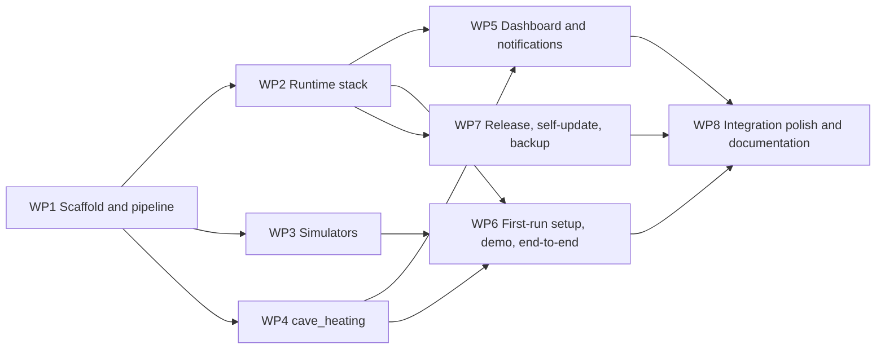

# cave_system — work packages

This splits the [concept](concept.md) into eight work packages. Each is implemented by a coding agent on its own branch, reviewed by a second agent, and merged only after that review.

## How a work package is delivered

1. **Implement.** The implementer works on branch `wp/<number>-<slug>` created from the current `main`, reads the concept and its work package, and builds exactly the deliverables listed.
2. **Verify.** `make check` passes locally. Docker is not available on the development machine, so anything that needs containers is verified by the pipeline on the pull request.
3. **Pull request.** One pull request per work package, with a description that states what was built, how it was verified, and every deviation from the concept. A deviation that changes a contract (the names in concept sections 4.1, 4.4, 5.1 and 5.2) updates the concept in the same pull request.
4. **Review.** A reviewer running on an Opus-class model or better reviews the pull request against the concept and the acceptance criteria, runs the checks itself, and posts a review comment that starts with `VERDICT: APPROVE` or `VERDICT: REQUEST CHANGES`. GitHub does not allow approving one's own pull request, so the verdict comment is the approval record.
5. **Fix and re-review** until the verdict is APPROVE and the pipeline is green on the latest commit, rebased on the current `main`.
6. **Merge.** Squash merge. Nobody merges their own work package.

### Definition of done, for every work package

- All acceptance criteria are met and demonstrated in the pull request.
- The pipeline is green and the review verdict is APPROVE.
- Tests assert behaviour, not just that code runs. A test that cannot fail does not count.
- No secrets, no commented-out code, no `TODO` without an explanation of what is missing and why.
- Every new command, variable or configuration key is documented where a user would look for it.
- Nothing outside the work package's own paths is changed, except the shared files named in its section.

## Overview

| # | Work package | Depends on | Implementer | Reviewer | Why this level |
|---|---|---|---|---|---|
| 1 | Scaffold and pipeline foundation | — | Sonnet 5.5, high effort | Opus 5.5, high | Conventional tooling, but everything else builds on it |
| 2 | Runtime stack and host provisioning | 1 | Sonnet 5.5, high | Opus 5.5, high | Compose and shell; careful rather than hard |
| 3 | Device simulators | 1 | Opus 5.5, high | Opus 5.5, high | Protocol fidelity decides what the tests are worth |
| 4 | `cave_heating` integration | 1 | Opus 5.5, extra-high | Fable 5.2, high | The control logic; timing, state and Home Assistant internals |
| 5 | Dashboard and notifications | 2, 4 | Sonnet 5.5, high | Opus 5.5, high | Generator plus configuration |
| 6 | First-run setup, demo mode, end-to-end tests | 2, 3, 4 | Opus 5.5, high | Opus 5.5, high | Crosses every component and uses Home Assistant internals |
| 7 | Release, self-update and backup | 2 | Opus 5.5, high | Opus 5.5, high | Rollback must be right the first time |
| 8 | Integration polish and documentation | 5, 6, 7 | Sonnet 5.5, high | Opus 5.5, high | Wiring and prose, checked against the real commands |

Work packages 2, 3 and 4 run in parallel, as do 5, 6 and 7 once their dependencies are merged.

### Shared files

Several work packages add to the same files. To keep that mechanical:

- **`.github/workflows/ci.yml`** only lists jobs. Each larger check lives in its own reusable workflow file (`stack.yml`, `e2e.yml`, `release.yml`) and is added to `ci.yml` as a short calling job. The final job `ci-ok` depends on all of them.
- **`cave`** is a dispatcher. Each command is its own file in `scripts/cave.d/`.
- **`pyproject.toml` and `uv.lock`**: add dependencies to the dev group, then run `uv lock`. After a rebase, regenerate the lock file instead of merging it by hand.
- **`homeassistant/configuration.yaml`** is written once in WP2 with the hooks later work packages need: packages are loaded from a directory, the heating dashboard is registered against a placeholder file, and `cave_heating` reads `cave/heating.yaml`.

---

## WP1 — Scaffold and pipeline foundation

**Goal.** A repository where `make check` and the pipeline work, so every later work package starts from working tooling.

**Deliverables**

- `pyproject.toml` and `uv.lock`: Python 3.14, managed with uv. Dev dependencies include pytest, pytest-cov, `pytest-homeassistant-custom-component` 0.13.375 (which pins Home Assistant 2026.10.4), Ruff, mypy and yamllint. ShellCheck and actionlint come from packages uv can install, so no system packages are needed.
- `custom_components/cave_heating/` as a minimal integration that Home Assistant loads: `manifest.json`, `__init__.py`, `const.py`. It accepts any `cave_heating:` configuration without validating it yet. One test proves Home Assistant sets it up.
- `Makefile` with `setup`, `lint`, `format`, `typecheck`, `test` and `check` (everything the pipeline runs).
- Lint configuration: Ruff for linting and formatting; mypy in strict mode for `custom_components`, `sim` and `tools`; yamllint rules that accept Home Assistant's `!include` and `!secret` tags; ShellCheck; actionlint. All of them skip `.venv`, `.claude` and `data`.
- `.github/workflows/ci.yml`: runs on pull requests and on pushes to `main`; cancels superseded runs; jobs `lint`, `test`, `hassfest` and `ci-ok`. Actions are pinned to full commit hashes with the version in a comment. The default token permission is read-only.
- `.github/dependabot.yml` for Actions, Python packages, Compose images and Dockerfiles: weekly, grouped.
- `.github/PULL_REQUEST_TEMPLATE.md`, `.editorconfig`, and `CLAUDE.md` with the commands and the delivery rules from this document, kept short.
- A developer section in `README.md`, and links to the concept and this document.

**Acceptance**

- `make setup && make check` passes on a clean clone on macOS and on Linux.
- The pipeline is green on the pull request, including hassfest.
- The pull request shows that a failing test and a lint error each make `make check` fail.

**Paths:** repository root files, `.github/`, `custom_components/cave_heating/` (skeleton only), `tests/` (skeleton).

---

## WP2 — Runtime stack and host provisioning

**Goal.** `./cave init && ./cave up` turns a clean checkout into a running, healthy Home Assistant with the broker, on a Debian server or a Raspberry Pi.

**Deliverables**

- `compose.yaml` with the services `homeassistant`, `mosquitto` and `zigbee2mqtt` exactly as in concept section 4.1: pinned versions, health checks, restart policies, log rotation, and the read-only code mounts and state directories of section 4.2.
- `homeassistant/configuration.yaml`: packages loaded from `packages/`; the heating dashboard registered in YAML mode against `dashboards/heating.yaml` (a placeholder for now); `cave_heating: !include cave/heating.yaml`; recorder retention; automations created in the UI stored in the state directory.
- `homeassistant/cave/heating.yaml`: a commented starter with the defaults from concept section 5.1 and an empty room list, so a fresh install boots before any device is paired.
- `mosquitto/mosquitto.conf` (password authentication, persistence, listeners as in section 4.1) and `zigbee2mqtt/configuration.template.yaml` (Home Assistant discovery and availability on, coordinator address and UI token from the environment).
- `.env.example` documenting every variable.
- `cave` and `scripts/cave.d/`: `init`, `up`, `down`, `restart`, `ps`, `logs`, `check`, `version`, `help`. `init` creates the state directories, generates passwords and tokens, writes `.env` with mode 0600 and the broker's password file, and changes nothing when run again.
- `scripts/provision-host.sh` for Debian 13 and Raspberry Pi OS 64-bit: installs Docker Engine and the Compose plugin from Docker's package repository, creates the service user, `/opt/cave` and `/var/lib/cave`. Idempotent, with a `--dry-run` mode.
- `.github/workflows/stack.yml` and its calling job: `./cave init`, `./cave check`, `./cave up` without the `zigbee` profile, wait until healthy, assert from the log that `cave_heating` was set up and that no errors were logged, `./cave down`.
- `docs/install.md`, first version.

**Acceptance**

- The `stack` job proves a healthy boot from a clean checkout with no interaction.
- `docker compose config` is valid with and without the `zigbee` profile; shell scripts pass ShellCheck.
- No secret is tracked; a second `./cave init` is a no-op.

**Paths:** `compose.yaml`, `cave`, `scripts/`, `homeassistant/`, `mosquitto/`, `zigbee2mqtt/`, `.env.example`, `docs/install.md`. Shared: `ci.yml`.

---

## WP3 — Device simulators

**Goal.** Software stand-ins for every recommended device (concept sections 3.1 and 8), faithful enough that Home Assistant's own integrations accept them.

**Deliverables**

- Package `sim/cave_sim` with:
  - a **Zigbee2MQTT stand-in** for the models TRV-ZBT, TRVZB, BTH-RA, SNZB-02P and SNZB-04P: discovery messages, state, availability and command handling, derived from Zigbee2MQTT's source and documentation, with the reference noted next to each model. Message fixtures are laid out so that recordings from real devices can replace the hand-built ones, and a documented way to make such a recording is included;
  - a **fake FRITZ!Box**: session login (PBKDF2 challenge–response and the legacy MD5 variant) and the smart-home commands that `pyfritzhome` and Home Assistant's `fritzbox` integration use, with FRITZ!Smart Thermo 302 devices and a configurable delay before a setpoint takes effect;
  - a **room model** in which temperature follows valve opening and open windows;
  - a **control API** over HTTP: open or close a window, set a room or outdoor temperature, take a device offline, change the FRITZ! delay, read device state.
- `sim/demo/home.yaml`: a demo home of three rooms that between them use every simulated model and both device families.
- `python -m cave_sim`, configured through the environment; `sim/Dockerfile`; `compose.sim.yaml` adding the `sim` service to the stack.
- Tests in `tests/sim/`:
  - the fake FRITZ!Box driven by the real `pyfritzhome` client: log in, list devices, set and read back a target temperature, observe the delay;
  - the discovery messages fed into Home Assistant's real MQTT integration in-process, asserting that the expected climate, sensor, binary sensor and number entities appear, and that a command issued through Home Assistant changes the simulated device;
  - the room model and the control API.
- `sim/README.md`: every MQTT topic and HTTP endpoint implemented, and the known differences from real devices.

**Acceptance**

- The tests above pass locally and in the pipeline.
- Every model in concept section 3.1 that is marked as simulated has a model here and is used in the demo home.

**Paths:** `sim/`, `tests/sim/`, `compose.sim.yaml`. Shared: `pyproject.toml`, `uv.lock`.

---

## WP4 — `cave_heating` integration

**Goal.** The heating logic of concept section 5, complete and tested.

**Deliverables**

- The integration in `custom_components/cave_heating/`: configuration schema and validation (section 5.1), the entities and services of section 5.2, the decision table and rules of section 5.3, and the thermostat handling of section 5.4.
- The YAML configuration is imported into a single config entry so that each room is a device in its Home Assistant area. YAML stays the source of truth and is re-read by `cave_heating.reload`.
- The decision logic of section 5.3 is a pure module without Home Assistant imports. A separate controller applies section 5.4.
- State restore after a restart, repair notices for unresponsive thermostats and missing entities, diagnostics, English and German translations, strict typing.
- Tests in `tests/cave_heating/`: unit tests for every row and rule of section 5.3 with simulated time, and integration tests for section 5.4 using fake thermostat entities: confirmation and resend, a slow thermostat, a change made on the thermostat, an unavailable thermostat, the room-temperature feed with its limits, restore after restart, reload, invalid configuration, a configuration with no rooms, and a configuration that names entities which do not exist.

**Acceptance**

- The pull request contains a table mapping every row and rule of sections 5.3 and 5.4 to the tests that prove it.
- Line coverage of the package is at least 90 %.
- hassfest passes; there is no blocking I/O in the event loop.
- Configurations with no rooms and with missing entities load without errors, the latter with a visible warning.

**Paths:** `custom_components/cave_heating/`, `tests/cave_heating/`. Shared: `pyproject.toml`, `uv.lock`.

---

## WP5 — Dashboard and notifications

**Goal.** The heating dashboard of concept section 6, generated from the room configuration, and the notifications.

**Deliverables**

- `tools/render_dashboard.py`: reads a `heating.yaml` and writes the dashboard. Output is deterministic. `--check` fails when the committed file is out of date. Built-in cards only.
- `homeassistant/dashboards/heating.yaml`, generated from the tracked configuration, with the room view and the maintenance view.
- `homeassistant/packages/cave_notifications.yaml`: low battery, a device silent for too long, a window left open, high humidity, an unresponsive thermostat. Each raises a persistent notification and also notifies the group `notify.cave` when the user has defined one.
- `make render`, and the `--check` run added to `make check`.
- Tests in `tests/tools/`: golden-file tests for the generator, including the demo home and a home with no rooms, and a test that fails when a card type outside Home Assistant's built-in set is used.

**Acceptance**

- `make check` fails when the dashboard is stale.
- The `stack` job still passes, proving Home Assistant accepts the dashboard and the package.

**Paths:** `tools/render_dashboard.py`, `tests/tools/`, `homeassistant/dashboards/`, `homeassistant/packages/`. Shared: `Makefile`.

---

## WP6 — First-run setup, demo mode and end-to-end tests

**Goal.** A fresh stack sets itself up without clicking, a demo with simulated devices starts with one command, and the pipeline proves the whole system end to end.

**Deliverables**

- `tools/bootstrap.py` and `cave bootstrap`, run inside the Home Assistant container: creates the owner account from `.env`, sets up the MQTT integration, sets up the FRITZ!SmartHome integration and FRITZ!Box Tools when credentials are present, creates a schedule helper with a default timetable for every room that names one, and stores a token for scripts in the state directory with mode 0600. Running it again changes nothing.
- `cave demo`: the stack with `compose.sim.yaml`, the demo home's `heating.yaml` mounted in place of the real one, and the bootstrap run against the simulators.
- `tests/e2e/`: against the running demo stack, through Home Assistant's API and the simulators' control API, the scenarios of concept section 8: schedule, window pause, away, boost, room-sensor feed, a slow FRITZ! thermostat, an offline device. Both device families are covered.
- `.github/workflows/e2e.yml` and its calling job. Home Assistant and simulator logs are uploaded as artifacts when the job fails.
- `docs/demo.md`.

**Acceptance**

- The `e2e` job passes three times in a row on the final commit.
- A second `cave bootstrap` is a no-op, asserted by a test.
- No scenario relies on fixed sleeps; each waits for a condition with a timeout.

**Paths:** `tools/bootstrap.py`, `scripts/cave.d/bootstrap`, `scripts/cave.d/demo`, `sim/demo/heating.yaml`, `tests/e2e/`, `.github/workflows/e2e.yml`, `docs/demo.md`. Shared: `ci.yml`, `compose.sim.yaml`, `pyproject.toml`, `uv.lock`.

---

## WP7 — Release, self-update and backup

**Goal.** A green `main` becomes a release, and the server installs releases by itself without ever being left broken (concept sections 9 and 11).

**Deliverables**

- `.github/workflows/release.yml` and its calling job, which runs on `main` only after every check has passed: creates the tag `vYYYY.MM.DD.N` and a GitHub Release with generated notes, and does nothing if the commit is already released.
- `cave update` and `cave status`: fetch tags; if a newer release exists, take a snapshot, check out the release, pull images, validate the Home Assistant configuration in the new image, restart, and verify health. On any failure, restore the snapshot and the previous release and report it. A lock prevents concurrent runs. `CAVE_AUTO_UPDATE=0` disables the timer's action but not a manual run.
- `cave backup` and `cave restore`: archive the state directory and `.env`, keep a configurable number of archives, optionally copy to a second location, and restore onto a fresh host.
- systemd service and timer units for update and backup, installed by `scripts/provision-host.sh`.
- Tests in `tests/ops/`, with `git` and `docker` replaced by stubs: no new release; a successful update; a failed configuration check, after which nothing was restarted; a failed health check, after which the previous release and the snapshot are back; a refused concurrent run; backup retention; a backup-and-restore round trip.
- `docs/operations.md`.

**Acceptance**

- The tests pass in the pipeline; the scripts pass ShellCheck.
- After the merge, the pipeline on `main` creates a release. This is checked on GitHub, not assumed.

**Paths:** `scripts/cave.d/update`, `status`, `backup`, `restore`, `scripts/systemd/`, `tests/ops/`, `.github/workflows/release.yml`, `docs/operations.md`. Shared: `ci.yml`, `scripts/provision-host.sh`.

---

## WP8 — Integration polish and documentation

**Goal.** The pieces are joined up, the web UI is shown to work, and someone can go from unboxed hardware to working heating by following the documentation alone.

**Deliverables**

- The demo mode uses a dashboard generated for the demo home.
- The `e2e` job opens the heating dashboard in a browser, fails if any card shows an error, and uploads a screenshot as an artifact on every run.
- `docs/hardware.md` (the shopping list from concept section 3), `docs/install.md` (complete, for the mini PC and the Raspberry Pi), `docs/pairing.md` (Zigbee2MQTT pairing, the Bosch install code, FRITZ! registration and its neutral timetable, entering devices in `heating.yaml`), `docs/phone-and-remote.md` (the apps, presence, the FRITZ!Box VPN), `docs/hardware-acceptance.md` (what to verify on real devices, including recording messages for the simulators), and a final `README.md`.
- A pipeline check that relative links in the documentation resolve and that every `cave` command mentioned exists.

**Acceptance**

- The screenshot artifact shows the demo home's rooms with live values and no error cards.
- The reviewer follows `docs/install.md` and `docs/demo.md` step by step against the repository and finds no command or path that does not exist.

**Paths:** `docs/`, `README.md`, `tests/e2e/` (dashboard check), `.github/workflows/e2e.yml`. Shared: `ci.yml`, `scripts/cave.d/demo`.
