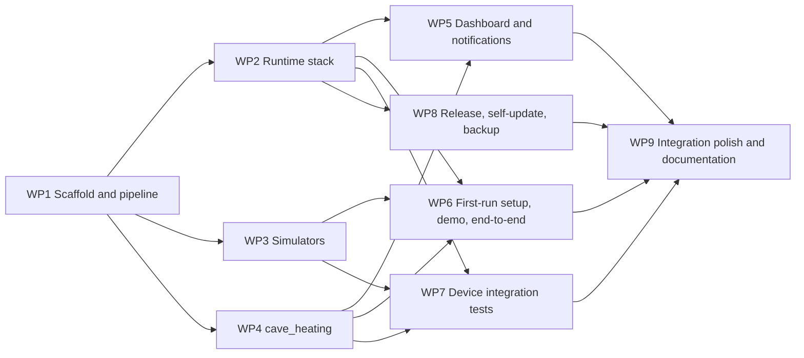

# cave_system — work packages

This splits the [concept](concept.md) into work packages. Each is implemented by a coding agent on its own branch, reviewed by a second agent, and merged only after that review.

Work packages 1 to 9 build the system. Work packages 10 to 12 close what their reviews left open. Work packages 16 and 17 are scheduled: 16 makes the pipeline cheaper to run, 17 rehearses the operations commands on a real Linux machine. Work packages 13 to 15 are defined so that they can be picked up, but each waits for something outside this repository; see [Later work packages](#later-work-packages).

## How a work package is delivered

1. **Implement.** The implementer works on branch `wp/<number>-<slug>` created from the current `main`, reads the concept and its work package, and builds exactly the deliverables listed.
2. **Verify.** `make check` passes locally. It covers everything that can run on the development machine: linting, type checking and the tests. Docker is not available there, so hassfest and anything that needs containers are verified by the pipeline on the pull request.
3. **Pull request.** One pull request per work package, with a description that states what was built, how it was verified, and every deviation from the concept. A deviation that changes a contract (concept sections 4.1, 4.2, 4.4, 4.5, 5.1 and 5.2) updates the concept in the same pull request.
4. **Review.** A reviewer running on an Opus-class model or better reviews the pull request against the concept and the acceptance criteria, runs the checks itself, and posts a review comment that starts with `VERDICT: APPROVE` or `VERDICT: REQUEST CHANGES`. GitHub does not allow approving one's own pull request, so the verdict comment is the approval record.
5. **Fix and re-review** until the verdict is APPROVE and the pipeline is green on the latest commit, rebased on the current `main`.
6. **Merge.** Squash merge. Nobody merges their own work package.

The repository is public since 23 November 2026. Branch protection and rulesets are available since then, but none is set up, so these rules are conventions that everyone working on the repository follows until the owner sets one up. (While the repository was private, the free plan offered neither.)

### Definition of done, for every work package

- All acceptance criteria are met and demonstrated in the pull request.
- The pipeline is green and the review verdict is APPROVE.
- Tests assert behaviour, not just that code runs. A test that cannot fail does not count.
- No secrets, no commented-out code, no `TODO` without an explanation of what is missing and why.
- Every new command, variable or configuration key is documented where a user would look for it.
- Nothing outside the work package's own paths is changed, except the shared files named in its section.

## Overview

| # | Work package | Depends on | Implementer | Reviewer | Why this level |
|---|---|---|---|---|---|
| 1 | Scaffold and pipeline foundation | — | Sonnet 5.5, high effort | Opus 5.5, high | Conventional tooling, but everything else builds on it |
| 2 | Runtime stack and host provisioning | 1 | Sonnet 5.5, high | Opus 5.5, high | Compose, configuration and a small command-line tool; careful rather than hard |
| 3 | Device simulators | 1 | Opus 5.5, high | Opus 5.5, high | Protocol fidelity decides what the tests are worth |
| 4 | `cave_heating` integration | 1 | Opus 5.5, extra-high | Fable 5.2, high | The control logic; timing, state and Home Assistant internals |
| 5 | Dashboard and notifications | 2, 4 | Sonnet 5.5, high | Opus 5.5, high | Generator plus configuration |
| 6 | First-run setup, demo mode, end-to-end tests | 2, 3, 4 | Opus 5.5, high | Opus 5.5, high | Crosses every component and uses Home Assistant internals |
| 7 | Device integration tests | 2, 3, 4 | Opus 5.5, high | Opus 5.5, high | The evidence for requirement R3; needs each device's behaviour understood |
| 8 | Release, self-update and backup | 2 | Opus 5.5, high | Opus 5.5, high | Rollback must be right the first time |
| 9 | Integration polish and documentation | 5, 6, 7, 8 | Sonnet 5.5, high | Opus 5.5, high | Wiring and prose, checked against the real commands |
| 10 | Sensor freshness and controller follow-ups | 4, 7, 9 | Opus 5.5, high | Opus 5.5, high | The control logic and the simulators' fidelity again, in a small area |
| 11 | Operations follow-ups and alerts without Home Assistant | 8, 9 | Opus 5.5, extra-high | Opus 5.5, high | Update and restore code: work package 8 needed eight review rounds, each for another interruption that was not handled |
| 12 | Notification and dashboard follow-ups | 5, 9 | Sonnet 5.5, high | Opus 5.5, high | Templates, the generator and their tests |
| 13 | Room-sensor regulation for FRITZ! thermostats | 10 | Opus 5.5, extra-high | Fable 5.2, high | Touches the most delicate rule of the controller. Later |
| 14 | Heating insights | 10, 12 | Sonnet 5.5, high | Opus 5.5, high | New entities, statistics and a dashboard view. Later |
| 15 | Home Assistant upgrade | all others | Sonnet 5.5, high | Opus 5.5, high | Mechanical, proven by the whole pipeline. Later |
| 16 | Pipeline diet | 9 | Opus 5.5, high | Opus 5.5, high | Pipeline structure, where a mistake lets a broken change through |
| 17 | Server rehearsal | 8, 11, 16 | Opus 5.5, high | Opus 5.5, high | Runs the operations commands for real, as root, on a throw-away machine |

Work packages 2, 3 and 4 run in parallel, as do 5, 6, 7 and 8 once their dependencies are merged. Work packages 10, 11 and 12 run in parallel. Their paths overlap only in three documents: `docs/concept.md` (10: section 5.4; 11: sections 4.2 and 4.5), `docs/devices.md` (10: the device tests and the SNZB-02P; 11: the `device-check` section) and `docs/hardware-acceptance.md` (10: the point about a sensor in a steady room; 11: a new section for the server). Each edits only its own sections, and whichever merges second rebases. Work packages 16 and 17 run one after the other: 17 adds a workflow of its own next to the pipeline that 16 restructures, and starts once 16 is merged.

### Shared files

Several work packages add to the same files. To keep that mechanical:

- **`.github/workflows/ci.yml`** lists the jobs of the pipeline. GitHub bills every job rounded up to the whole minute, so a check that takes seconds is a step of a job that exists anyway, not a job of its own (WP16). The jobs:
  - `lint`: Ruff, yamllint, ShellCheck, actionlint, mypy, the version check, the document check (`tests/docs/`), the dry run of `scripts/provision-host.sh`, and whether the change touches code at all (below).
  - `test`: the test suite in parallel with coverage, the tests of the `cave` command on Python 3.11, the device matrix, and hassfest.
  - `e2e` (`e2e.yml`): everything with containers, one part after the other: the stack check (the composite action in `.github/actions/stack/`), the simulator check (`.github/actions/sim/`), then first-run setup, the dashboard in a browser and the scenarios on the demo. The first part that fails ends the job. `stack.yml` and `sim.yml` run the stack check or the simulator check on its own, on demand; the pipeline does not call them.
  - `ci-ok`: the one check that says a commit is good. It passes when every job in its `needs` succeeded. A failed or cancelled job fails it, and so does a skipped one, except under the rule for documents below. `needs` is the only list to edit.
  - `release` (`release.yml`): the exception. It has `needs: ci-ok`, runs only for pushes to `main`, and `ci-ok` does not depend on it. Its calling job sets `permissions: contents: write`, because a reusable workflow cannot raise the read-only default.
- **A new check** goes into the job that already has what it needs: a static check into `lint`, a test into the suite, a check of the integration with Docker into `test`, a check with containers into the matching part of `e2e`. A check step after the first of a job has `if: ${{ !cancelled() }}`, so that one failing check does not hide the others; the parts of `e2e` are the exception, because each needs the one before to have left a clean runner. A new check with many steps becomes a composite action under `.github/actions/` run as a step there; a new job is the last resort, with the same `needs: lint` and `if:` as `e2e`, and is added to the `needs` of `ci-ok`.
- **Documents only.** A pull request that changes nothing but Markdown files runs `lint`, which includes the document check, and skips `test` and `e2e`; `ci-ok` accepts those as skipped. `lint` decides it from the diff of the merge commit GitHub makes of the pull request against its base, so the pull request counts as a whole, whatever was pushed. No test except the document check reads a Markdown file, and none may, unless this rule is widened. A push to `main` always runs everything.
- **`make check`** runs on the development machine what `lint` and `test` run, except the provision-host dry run, hassfest and the device matrix; these, the tests that need Docker and the job `e2e` run only in the pipeline.
- Superseded runs are cancelled for pull requests only. Every run on `main` completes.
- **The `cave` command** discovers its commands from `ops/cave_ops/commands/`, one module per command. A work package adds modules there and does not edit other commands.
- **Core modules of the `cave` command.** WP2 delivers, besides its own commands, what later commands need: the runner for `docker` and `git`, the `.env` loader and the paths, the script-token reader, a small client for Home Assistant's REST API, the health check and the notification call of concept section 4.5, the function that validates a `heating.yaml` and stores its applied copy, the lock, and the test fixtures that fake them. Later work packages import these and do not write their own. If one of them lacks something, the work package that needs it extends it and says so in its pull request.
- **`.env.example` and the `init` command** are written once, in WP2, for the complete variable table in concept section 4.2, including the variables only later work packages read. Later work packages do not need to change them. WP11 is the planned exception: it adds a variable, and it changes existing commands where its issues ask for that.
- **`tests/conftest.py`** stays free of Home Assistant, so that tests of the `cave` command can run on Python 3.11. Each test directory that needs Home Assistant has its own `conftest.py`.
- **`pyproject.toml` and `uv.lock`**: add dependencies to the dev group, then run `uv lock`. After a rebase, regenerate the lock file instead of merging it by hand.
- **`homeassistant/configuration.yaml`** is written once in WP2 with the hooks later work packages need: packages are loaded from a directory, the heating dashboard is registered as in concept section 4.5, and `cave_heating` is enabled.

---

## WP1 — Scaffold and pipeline foundation

**Goal.** A repository where `make check` and the pipeline work, so every later work package starts from working tooling.

**Deliverables**

- `pyproject.toml` and `uv.lock`: Python 3.14.2 or newer, managed with uv. Dev dependencies include pytest, pytest-cov, `pytest-homeassistant-custom-component` 0.13.375 (which pins Home Assistant 2026.10.4), Ruff, mypy and yamllint. ShellCheck and actionlint come from packages uv can install, so no system packages are needed.
- `custom_components/cave_heating/` as a minimal integration that Home Assistant loads: `manifest.json`, `__init__.py` with a permissive configuration schema, `const.py`. A test proves Home Assistant sets it up.
- `Makefile` with `setup`, `lint`, `format`, `typecheck`, `test` and `check`. `check` is everything that can run locally; hassfest runs only in the pipeline.
- Lint configuration: Ruff for linting and formatting; mypy in strict mode for `custom_components`, `sim` and `tools`, arranged so that `ops/` can later be checked against Python 3.11; yamllint rules that accept Home Assistant's `!include` and `!secret` tags; ShellCheck; actionlint. All of them skip `.venv`, `.claude` and the state directory `data` at the repository root, and nothing else. The rules accept idiomatic Home Assistant entity code and what the later packages legitimately need, such as printing in a command-line tool.
- `.github/workflows/ci.yml`: runs on pull requests and on pushes to `main`; cancels superseded runs for pull requests only; jobs `lint`, `test`, `hassfest` and `ci-ok`, which fails unless every job it needs succeeded. Actions are pinned to full commit hashes with the version in a comment. hassfest runs in the image of the Home Assistant version the tests use. The default token permission is read-only.
- `.github/dependabot.yml` for Actions, Python packages, Compose images and Dockerfiles: weekly, grouped, with Home Assistant excluded in every form — the image, the `homeassistant` package and the test library that pins it (concept section 9).
- `.github/PULL_REQUEST_TEMPLATE.md`, `.editorconfig`, and `CLAUDE.md` with the commands and the delivery rules from this document, kept short.
- A developer section in `README.md`.

**Acceptance**

- `make setup && make check` passes on a clean clone on macOS and on Linux.
- The pipeline is green on the pull request, including hassfest.
- The pull request shows that a failing test and a lint error each make `make check` fail, and that a job added to the `needs` of `ci-ok` makes `ci-ok` fail when it fails.

**Paths:** repository root files, `.github/`, `custom_components/cave_heating/` (skeleton only), `tests/` (skeleton).

---

## WP2 — Runtime stack and host provisioning

**Goal.** `./cave init && ./cave up` turns a clean checkout into a running, healthy Home Assistant with the broker, on a Debian server or a Raspberry Pi.

**Deliverables**

- **The `cave` command** as in concept section 4.4: the executable `cave`; the package `ops/cave_ops/` using only the standard library and running on Python 3.11 or newer; command discovery from `ops/cave_ops/commands/`; the commands `init`, `up`, `down`, `restart`, `ps`, `logs`, `check`, `version` and `help`; and the core modules listed under "Shared files". With an older Python it stops with a clear message.
- **`init`** creates the state directories and every file listed in concept section 4.2, including the starter `cave/heating.yaml` and its applied copy; generates passwords and tokens; writes `.env` (mode 0600) for the complete variable table in that section; and writes the broker's password file. Run again, it changes nothing.
- **`compose.yaml`** with the services `homeassistant`, `mosquitto` and `zigbee2mqtt` exactly as in concept section 4.1: pinned versions, health checks, restart policies, log rotation, and the read-only code mounts, state directories and container paths of sections 4.2 and 4.5.
- **`homeassistant/configuration.yaml`**: packages loaded from `packages/`; the heating dashboard registered as in section 4.5; `cave_heating` enabled with an empty entry, because the integration reads its applied copy itself; recorder retention; the UI-managed `automations.yaml`, `scripts.yaml` and `scenes.yaml` included from the state directory.
- **`homeassistant/heating.example.yaml`**: a commented starter with the defaults from concept section 5.1 and an empty room list.
- **`mosquitto/mosquitto.conf`** (password authentication, persistence, listeners as in section 4.1) and **`zigbee2mqtt/configuration.template.yaml`**: Home Assistant discovery on; availability on, with Zigbee2MQTT's 25 hours for battery devices stated explicitly; `last_seen` enabled; coordinator address, driver and UI token from the environment. `init` copies it into the state directory, where Zigbee2MQTT keeps writing to it.
- **`.env.example`** documenting every variable of the table in section 4.2.
- **A version check**, part of `make check`: the Home Assistant image tag in `compose.yaml` and the hassfest image tag in the pipeline both equal the `homeassistant` version locked in `uv.lock`; and the client libraries of Home Assistant's MQTT and FRITZ! integrations, `paho-mqtt` and `pyfritzhome`, are locked at exactly the versions those integrations ask for, whenever they are locked at all.
- **`scripts/provision-host.sh`** for Debian 13 and Raspberry Pi OS 64-bit: installs Docker Engine and the Compose plugin from Docker's package repository, Git and Python; creates the service user, `/opt/cave` and `/var/lib/cave`. Idempotent, with a `--dry-run` mode.
- **Tests** in `tests/ops/` for the commands and the core modules, with the runner replaced by a fake. They import nothing from Home Assistant and run on Python 3.14 with the rest of the suite and on Python 3.11 in a separate pipeline step. Ruff and mypy check `ops/` against Python 3.11.
- **`.github/workflows/stack.yml`** and its calling job: `./cave init`, `./cave check`, `./cave up` without the `zigbee` profile, wait until healthy as in section 4.5, assert from the log that `cave_heating` was set up and that no errors were logged apart from an explicit, commented allow-list, then `./cave down`.
- **`docs/install.md`**, first version.

**Acceptance**

- The `stack` job proves a healthy boot from a clean checkout with no interaction.
- `docker compose config` is valid with and without the `zigbee` profile; the shell script passes ShellCheck.
- No secret is tracked; a second `./cave init` is a no-op, asserted by a test.
- The `tests/ops` tests pass on Python 3.11 and 3.14.

**Paths:** `compose.yaml`, `cave`, `ops/`, `tests/ops/`, `scripts/provision-host.sh`, `homeassistant/`, `mosquitto/`, `zigbee2mqtt/`, `.env.example`, `docs/install.md`, `.github/workflows/stack.yml`. Shared: `ci.yml`, `Makefile`, `pyproject.toml`.

---

## WP3 — Device simulators

**Goal.** Software stand-ins for every recommended device (concept sections 3.1 and 8), faithful enough that Home Assistant's own integrations accept them.

**Deliverables**

- Package `sim/cave_sim` with:
  - a **Zigbee2MQTT stand-in** for the models TRV-ZBT, TRVZB, BTH-RA, SNZB-02P and SNZB-04P: discovery messages, state, availability and command handling, derived from Zigbee2MQTT's source and documentation at the pinned version, with the reference noted next to each model. Models are described as data. The thermostat models include the external temperature input and the settings entities of concept section 5.6 (sensor selection, window detection), and a Sonoff model switches its sensor selection by itself when the external temperature stops arriving, as the real device is documented to. Entity IDs come out as Zigbee2MQTT's scheme produces them (concept section 4.1). Message fixtures are laid out so that recordings from real devices can replace the hand-built ones, and a documented way to make such a recording is included;
  - a **fake FRITZ!Box**: the session login with the PBKDF2 challenge–response, and the smart-home commands that `pyfritzhome` and Home Assistant's `fritzbox` integration use, with FRITZ!Smart Thermo 302 devices. It can report a new setpoint at once or only after a configurable delay, and it can refuse commands the way a real box does while its summer or holiday mode or the key lock is active;
  - a **room model** in which temperature follows valve opening and open windows;
  - a **control API** over HTTP: open or close a window, set a room or outdoor temperature, take a device offline, change the FRITZ! behaviour, turn a thermostat's dial, read device state.
- `cave_sim.testing`: an importable module that wires the simulators into Home Assistant in-process, feeding the Zigbee2MQTT stand-in's messages into Home Assistant's MQTT integration and starting the fake FRITZ!Box on the loopback address. The tests here, the demo test in WP6 and the device tests in WP7 all use it.
- `paho-mqtt` and `pyfritzhome` as dev dependencies, pinned to exactly the versions Home Assistant's MQTT and FRITZ! integrations ask for, because the test library does not install them, and excluded from Dependabot like Home Assistant itself.
- `sim/demo/home.yaml`: a demo home of three rooms that between them use every simulated model and both device families.
- `python -m cave_sim`, configured through the environment; `sim/Dockerfile`; `compose.sim.yaml` adding the `sim` service with the ports of concept section 4.1.
- `.github/workflows/sim.yml` and its calling job: builds the image and runs it against a real broker, checking that it publishes its devices and answers a command.
- Tests in `tests/sim/` that show the simulators are accepted by the real clients:
  - the fake FRITZ!Box driven by the real `pyfritzhome` client: log in, list devices, set and read back a target temperature, both reporting behaviours, a refused command;
  - the discovery messages of every model fed into Home Assistant's real MQTT integration in-process, asserting that the expected entities appear with the expected entity IDs and that one command per model issued through Home Assistant changes the simulated device;
  - the room model and the control API.
- `sim/README.md`: every MQTT topic and HTTP endpoint implemented, and the known differences from real devices.

The exhaustive tests of each device against each capability belong to WP7, not here.

**Acceptance**

- The tests above pass locally and in the pipeline; the `sim` job is green.
- Every model in concept section 3.1 that is marked as simulated has a model here and is used in the demo home.

**Paths:** `sim/`, `tests/sim/`, `compose.sim.yaml`, `.github/workflows/sim.yml`. Shared: `ci.yml`, `.github/dependabot.yml`, `pyproject.toml`, `uv.lock`.

---

## WP4 — `cave_heating` integration

**Goal.** The heating logic of concept section 5, complete and tested.

**Deliverables**

- The integration in `custom_components/cave_heating/`: the configuration schema and validation of section 5.1 including `version`, `presence` lists, `settings`, `slow` and the `timing` block; the entities and services of section 5.2 with exactly the entity IDs and unique IDs given there; the decision table and rules of section 5.3; the input handling of section 5.4; the thermostat handling of section 5.5.
- The integration reads the applied copy of `heating.yaml` itself (concept section 4.5), at start-up and on `cave_heating.reload`. A missing or invalid file at start-up means no rooms and a repair notice; an invalid file on reload leaves the running configuration in effect. It never keeps Home Assistant from starting.
- The validator of concept section 4.5, `python -m custom_components.cave_heating.validate <file>`, using the same schema.
- The file format carries a `version`. The loader converts older versions; a test loads a stored example of every version that ever existed.
- The integration is represented by one config entry, which it creates itself on first start, so that each room is a device in its Home Assistant area.
- The services `cave_heating.hold` and `cave_heating.release` of section 5.5.
- The decision logic of sections 5.3 and 5.4 is a pure module without Home Assistant imports. A separate controller applies section 5.5.
- State restore after a restart, the problem sensor and repair notices, diagnostics, English and German translations, strict typing.
- Tests in `tests/cave_heating/`:
  - unit tests with simulated time for every row and rule of sections 5.3 and 5.4;
  - integration tests with fake thermostat entities for every rule of section 5.5: rounding and clamping to a thermostat's step and range, including a thermostat without a step; the command form for heat and off; confirmation, resend and `unresponsive`; a refused command and `blocked`; a late report of an earlier command while a later one is waiting, which must not count as a hand change; a dial turned to a value that was sent earlier and since superseded, which must count; a thermostat that differs without a hand change, which is corrected; a dial turned through intermediate values; two dials turned within seconds of each other; a dial turned during a window pause; the first report after a start and after a thermostat returns from being unavailable, neither of which is adopted; a held thermostat, which receives nothing and from which nothing is adopted, released by the service and by its own time limit; the command budget; the temperature feed with its limits, its stops and its restart; device settings at their three moments, and a setting the device changes by itself, which is left alone; restore after restart; reload with a valid and an invalid file; a file with no rooms; a file that names entities which do not exist.

**Acceptance**

- The pull request contains a table mapping every row and rule of sections 5.3, 5.4 and 5.5 to the tests that prove it.
- A test asserts the exact entity IDs of section 5.2.
- Line coverage of the package is at least 90 %.
- hassfest passes; there is no blocking I/O in the event loop.
- Configurations with no rooms and with missing entities load without errors, the latter with the problem sensor on.

**Paths:** `custom_components/cave_heating/`, `tests/cave_heating/`. Shared: `pyproject.toml`, `uv.lock`.

---

## WP5 — Dashboard and notifications

**Goal.** The heating dashboard of concept section 6, generated from the room configuration with one command, and the notifications.

**Deliverables**

- `tools/render_dashboard.py`: reads a `heating.yaml` and writes the dashboard with the room view and the maintenance view. Output is deterministic. Built-in cards only, enforced by an allow-list of card types. Battery levels on the maintenance view come from a built-in card that lists every battery sensor Home Assistant knows, so the generator does not have to guess entity names.
- The `apply` command (`ops/cave_ops/commands/apply.py`), in this order: validate the edited file and store it as the applied copy, using the shared function from WP2; regenerate `dashboards/heating.yaml` from it; and call `cave_heating.reload` using the script token. Without a token it says that Home Assistant has to be restarted instead. An invalid file changes nothing and the errors are shown.
- `homeassistant/packages/cave_notifications.yaml`: `script.cave_notify` and `input_text.cave_notify_service` as described in concept section 6, and the notifications for a low battery, a device unavailable for too long, a window left open, high humidity and a room's problem sensor.
- Tests in `tests/tools/` and `tests/ops/`: golden-file tests for the generator, including the demo home and a home with no rooms; a test that fails when a card type outside the allow-list is produced; tests for `apply` with a fake Home Assistant, covering the valid, the invalid and the no-token case.

**Acceptance**

- `make check` passes with the new tests.
- The `stack` job still passes with the package loaded, and additionally shows that `./cave apply` produces a dashboard file for the starter configuration.

**Paths:** `tools/render_dashboard.py`, `ops/cave_ops/commands/apply.py`, `tests/tools/`, `tests/ops/` (apply only), `homeassistant/packages/`. Shared: `stack.yml`, `pyproject.toml`, `uv.lock`.

---

## WP6 — First-run setup, demo mode and end-to-end tests

**Goal.** A fresh stack sets itself up without clicking, a demo with simulated devices starts with one command, and the pipeline proves the whole system end to end.

**Deliverables**

- `tools/bootstrap.py` and the `bootstrap` command, run inside the Home Assistant container: creates the owner account from `.env`; sets Home Assistant's own time zone (from `TZ`), unit system, country and currency, which `configuration.yaml` does not set; sets up the MQTT integration, handling a config flow that opens with a menu; sets up the FRITZ!SmartHome integration and FRITZ!Box Tools when credentials are present; creates a schedule helper with a default timetable for every room that names one; stores the script token as in concept section 4.5. Running it again changes nothing.
- The `demo` command: the stack with `compose.sim.yaml`, a state directory of its own, the demo home's `heating.yaml` with timings in seconds validated and stored as the applied copy through the shared function from WP2, and the bootstrap run against the simulators.
- `sim/demo/heating.yaml`: the `cave_heating` configuration for the demo home, and a test in `tests/demo/` that every entity it names is one the simulators produce.
- `tests/e2e/`: against the running demo stack, through Home Assistant's API and the simulators' control API, the scenarios of concept section 8: schedule, window pause, away, boost, room-sensor feed, a slow FRITZ! thermostat, an offline device. Both device families are covered.
- `.github/workflows/e2e.yml` and its calling job. Home Assistant and simulator logs are uploaded as artifacts when the job fails.
- `docs/demo.md`.

**Acceptance**

- The `e2e` job passes three times in a row on the final commit and takes no more than about ten minutes.
- A second `cave bootstrap` is a no-op, asserted by a test.
- No scenario relies on fixed sleeps; each waits for a condition with a timeout.

**Paths:** `tools/bootstrap.py`, `ops/cave_ops/commands/bootstrap.py`, `ops/cave_ops/commands/demo.py`, `sim/demo/heating.yaml`, `tests/demo/`, `tests/e2e/`, `.github/workflows/e2e.yml`, `docs/demo.md`. Shared: `ci.yml`, `compose.sim.yaml`, `pyproject.toml`, `uv.lock`.

---

## WP7 — Device integration tests

**Goal.** Proof, device by device, that every recommended product works through Home Assistant with the heating logic: now against the simulators, and with one command against the real device once it is bought (requirement R3).

**Deliverables**

- `tests/devices/`: an in-process suite that runs every recommended device through Home Assistant's real MQTT and FRITZ! integrations, fed by the simulators, with `cave_heating` on top. Tests are parametrised by device model, so the test names read as a device-by-capability matrix.
  - **Every thermostat model** (TRV-ZBT, TRVZB, BTH-RA, FRITZ!Smart Thermo 302):
    - discovery gives the expected entities, entity IDs, temperature range and step;
    - heat at a target, with rounding and clamping to that model's step and range; off; back to heat;
    - a command is confirmed from the device's report, and an unanswered one is resent and then flagged;
    - a dial turned on the device becomes the room's override, and a mode changed on the device is put back;
    - the device going offline and coming back;
    - the battery level is available.
  - **Model-specific behaviour:**
    - Sonoff: the room temperature reaches the external input; the sensor selection is set once and is left alone when the device switches it by itself;
    - Bosch: the external temperature arrives at least every 30 minutes; window detection is switched off;
    - FRITZ!: both reporting behaviours; a command refused during summer mode, holiday mode or key lock makes the thermostat `blocked`; the mode is never set to `heat` on its own.
  - **Sensors:** the SNZB-02P supplies the room's temperature, humidity and the feed, including going stale; the SNZB-04P starts and ends the window pause, including going silent while open.
  - **Rooms built from each thermostat model** run the core scenarios of concept section 5.3: comfort and eco by schedule, window pause, away, boost, and an override that expires.
  - **A mixed room** with a Zigbee thermostat and a FRITZ! thermostat stays in step.
- **The matrix in the pipeline.** A small script turns the test results into a table of devices against capabilities, shown in the job summary of every pipeline run.
- **`cave device-check <thermostat entity>`** (`ops/cave_ops/commands/device_check.py`): the same questions asked of a real, paired device on the server, through Home Assistant's API with the script token. It first holds the thermostat with `cave_heating.hold`, so the controller neither reacts to the check nor passes it on to the room, and releases it at the end. It checks that the entity exists and is available, that it reports a temperature, that it accepts a target half a degree higher and reports it back, how long that took, and restores the original target; where the applied `heating.yaml` lists them, that the external temperature input accepts a value and that the settings entities exist with the configured options. It prints a pass/fail table with timings and exits non-zero on a failure. It changes nothing permanently: the original target is restored and the hold released whatever happens, and the hold ends by itself if the command is killed.
- Tests for `device-check` in `tests/ops/` with a fake Home Assistant: a device that passes, one that never confirms, one that is unavailable, and that in every case the original target is restored and the hold released.
- `docs/devices.md`: per device, what is tested, the known differences between simulator and real device, and how to run `device-check`.

**Acceptance**

- Every device of concept section 3.1 that is marked as simulated appears in the suite, and the matrix in the job summary has no gap for a capability that applies to the device.
- The suite runs as part of `make check` and takes no more than about two minutes.
- The pull request shows that breaking one simulated behaviour, such as a thermostat that ignores commands, makes the matching device tests fail.
- The `device-check` tests pass on Python 3.11 and 3.14.

**Paths:** `tests/devices/`, `ops/cave_ops/commands/device_check.py`, `tests/ops/` (device-check only), `docs/devices.md`. Shared: `ci.yml` (job summary), `pyproject.toml`, `uv.lock`.

---

## WP8 — Release, self-update and backup

**Goal.** A green `main` becomes a release, and the server installs releases by itself without ever being left broken (concept sections 9 and 11).

**Deliverables**

- `.github/workflows/release.yml` and its calling job, wired as described under "Shared files": creates the tag `vYYYY.MM.DD.N` and a GitHub Release with generated notes, and does nothing if the commit is already released.
- The `update` and `status` commands. `update` follows concept section 9 exactly:
  - holding the lock of section 4.5, fetch tags and find a newer release, skipping one remembered as failed unless `--force` is given;
  - before anything is touched: check that the running stack is healthy; export the new release into a temporary directory; pull its images; validate the Home Assistant configuration and the applied `heating.yaml` with the new release in the new image;
  - the switch: stop, snapshot, check out, start, wait for healthy;
  - on failure: stop, restore the snapshot and the previous release, start, wait for healthy; if that fails too, leave the previous release running and say so;
  - report every outcome through the notification contract of section 4.5, remember a failed release, and keep the last two snapshots.
  - `CAVE_AUTO_UPDATE=0` stops timer-started runs only.
- `status` shows the installed release, whether the stack is healthy, the last update's outcome, and whether `heating.yaml` differs from its applied copy.
- The `backup` and `restore` commands, holding the same lock: archive the state directory and `.env` without stopping the stack, using the SQLite online backup for Home Assistant's database; keep `CAVE_BACKUP_KEEP` archives; optionally copy to `CAVE_BACKUP_COPY_TO`; restore onto a fresh host.
- systemd service and timer units for update and backup in `scripts/systemd/`, installed by `scripts/provision-host.sh`.
- Tests in `tests/ops/`, with the runner replaced by a fake and real temporary directories and Git repositories: no new release; a successful update; an unhealthy stack before the update, which is left alone; a failed image pull, a failed configuration check and an invalid applied `heating.yaml`, after each of which nothing was stopped; a failed health check, after which the previous release and the snapshot are back and running; a failed rollback; a failed release that is skipped the next night and installed with `--force`; a refused concurrent run, including backup against update; backup retention; a backup-and-restore round trip including the database.
- `docs/operations.md`.

**Acceptance**

- The tests pass on Python 3.11 and 3.14.
- After the merge, the pipeline on `main` creates a release. This is checked on GitHub, not assumed.

**Paths:** `ops/cave_ops/commands/update.py`, `status.py`, `backup.py`, `restore.py` and helpers only they need, `scripts/systemd/`, `tests/ops/` (these commands), `.github/workflows/release.yml`, `docs/operations.md`. Shared: `ci.yml`, `scripts/provision-host.sh`.

---

## WP9 — Integration polish and documentation

**Goal.** The pieces are joined up, the web UI is shown to work, and someone can go from unboxed hardware to working heating by following the documentation alone.

**Deliverables**

- The demo mode runs `apply`, so it shows a dashboard generated for the demo home.
- The `e2e` job fetches the dashboard configuration from Home Assistant, opens the heating dashboard in a browser, fails if any card shows an error, and uploads a screenshot as an artifact on every run.
- `docs/hardware.md` (the shopping list from concept section 3), `docs/install.md` (complete, for the mini PC and the Raspberry Pi), `docs/pairing.md` (Zigbee2MQTT pairing, the Bosch install code, FRITZ! registration and its neutral timetable, the `settings` entries per model, describing rooms in `heating.yaml` and applying them, running `device-check`, and that a room is switched off in the UI and not at a FRITZ! dial), `docs/phone-and-remote.md` (the apps, enabling the phones' trackers for presence, the FRITZ!Box VPN), `docs/hardware-acceptance.md` (what to verify on real devices beyond `device-check`, including the open points of concept section 12 and recording messages for the simulators), and a final `README.md`.
- A pipeline check that relative links in the documentation resolve and that every `cave` command mentioned exists.

`docs/hardware.md` and `docs/phone-and-remote.md` were delivered ahead of the rest, in their own pull request, because they depend on no code.

**Acceptance**

- The screenshot artifact shows the demo home's rooms with live values and no error cards.
- The reviewer follows `docs/install.md` and `docs/demo.md` step by step against the repository and finds no command or path that does not exist.

**Paths:** `docs/`, `README.md`, `tests/e2e/` (dashboard check), `.github/workflows/e2e.yml`. Shared: `ci.yml`, `ops/cave_ops/commands/demo.py`.

---

## WP10 — Sensor freshness and controller follow-ups

**Goal.** A room sensor that is alive is never treated as stale, and the open items from the controller's reviews are closed (issues #21 and #13).

**Background.** Concept section 5.4 calls a room sensor stale when no entity of its device has reported for `sensor_stale`. Home Assistant's MQTT entities record no report when a message repeats a value, so a sensor whose temperature, humidity and battery level all stay exactly the same goes stale although it sends a message every hour. The room then falls back to the thermostat's own reading and the temperature feed stops, until a value changes. The device tests pin this as finding F4, a strict expected failure.

**Deliverables**

- Freshness that follows the messages a device sends, not the values that changed. Zigbee2MQTT already adds `last_seen` to every device's state (`advanced.last_seen: ISO_8601` has been in the configuration template since WP2), and the stand-in already publishes it and its discovery entry as Zigbee2MQTT 2.14.3 does. What is missing: Home Assistant's `last_seen` sensor is disabled by default (`enabled_by_default: false` in the discovery entry), so it has no state and the controller cannot see it. Once it is enabled, the existing rule, which takes the newest report of any entity of the sensor's device, counts every message. The expected design is that Zigbee2MQTT's discovery enables it, through `device_options`, `homeassistant`, `last_seen`, `enabled_by_default: true`, set from `compose.yaml` with Zigbee2MQTT's `ZIGBEE2MQTT_CONFIG_*` environment override so that no state file is edited. The stand-in transcribes the `device_options` merge and the per-entity override of Zigbee2MQTT's Home Assistant extension at 2.14.3, with the source cited as `sim/README.md` does for everything else. Read the source at the pinned version before building, including whether `device_options` can be set through the environment; if it shows that this cannot work, choose the mechanism it does support (for example Zigbee2MQTT's availability with a shorter timeout for room sensors, which issue #21 names) and give the reason in the pull request.
- Prefer the value of `last_seen` over the time Home Assistant recorded a report, if the rule can take it: a restart of Home Assistant, and Zigbee2MQTT's republish after it, write every entity again, so a sensor that died looks fresh for `sensor_stale` after every restart. That is today's behaviour too; say what you decided and why.
- A sensor entity that Home Assistant registered as disabled before this change stays disabled, because `enabled_by_default` applies only when an entity is first registered. Say how such an entity gets enabled without the owner doing it by hand (for example by `./cave apply`), and handle what follows from it: enabling an entity makes Home Assistant reload the MQTT integration about half a minute later, and during that reload every MQTT entity is unavailable, which window contacts, `window_unavailable_grace` and the problem sensors see. The change must not touch the Zigbee network key, the paired devices or anything else in Zigbee2MQTT's state. Test it.
- A sensor that stops sending still goes stale after `sensor_stale`, exactly as before. A thermostat's own entities, and FRITZ! devices, are not affected; say why.
- The strict expected failure for F4 is removed from the device tests, the case passes, and the device matrix shows no finding.
- From issue #13:
  - a window contact that is open and whose entity is then removed holds the pause for `window_unavailable_grace`, as an open contact that goes silent already does;
  - the three duplicate-command sequences listed there are either removed or shown, with the reason, to be unavoidable; each is covered by a test that asserts the exact commands sent;
  - a test for each of the three rules the issue lists as untested, each failing when its rule is broken.
- Concept section 5.4, `docs/devices.md`, `docs/pairing.md` and the matching point of `docs/hardware-acceptance.md` say what is now true. Issue #21's own suggestion to turn `last_seen` on in the template is out of date, as described above.

**Acceptance**

- A simulated SNZB-02P that sends identical values every hour for twelve hours keeps its room on the sensor's reading, and the feed continues. Without the change the same test fails.
- A simulated sensor that stops sending goes stale after `sensor_stale`.
- Breaking each new or newly tested rule fails a test; the pull request lists the breakages tried.
- The pipeline is green, including the device matrix without a finding and the end-to-end job.

**Paths:** `custom_components/cave_heating/`, `sim/`, `zigbee2mqtt/`, `compose.yaml`, `tests/cave_heating/`, `tests/sim/`, `tests/devices/`. Shared: `docs/concept.md` (section 5.4), `docs/devices.md` (the device tests and the SNZB-02P), `docs/pairing.md`, `docs/hardware-acceptance.md` (the point about a sensor in a steady room), and, only if enabling existing entities needs it, `ops/cave_ops/commands/apply.py` with its tests in `tests/ops/test_apply.py`.

---

## WP11 — Operations follow-ups and alerts without Home Assistant

**Goal.** The open items from the reviews of the operations commands are closed, the server neither fills its disk nor stops updating over time, and the owner hears about a stack that is down even when Home Assistant cannot tell them (issues #24 and #25, and the `demo` item of #16).

**Deliverables**

- Every item of issue #25. Each change of behaviour has a test that fails without it, and each item that only asks for a test gets one that fails when the code it guards is broken. The item about `runuser` and `HOME`, and what the issue's last paragraph lists as not verifiable in the pipeline (files owned by root, the systemd timers and the boot unit, Docker creating a missing bind-mount source, real power cuts), become a new section, "The server", in `docs/hardware-acceptance.md`: what to do on the real server, what to observe, and what to do with the answer. The two items that matter most in daily use:
  - container images of releases that are no longer needed are removed, so that the disk check does not start refusing updates after many releases. Only images of the repositories named in this project's Compose files are candidates. Of those, the images of the checked-out release and of the release a rollback would return to are kept, and nothing else on the host is touched: never `docker image prune -a`, never `docker system prune`. Nothing is removed while another command holds the lock, while an update is interrupted or a restore unfinished, or while the stack is not running;
  - when the newest release is remembered as failed, the newest release that is not is installed.
- An alert that does not depend on Home Assistant. Today "nothing is running" and "unhealthy" reach only the system journal while Home Assistant is down. Deliver:
  - a new variable in `.env` that names a URL. When it is set, a short text is sent to it with an HTTP POST, as a plain UTF-8 body with the title in a `Title` header. That is ntfy's format, which a self-hosted ntfy and most webhook receivers accept; other servers are not targeted. When the variable is unset, nothing leaves the server and the behaviour is as today. Standard library only. The URL may carry a token: it is never printed, logged or sent anywhere but to itself;
  - what the text contains: the server's name, the state of the stack and the command concerned. No room, no device and no reading, so that device data stays in the home (concept section 10). The guide says that a receiver on the home network keeps everything local and a public one does not;
  - a periodic health watch, a systemd timer that runs every five minutes as the service user, who may ask Docker. It alerts once when the stack has been unhealthy or stopped for fifteen minutes, and once when it is healthy again; both times are constants, named in the guide. It does not take the lock, because a nightly `update` that coincides with it would then refuse; it reads who holds it and stays quiet while a command is at work. An interrupted update and a restore that stopped half-way are incidents: that is when the owner is needed. A stack that is stopped on purpose is not: after `./cave down`, after a restore or undo with `--no-start`, and before the first `up`. `down` records nothing today, so this needs a record: `down` and the `--no-start` paths write it, and `up` clears it. What it has already alerted is remembered below `CAVE_DATA/.cave/`, in a place the service user may write;
  - the same channel for every outcome of `update`, `backup` and `restore` whose message is a warning (for example: rolled back, left unhealthy, nothing running, a restore that stopped half-way), in addition to the notification of concept section 4.5;
  - a send that fails or hangs never fails or delays the command beyond its timeout, and never changes its exit status.
- From issue #24: items 1 to 4, each with a test; items 5 and 6 as corrections of `docs/devices.md`. Item 7, that the check refuses every `climate.cave_*` name, stays as it is, as the issue decided. And `update` does not begin its switch while a thermostat is held by `device-check`; it says so and tries again on its next run.
- From issue #16: the path constants `demo` imports from the `apply` command move to a core module.
- `docs/operations.md`, `docs/devices.md` (the `device-check` section), `docs/install.md` (the new variable and the watch), `ops/README.md`.

A new variable and the fallback channel change contracts: concept sections 4.2 and 4.5 are updated in the same pull request, and `.env.example` and `init` learn the variable.

**Acceptance**

- The reviewers' failing tests named in issues #24 and #25 are in the suite under proper names and pass.
- Against a local HTTP endpoint in the tests: one alert per incident and one all-clear; none when the variable is unset; a hanging or refusing endpoint costs the command no more than its timeout and does not change its exit status.
- After a series of simulated releases, only the images of the running and the previous release remain among this project's images, an unrelated image is untouched, and nothing is removed while maintenance is unfinished or the stack is stopped.
- The watch: no alert for a stack stopped on purpose; one for an interrupted update; none while a command holds the lock; and a coinciding `update` is not refused because of it.
- The tests pass on Python 3.11 and 3.14, and the `provision-host dry run` job shows the new timer.

**Paths:** `ops/`, `scripts/`, `tests/ops/`, `docs/operations.md`, `ops/README.md`. Shared: `docs/concept.md` (sections 4.2 and 4.5), `.env.example`, `docs/devices.md` (the `device-check` section), `docs/install.md`, `docs/hardware-acceptance.md` (the new section only). If WP10 changes `ops/cave_ops/commands/apply.py`, whichever of the two merges second rebases.

---

## WP12 — Notification and dashboard follow-ups

**Goal.** Notifications and the dashboard have no known rough edges (issue #16, and the dashboard item of issue #24).

**Deliverables**

- A high-humidity notification no longer stands for ever once the room's reading is gone: it ends when the room has had no reading for an hour, and does not come back after a restart for a room that has no humidity sensor any more. `docs/dashboard-and-notifications.md` ("What notifies, and when") names that hour.
- The package tests allow a logged error only in the tests that provoke it, and only with the expected text.
- The intermittent failures of the package tests are not part of this package: they kept `main` red, so they are fixed ahead of it in a pull request of their own. The cause, reproduced in the review of this plan, is the tests' frozen clock: Home Assistant runs a time-pattern timer up to half a second after the minute, the test library fires only timers due within half a second of the frozen time, and a clock frozen in the last half-second before a minute boundary can therefore miss every other evaluation. If a package test still fails now and then when this package starts, that comes first; say what it raced with.
- `docs/dashboard-and-notifications.md` says that a first install pushes nothing to the phone for conditions that already exist.
- On the generated dashboard the row of a window contact reads as a window. Today it shows the name Home Assistant derives from the device class, "Wohnzimmer Fenster Door" for a window. The generator knows a contact only by its entity ID, so choose how the label is made (for example the device's name through what the frontend offers, or the room's name with "window" and a number when a room has several), say why, and say what a contact on a balcony door shows. Check every other generated row for the same kind of label.

**Acceptance**

- Each change has a test that fails without it.
- The screenshots of the browser check show the contact rows with the chosen label and no error card.

**Paths:** `homeassistant/packages/`, `tools/render_dashboard.py`, `tests/packages/`, `tests/tools/`, `docs/dashboard-and-notifications.md`. Something outside these paths that shows a defect found here is reported in the pull request and in an issue, not changed.

---

## WP16 — Pipeline diet

**Goal.** A pipeline run costs clearly less than it does now, and checks exactly what it checked before.

**Background.** In November 2026 the pipeline used more than the 2,000 Actions minutes a private repository gets for free. A run billed about 21 minutes, 22 on `main`: GitHub bills every job rounded up to the minute, five jobs take seconds, and the test job had grown to nearly seven minutes. The repository is public since 23 November 2026, so runs on GitHub's runners are free: the diet now buys time, not money.

**Deliverables**

- Fewer, fuller jobs: checks that take seconds share a job with others instead of each billing a minute. What is checked, and that a failing check fails the pipeline, does not change.
- A faster test job, for example by running the tests in parallel, with the same tests and the same coverage report.
- Nothing downloaded twice that can be cached: the browser of the dashboard check, tool and package caches.
- A change that touches only documents does not start the stack, the simulator or the end-to-end checks; the document check still runs. A push to `main` always runs everything, so that every release has passed the whole pipeline.
- `ci-ok` stays the one check that says a commit is good, and it fails when any check it stands for failed or was cancelled. A check that was skipped on purpose under the rule above does not fail it.
- `CLAUDE.md` and the "Shared files" section of this document describe the pipeline as it is afterwards.

**Acceptance**

- A table in the pull request with the billed minutes per job of a run before and after, taken from GitHub's own job data, for a pull request that changes code and for one that changes only a document. The run for a code change bills at most 14 minutes.
- For every check the pipeline made before, the pull request says where it runs now. Each is shown to still fail the pipeline: by a deliberately failing change for each job that was restructured, in as few pipeline runs as possible, and by the workflow's logic for the rest.
- A run on `main` still ends with a release.

**Paths:** `.github/workflows/`, `Makefile`, `pyproject.toml` and `uv.lock` (only for what the faster test job needs), `CLAUDE.md`, the "Shared files" section of `docs/work-packages.md`.

---

## WP17 — Server rehearsal

**Goal.** What the reviews of the operations commands could not verify without root, systemd and a real Docker is verified on a real Debian machine before the owner installs.

**Where it runs.** GitHub's runners are Ubuntu, the provisioning script accepts only Debian 13 and Raspberry Pi OS 64-bit (which is Debian 13 too), on purpose, and a runner cannot reboot. So the rehearsal starts a Debian 13 virtual machine on the runner (QEMU with KVM, from Debian's official cloud image, whose published checksum is verified) and does everything inside it over SSH. The provisioning script's check of the operating system is never switched off, and no check of any command is weakened for the rehearsal. Before anything else is built, the first step shows that the runner offers KVM; without it the rehearsal is not feasible, and the work package says so and stops. Raspberry Pi OS is not covered and stays for the owner's server.

**Deliverables**

- A rehearsal, as a workflow of its own that the ordinary pipeline does not call: it starts on demand, once a week, on a push to `main` that changes the operations commands or the provisioning, and on a pull request that changes the rehearsal itself. It uses the `pull_request` event only, never `pull_request_target`, and no secrets.
- In the virtual machine it provisions the host with the provisioning script for real, installs from a local Git remote that carries releases, and then goes through what an owner does and what happens to a server: `init`, `check`, `up`, `bootstrap`, `apply`; a backup by its systemd unit; an update to a newer release; an update to a release that does not become healthy, and its way back; a restore onto the same state directory and onto a new one; `restore --undo`; a reboot of the machine, after which the stack runs again and the recovery unit has done its part; the machine switched off hard in the middle of an update's switch and started again, after which the update is finished or rolled back and nothing is left half-done; `down`, `up`; and the watch with an alert receiver in the machine: the stack is made unhealthy and left so, in real time, until the alert arrives after its fifteen minutes, and the all-clear after the stack is healthy again.
- After each step it asserts what `docs/operations.md` promises: who owns which file, that the service user can still `apply` after root has run, what `cave status` says, which timers are enabled, which containers run, which images remain, what the receiver got.
- It answers the points of section 6 of `docs/hardware-acceptance.md` that a virtual machine can answer, among them what Docker really prints when images are listed with digests, that Docker refuses to remove an image a stopped container uses, Git run for the service user by root, the timers and the boot order, and a power cut as far as a hard switch-off shows it. That section then says for each point whether the rehearsal covers it or whether it stays for the owner's server.
- A time budget: the whole rehearsal finishes within an hour, the job has a timeout, and the log says how long each part took.
- A step whose failure is a known finding is named in one list, with its issue. The summary reports it as a finding, the job still fails for every other failed step, and a finding that starts to pass fails the job too, as in the device tests. No step is allowed to fail silently.
- Defects the rehearsal finds in the operations commands are fixed in the same pull request when the fix is small, each with a test in the ordinary suite; otherwise they become issues and known findings.
- The rehearsal is documented where the operations commands are: what it proves, how to start it, how long it takes.

**Acceptance**

- The rehearsal has run green on the pull request, and its log shows each step and each assertion by name.
- It fails when it should: shown for three assertions chosen from different steps.
- A table of the points of section 6 with "rehearsal" or "owner's server" for each, and the evidence for the first kind.

**Paths:** a new workflow under `.github/workflows/` and its scripts under `tests/`, `docs/operations.md`, `docs/hardware-acceptance.md` (section 6), and in `ops/` and `scripts/` only the fixes of what it finds.

---

## Later work packages

These are defined so that they can be started without another round of planning. None is scheduled: each waits for something outside this repository.

### WP13 — Room-sensor regulation for FRITZ! thermostats

**Waits for:** the decision to buy FRITZ! thermostats. A FRITZ!Smart Thermo 302 has no input for an external temperature, so its room is regulated on the sensor next to the radiator.

**Goal.** A room whose thermostats accept no external temperature still reaches its target on the room sensor (concept section 11, "Later additions").

**Outline.** A slow, bounded correction of the setpoint sent to such a thermostat, derived from the difference between the room sensor and the room's target. The correction must be told apart from a change made by hand at the device, which is the most delicate rule of the controller (concept section 5.5); it is limited in size and rate, drops to zero when the room sensor is stale, and is visible in the room's reason. Proven against the fake FRITZ!Box with a room model whose radiator-side reading is offset from the room, and listed for the real device on the hardware acceptance checklist. Its pull request updates requirement R2, which says today that FRITZ! thermostats regulate on their own sensor, and moves the line out of the "Later additions" of concept section 11.

### WP14 — Heating insights

**Waits for:** real thermostats that have run for a few weeks. Until then there is nothing to measure, and whether "the room called for heat" matches what a radiator did can only be checked against one.

**Goal.** The owner sees where the heat goes: per room and day, how long the room called for heat and how long its windows were open, and a weekly summary.

**Outline.** New sensors of `cave_heating` per room (a contract change, concept section 5.2), long-term statistics, a third dashboard view generated by `apply`, and one weekly notification through the existing script. No energy in kWh is claimed: without heat meters these are durations, and the guide says so.

### WP15 — Home Assistant upgrade

**Waits for:** a release of the test library `pytest-homeassistant-custom-component` that pins a newer Home Assistant. On 22 November 2026 its newest release, 0.13.375, pins 2026.10.4, which is the version in use.

**Goal.** The system runs on the current Home Assistant, and the upgrade is shown to work end to end, including the self-update with its rollback.

**Outline.** The version moves in the three places `make versions` checks, in one pull request; `paho-mqtt` and `pyfritzhome` follow Home Assistant's own requirements; the whole pipeline, including the device tests, the end-to-end job and the browser check, decides. Whatever the upgrade breaks is fixed in the same pull request, and the frontend's element names used by the browser check are read again from the new frontend.
