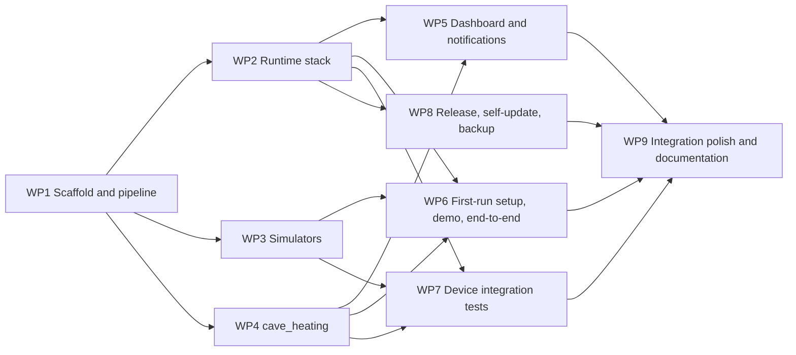

# cave_system — work packages

This splits the [concept](concept.md) into nine work packages. Each is implemented by a coding agent on its own branch, reviewed by a second agent, and merged only after that review.

## How a work package is delivered

1. **Implement.** The implementer works on branch `wp/<number>-<slug>` created from the current `main`, reads the concept and its work package, and builds exactly the deliverables listed.
2. **Verify.** `make check` passes locally. It covers everything that can run on the development machine: linting, type checking and the tests. Docker is not available there, so hassfest and anything that needs containers are verified by the pipeline on the pull request.
3. **Pull request.** One pull request per work package, with a description that states what was built, how it was verified, and every deviation from the concept. A deviation that changes a contract (concept sections 4.1, 4.2, 4.4, 4.5, 5.1 and 5.2) updates the concept in the same pull request.
4. **Review.** A reviewer running on an Opus-class model or better reviews the pull request against the concept and the acceptance criteria, runs the checks itself, and posts a review comment that starts with `VERDICT: APPROVE` or `VERDICT: REQUEST CHANGES`. GitHub does not allow approving one's own pull request, so the verdict comment is the approval record.
5. **Fix and re-review** until the verdict is APPROVE and the pipeline is green on the latest commit, rebased on the current `main`.
6. **Merge.** Squash merge. Nobody merges their own work package.

GitHub offers no branch protection for a private repository on the free plan, so these rules are conventions that everyone working on the repository follows.

### Definition of done, for every work package

- All acceptance criteria are met and demonstrated in the pull request.
- The pipeline is green and the review verdict is APPROVE.
- Tests assert behaviour, not just that code runs. A test that cannot fail does not count.
- No secrets, no commented-out code, no `TODO` without an explanation of what is missing and why.
- Every new command, variable or configuration key is documented where a user would look for it.
- Nothing outside the work package's own paths is changed, except the shared files named in its section.

## Overview

| # | Work package | Depends on | Implementer | Reviewer | Why this level |
|---|---|---|---|---|---|
| 1 | Scaffold and pipeline foundation | — | Sonnet 5.5, high effort | Opus 5.5, high | Conventional tooling, but everything else builds on it |
| 2 | Runtime stack and host provisioning | 1 | Sonnet 5.5, high | Opus 5.5, high | Compose, configuration and a small command-line tool; careful rather than hard |
| 3 | Device simulators | 1 | Opus 5.5, high | Opus 5.5, high | Protocol fidelity decides what the tests are worth |
| 4 | `cave_heating` integration | 1 | Opus 5.5, extra-high | Fable 5.2, high | The control logic; timing, state and Home Assistant internals |
| 5 | Dashboard and notifications | 2, 4 | Sonnet 5.5, high | Opus 5.5, high | Generator plus configuration |
| 6 | First-run setup, demo mode, end-to-end tests | 2, 3, 4 | Opus 5.5, high | Opus 5.5, high | Crosses every component and uses Home Assistant internals |
| 7 | Device integration tests | 2, 3, 4 | Opus 5.5, high | Opus 5.5, high | The evidence for requirement R3; needs each device's behaviour understood |
| 8 | Release, self-update and backup | 2 | Opus 5.5, high | Opus 5.5, high | Rollback must be right the first time |
| 9 | Integration polish and documentation | 5, 6, 7, 8 | Sonnet 5.5, high | Opus 5.5, high | Wiring and prose, checked against the real commands |

Work packages 2, 3 and 4 run in parallel, as do 5, 6, 7 and 8 once their dependencies are merged.

### Shared files

Several work packages add to the same files. To keep that mechanical:

- **`.github/workflows/ci.yml`** only lists jobs. Each larger check lives in its own reusable workflow file (`stack.yml`, `sim.yml`, `e2e.yml`, `release.yml`) and is added to `ci.yml` as a short calling job, which is also added to the `needs` of `ci-ok`. `ci-ok` checks every job it needs, so `needs` is the only list to edit.
  - The `release` job is the exception: it has `needs: ci-ok`, runs only for pushes to `main`, and `ci-ok` does not depend on it. Its calling job sets `permissions: contents: write`, because a reusable workflow cannot raise the read-only default.
  - Superseded runs are cancelled for pull requests only. Every run on `main` completes.
- **The `cave` command** discovers its commands from `ops/cave_ops/commands/`, one module per command. A work package adds modules there and does not edit other commands.
- **Core modules of the `cave` command.** WP2 delivers, besides its own commands, what later commands need: the runner for `docker` and `git`, the `.env` loader and the paths, the script-token reader, a small client for Home Assistant's REST API, the health check and the notification call of concept section 4.5, the function that validates a `heating.yaml` and stores its applied copy, the lock, and the test fixtures that fake them. Later work packages import these and do not write their own. If one of them lacks something, the work package that needs it extends it and says so in its pull request.
- **`.env.example` and the `init` command** are written once, in WP2, for the complete variable table in concept section 4.2, including the variables only later work packages read. Later work packages do not need to change them.
- **`tests/conftest.py`** stays free of Home Assistant, so that tests of the `cave` command can run on Python 3.11. Each test directory that needs Home Assistant has its own `conftest.py`.
- **`pyproject.toml` and `uv.lock`**: add dependencies to the dev group, then run `uv lock`. After a rebase, regenerate the lock file instead of merging it by hand.
- **`homeassistant/configuration.yaml`** is written once in WP2 with the hooks later work packages need: packages are loaded from a directory, the heating dashboard is registered as in concept section 4.5, and `cave_heating` is enabled.

---

## WP1 — Scaffold and pipeline foundation

**Goal.** A repository where `make check` and the pipeline work, so every later work package starts from working tooling.

**Deliverables**

- `pyproject.toml` and `uv.lock`: Python 3.14.2 or newer, managed with uv. Dev dependencies include pytest, pytest-cov, `pytest-homeassistant-custom-component` 0.13.375 (which pins Home Assistant 2026.10.4), Ruff, mypy and yamllint. ShellCheck and actionlint come from packages uv can install, so no system packages are needed.
- `custom_components/cave_heating/` as a minimal integration that Home Assistant loads: `manifest.json`, `__init__.py` with a permissive configuration schema, `const.py`. A test proves Home Assistant sets it up.
- `Makefile` with `setup`, `lint`, `format`, `typecheck`, `test` and `check`. `check` is everything that can run locally; hassfest runs only in the pipeline.
- Lint configuration: Ruff for linting and formatting; mypy in strict mode for `custom_components`, `sim` and `tools`, arranged so that `ops/` can later be checked against Python 3.11; yamllint rules that accept Home Assistant's `!include` and `!secret` tags; ShellCheck; actionlint. All of them skip `.venv`, `.claude` and the state directory `data` at the repository root, and nothing else. The rules accept idiomatic Home Assistant entity code and what the later packages legitimately need, such as printing in a command-line tool.
- `.github/workflows/ci.yml`: runs on pull requests and on pushes to `main`; cancels superseded runs for pull requests only; jobs `lint`, `test`, `hassfest` and `ci-ok`, which fails unless every job it needs succeeded. Actions are pinned to full commit hashes with the version in a comment. hassfest runs in the image of the Home Assistant version the tests use. The default token permission is read-only.
- `.github/dependabot.yml` for Actions, Python packages, Compose images and Dockerfiles: weekly, grouped, with Home Assistant excluded in every form — the image, the `homeassistant` package and the test library that pins it (concept section 9).
- `.github/PULL_REQUEST_TEMPLATE.md`, `.editorconfig`, and `CLAUDE.md` with the commands and the delivery rules from this document, kept short.
- A developer section in `README.md`.

**Acceptance**

- `make setup && make check` passes on a clean clone on macOS and on Linux.
- The pipeline is green on the pull request, including hassfest.
- The pull request shows that a failing test and a lint error each make `make check` fail, and that a job added to the `needs` of `ci-ok` makes `ci-ok` fail when it fails.

**Paths:** repository root files, `.github/`, `custom_components/cave_heating/` (skeleton only), `tests/` (skeleton).

---

## WP2 — Runtime stack and host provisioning

**Goal.** `./cave init && ./cave up` turns a clean checkout into a running, healthy Home Assistant with the broker, on a Debian server or a Raspberry Pi.

**Deliverables**

- **The `cave` command** as in concept section 4.4: the executable `cave`; the package `ops/cave_ops/` using only the standard library and running on Python 3.11 or newer; command discovery from `ops/cave_ops/commands/`; the commands `init`, `up`, `down`, `restart`, `ps`, `logs`, `check`, `version` and `help`; and the core modules listed under "Shared files". With an older Python it stops with a clear message.
- **`init`** creates the state directories and every file listed in concept section 4.2, including the starter `cave/heating.yaml` and its applied copy; generates passwords and tokens; writes `.env` (mode 0600) for the complete variable table in that section; and writes the broker's password file. Run again, it changes nothing.
- **`compose.yaml`** with the services `homeassistant`, `mosquitto` and `zigbee2mqtt` exactly as in concept section 4.1: pinned versions, health checks, restart policies, log rotation, and the read-only code mounts, state directories and container paths of sections 4.2 and 4.5.
- **`homeassistant/configuration.yaml`**: packages loaded from `packages/`; the heating dashboard registered as in section 4.5; `cave_heating` enabled with an empty entry, because the integration reads its applied copy itself; recorder retention; the UI-managed `automations.yaml`, `scripts.yaml` and `scenes.yaml` included from the state directory.
- **`homeassistant/heating.example.yaml`**: a commented starter with the defaults from concept section 5.1 and an empty room list.
- **`mosquitto/mosquitto.conf`** (password authentication, persistence, listeners as in section 4.1) and **`zigbee2mqtt/configuration.template.yaml`**: Home Assistant discovery on; availability on, with Zigbee2MQTT's 25 hours for battery devices stated explicitly; `last_seen` enabled; coordinator address, driver and UI token from the environment. `init` copies it into the state directory, where Zigbee2MQTT keeps writing to it.
- **`.env.example`** documenting every variable of the table in section 4.2.
- **A version check**, part of `make check`: the Home Assistant image tag in `compose.yaml` and the hassfest image tag in the pipeline both equal the `homeassistant` version locked in `uv.lock`; and the client libraries of Home Assistant's MQTT and FRITZ! integrations, `paho-mqtt` and `pyfritzhome`, are locked at exactly the versions those integrations ask for, whenever they are locked at all.
- **`scripts/provision-host.sh`** for Debian 13 and Raspberry Pi OS 64-bit: installs Docker Engine and the Compose plugin from Docker's package repository, Git and Python; creates the service user, `/opt/cave` and `/var/lib/cave`. Idempotent, with a `--dry-run` mode.
- **Tests** in `tests/ops/` for the commands and the core modules, with the runner replaced by a fake. They import nothing from Home Assistant and run on Python 3.14 with the rest of the suite and on Python 3.11 in a separate pipeline step. Ruff and mypy check `ops/` against Python 3.11.
- **`.github/workflows/stack.yml`** and its calling job: `./cave init`, `./cave check`, `./cave up` without the `zigbee` profile, wait until healthy as in section 4.5, assert from the log that `cave_heating` was set up and that no errors were logged apart from an explicit, commented allow-list, then `./cave down`.
- **`docs/install.md`**, first version.

**Acceptance**

- The `stack` job proves a healthy boot from a clean checkout with no interaction.
- `docker compose config` is valid with and without the `zigbee` profile; the shell script passes ShellCheck.
- No secret is tracked; a second `./cave init` is a no-op, asserted by a test.
- The `tests/ops` tests pass on Python 3.11 and 3.14.

**Paths:** `compose.yaml`, `cave`, `ops/`, `tests/ops/`, `scripts/provision-host.sh`, `homeassistant/`, `mosquitto/`, `zigbee2mqtt/`, `.env.example`, `docs/install.md`, `.github/workflows/stack.yml`. Shared: `ci.yml`, `Makefile`, `pyproject.toml`.

---

## WP3 — Device simulators

**Goal.** Software stand-ins for every recommended device (concept sections 3.1 and 8), faithful enough that Home Assistant's own integrations accept them.

**Deliverables**

- Package `sim/cave_sim` with:
  - a **Zigbee2MQTT stand-in** for the models TRV-ZBT, TRVZB, BTH-RA, SNZB-02P and SNZB-04P: discovery messages, state, availability and command handling, derived from Zigbee2MQTT's source and documentation at the pinned version, with the reference noted next to each model. Models are described as data. The thermostat models include the external temperature input and the settings entities of concept section 5.6 (sensor selection, window detection), and a Sonoff model switches its sensor selection by itself when the external temperature stops arriving, as the real device is documented to. Entity IDs come out as Zigbee2MQTT's scheme produces them (concept section 4.1). Message fixtures are laid out so that recordings from real devices can replace the hand-built ones, and a documented way to make such a recording is included;
  - a **fake FRITZ!Box**: the session login with the PBKDF2 challenge–response, and the smart-home commands that `pyfritzhome` and Home Assistant's `fritzbox` integration use, with FRITZ!Smart Thermo 302 devices. It can report a new setpoint at once or only after a configurable delay, and it can refuse commands the way a real box does while its summer or holiday mode or the key lock is active;
  - a **room model** in which temperature follows valve opening and open windows;
  - a **control API** over HTTP: open or close a window, set a room or outdoor temperature, take a device offline, change the FRITZ! behaviour, turn a thermostat's dial, read device state.
- `cave_sim.testing`: an importable module that wires the simulators into Home Assistant in-process, feeding the Zigbee2MQTT stand-in's messages into Home Assistant's MQTT integration and starting the fake FRITZ!Box on the loopback address. The tests here, the demo test in WP6 and the device tests in WP7 all use it.
- `paho-mqtt` and `pyfritzhome` as dev dependencies, pinned to exactly the versions Home Assistant's MQTT and FRITZ! integrations ask for, because the test library does not install them, and excluded from Dependabot like Home Assistant itself.
- `sim/demo/home.yaml`: a demo home of three rooms that between them use every simulated model and both device families.
- `python -m cave_sim`, configured through the environment; `sim/Dockerfile`; `compose.sim.yaml` adding the `sim` service with the ports of concept section 4.1.
- `.github/workflows/sim.yml` and its calling job: builds the image and runs it against a real broker, checking that it publishes its devices and answers a command.
- Tests in `tests/sim/` that show the simulators are accepted by the real clients:
  - the fake FRITZ!Box driven by the real `pyfritzhome` client: log in, list devices, set and read back a target temperature, both reporting behaviours, a refused command;
  - the discovery messages of every model fed into Home Assistant's real MQTT integration in-process, asserting that the expected entities appear with the expected entity IDs and that one command per model issued through Home Assistant changes the simulated device;
  - the room model and the control API.
- `sim/README.md`: every MQTT topic and HTTP endpoint implemented, and the known differences from real devices.

The exhaustive tests of each device against each capability belong to WP7, not here.

**Acceptance**

- The tests above pass locally and in the pipeline; the `sim` job is green.
- Every model in concept section 3.1 that is marked as simulated has a model here and is used in the demo home.

**Paths:** `sim/`, `tests/sim/`, `compose.sim.yaml`, `.github/workflows/sim.yml`. Shared: `ci.yml`, `.github/dependabot.yml`, `pyproject.toml`, `uv.lock`.

---

## WP4 — `cave_heating` integration

**Goal.** The heating logic of concept section 5, complete and tested.

**Deliverables**

- The integration in `custom_components/cave_heating/`: the configuration schema and validation of section 5.1 including `version`, `presence` lists, `settings`, `slow` and the `timing` block; the entities and services of section 5.2 with exactly the entity IDs and unique IDs given there; the decision table and rules of section 5.3; the input handling of section 5.4; the thermostat handling of section 5.5.
- The integration reads the applied copy of `heating.yaml` itself (concept section 4.5), at start-up and on `cave_heating.reload`. A missing or invalid file at start-up means no rooms and a repair notice; an invalid file on reload leaves the running configuration in effect. It never keeps Home Assistant from starting.
- The validator of concept section 4.5, `python -m custom_components.cave_heating.validate <file>`, using the same schema.
- The file format carries a `version`. The loader converts older versions; a test loads a stored example of every version that ever existed.
- The integration is represented by one config entry, which it creates itself on first start, so that each room is a device in its Home Assistant area.
- The services `cave_heating.hold` and `cave_heating.release` of section 5.5.
- The decision logic of sections 5.3 and 5.4 is a pure module without Home Assistant imports. A separate controller applies section 5.5.
- State restore after a restart, the problem sensor and repair notices, diagnostics, English and German translations, strict typing.
- Tests in `tests/cave_heating/`:
  - unit tests with simulated time for every row and rule of sections 5.3 and 5.4;
  - integration tests with fake thermostat entities for every rule of section 5.5: rounding and clamping to a thermostat's step and range, including a thermostat without a step; the command form for heat and off; confirmation, resend and `unresponsive`; a refused command and `blocked`; a late report of an earlier command while a later one is waiting, which must not count as a hand change; a dial turned to a value that was sent earlier and since superseded, which must count; a thermostat that differs without a hand change, which is corrected; a dial turned through intermediate values; two dials turned within seconds of each other; a dial turned during a window pause; the first report after a start and after a thermostat returns from being unavailable, neither of which is adopted; a held thermostat, which receives nothing and from which nothing is adopted, released by the service and by its own time limit; the command budget; the temperature feed with its limits, its stops and its restart; device settings at their three moments, and a setting the device changes by itself, which is left alone; restore after restart; reload with a valid and an invalid file; a file with no rooms; a file that names entities which do not exist.

**Acceptance**

- The pull request contains a table mapping every row and rule of sections 5.3, 5.4 and 5.5 to the tests that prove it.
- A test asserts the exact entity IDs of section 5.2.
- Line coverage of the package is at least 90 %.
- hassfest passes; there is no blocking I/O in the event loop.
- Configurations with no rooms and with missing entities load without errors, the latter with the problem sensor on.

**Paths:** `custom_components/cave_heating/`, `tests/cave_heating/`. Shared: `pyproject.toml`, `uv.lock`.

---

## WP5 — Dashboard and notifications

**Goal.** The heating dashboard of concept section 6, generated from the room configuration with one command, and the notifications.

**Deliverables**

- `tools/render_dashboard.py`: reads a `heating.yaml` and writes the dashboard with the room view and the maintenance view. Output is deterministic. Built-in cards only, enforced by an allow-list of card types. Battery levels on the maintenance view come from a built-in card that lists every battery sensor Home Assistant knows, so the generator does not have to guess entity names.
- The `apply` command (`ops/cave_ops/commands/apply.py`), in this order: validate the edited file and store it as the applied copy, using the shared function from WP2; regenerate `dashboards/heating.yaml` from it; and call `cave_heating.reload` using the script token. Without a token it says that Home Assistant has to be restarted instead. An invalid file changes nothing and the errors are shown.
- `homeassistant/packages/cave_notifications.yaml`: `script.cave_notify` and `input_text.cave_notify_service` as described in concept section 6, and the notifications for a low battery, a device unavailable for too long, a window left open, high humidity and a room's problem sensor.
- Tests in `tests/tools/` and `tests/ops/`: golden-file tests for the generator, including the demo home and a home with no rooms; a test that fails when a card type outside the allow-list is produced; tests for `apply` with a fake Home Assistant, covering the valid, the invalid and the no-token case.

**Acceptance**

- `make check` passes with the new tests.
- The `stack` job still passes with the package loaded, and additionally shows that `./cave apply` produces a dashboard file for the starter configuration.

**Paths:** `tools/render_dashboard.py`, `ops/cave_ops/commands/apply.py`, `tests/tools/`, `tests/ops/` (apply only), `homeassistant/packages/`. Shared: `stack.yml`, `pyproject.toml`, `uv.lock`.

---

## WP6 — First-run setup, demo mode and end-to-end tests

**Goal.** A fresh stack sets itself up without clicking, a demo with simulated devices starts with one command, and the pipeline proves the whole system end to end.

**Deliverables**

- `tools/bootstrap.py` and the `bootstrap` command, run inside the Home Assistant container: creates the owner account from `.env`; sets up the MQTT integration, handling a config flow that opens with a menu; sets up the FRITZ!SmartHome integration and FRITZ!Box Tools when credentials are present; creates a schedule helper with a default timetable for every room that names one; stores the script token as in concept section 4.5. Running it again changes nothing.
- The `demo` command: the stack with `compose.sim.yaml`, a state directory of its own, the demo home's `heating.yaml` with timings in seconds validated and stored as the applied copy through the shared function from WP2, and the bootstrap run against the simulators.
- `sim/demo/heating.yaml`: the `cave_heating` configuration for the demo home, and a test in `tests/demo/` that every entity it names is one the simulators produce.
- `tests/e2e/`: against the running demo stack, through Home Assistant's API and the simulators' control API, the scenarios of concept section 8: schedule, window pause, away, boost, room-sensor feed, a slow FRITZ! thermostat, an offline device. Both device families are covered.
- `.github/workflows/e2e.yml` and its calling job. Home Assistant and simulator logs are uploaded as artifacts when the job fails.
- `docs/demo.md`.

**Acceptance**

- The `e2e` job passes three times in a row on the final commit and takes no more than about ten minutes.
- A second `cave bootstrap` is a no-op, asserted by a test.
- No scenario relies on fixed sleeps; each waits for a condition with a timeout.

**Paths:** `tools/bootstrap.py`, `ops/cave_ops/commands/bootstrap.py`, `ops/cave_ops/commands/demo.py`, `sim/demo/heating.yaml`, `tests/demo/`, `tests/e2e/`, `.github/workflows/e2e.yml`, `docs/demo.md`. Shared: `ci.yml`, `compose.sim.yaml`, `pyproject.toml`, `uv.lock`.

---

## WP7 — Device integration tests

**Goal.** Proof, device by device, that every recommended product works through Home Assistant with the heating logic: now against the simulators, and with one command against the real device once it is bought (requirement R3).

**Deliverables**

- `tests/devices/`: an in-process suite that runs every recommended device through Home Assistant's real MQTT and FRITZ! integrations, fed by the simulators, with `cave_heating` on top. Tests are parametrised by device model, so the test names read as a device-by-capability matrix.
  - **Every thermostat model** (TRV-ZBT, TRVZB, BTH-RA, FRITZ!Smart Thermo 302):
    - discovery gives the expected entities, entity IDs, temperature range and step;
    - heat at a target, with rounding and clamping to that model's step and range; off; back to heat;
    - a command is confirmed from the device's report, and an unanswered one is resent and then flagged;
    - a dial turned on the device becomes the room's override, and a mode changed on the device is put back;
    - the device going offline and coming back;
    - the battery level is available.
  - **Model-specific behaviour:**
    - Sonoff: the room temperature reaches the external input; the sensor selection is set once and is left alone when the device switches it by itself;
    - Bosch: the external temperature arrives at least every 30 minutes; window detection is switched off;
    - FRITZ!: both reporting behaviours; a command refused during summer mode, holiday mode or key lock makes the thermostat `blocked`; the mode is never set to `heat` on its own.
  - **Sensors:** the SNZB-02P supplies the room's temperature, humidity and the feed, including going stale; the SNZB-04P starts and ends the window pause, including going silent while open.
  - **Rooms built from each thermostat model** run the core scenarios of concept section 5.3: comfort and eco by schedule, window pause, away, boost, and an override that expires.
  - **A mixed room** with a Zigbee thermostat and a FRITZ! thermostat stays in step.
- **The matrix in the pipeline.** A small script turns the test results into a table of devices against capabilities, shown in the job summary of every pipeline run.
- **`cave device-check <thermostat entity>`** (`ops/cave_ops/commands/device_check.py`): the same questions asked of a real, paired device on the server, through Home Assistant's API with the script token. It first holds the thermostat with `cave_heating.hold`, so the controller neither reacts to the check nor passes it on to the room, and releases it at the end. It checks that the entity exists and is available, that it reports a temperature, that it accepts a target half a degree higher and reports it back, how long that took, and restores the original target; where the applied `heating.yaml` lists them, that the external temperature input accepts a value and that the settings entities exist with the configured options. It prints a pass/fail table with timings and exits non-zero on a failure. It changes nothing permanently: the original target is restored and the hold released whatever happens, and the hold ends by itself if the command is killed.
- Tests for `device-check` in `tests/ops/` with a fake Home Assistant: a device that passes, one that never confirms, one that is unavailable, and that in every case the original target is restored and the hold released.
- `docs/devices.md`: per device, what is tested, the known differences between simulator and real device, and how to run `device-check`.

**Acceptance**

- Every device of concept section 3.1 that is marked as simulated appears in the suite, and the matrix in the job summary has no gap for a capability that applies to the device.
- The suite runs as part of `make check` and takes no more than about two minutes.
- The pull request shows that breaking one simulated behaviour, such as a thermostat that ignores commands, makes the matching device tests fail.
- The `device-check` tests pass on Python 3.11 and 3.14.

**Paths:** `tests/devices/`, `ops/cave_ops/commands/device_check.py`, `tests/ops/` (device-check only), `docs/devices.md`. Shared: `ci.yml` (job summary), `pyproject.toml`, `uv.lock`.

---

## WP8 — Release, self-update and backup

**Goal.** A green `main` becomes a release, and the server installs releases by itself without ever being left broken (concept sections 9 and 11).

**Deliverables**

- `.github/workflows/release.yml` and its calling job, wired as described under "Shared files": creates the tag `vYYYY.MM.DD.N` and a GitHub Release with generated notes, and does nothing if the commit is already released.
- The `update` and `status` commands. `update` follows concept section 9 exactly:
  - holding the lock of section 4.5, fetch tags and find a newer release, skipping one remembered as failed unless `--force` is given;
  - before anything is touched: check that the running stack is healthy; export the new release into a temporary directory; pull its images; validate the Home Assistant configuration and the applied `heating.yaml` with the new release in the new image;
  - the switch: stop, snapshot, check out, start, wait for healthy;
  - on failure: stop, restore the snapshot and the previous release, start, wait for healthy; if that fails too, leave the previous release running and say so;
  - report every outcome through the notification contract of section 4.5, remember a failed release, and keep the last two snapshots.
  - `CAVE_AUTO_UPDATE=0` stops timer-started runs only.
- `status` shows the installed release, whether the stack is healthy, the last update's outcome, and whether `heating.yaml` differs from its applied copy.
- The `backup` and `restore` commands, holding the same lock: archive the state directory and `.env` without stopping the stack, using the SQLite online backup for Home Assistant's database; keep `CAVE_BACKUP_KEEP` archives; optionally copy to `CAVE_BACKUP_COPY_TO`; restore onto a fresh host.
- systemd service and timer units for update and backup in `scripts/systemd/`, installed by `scripts/provision-host.sh`.
- Tests in `tests/ops/`, with the runner replaced by a fake and real temporary directories and Git repositories: no new release; a successful update; an unhealthy stack before the update, which is left alone; a failed image pull, a failed configuration check and an invalid applied `heating.yaml`, after each of which nothing was stopped; a failed health check, after which the previous release and the snapshot are back and running; a failed rollback; a failed release that is skipped the next night and installed with `--force`; a refused concurrent run, including backup against update; backup retention; a backup-and-restore round trip including the database.
- `docs/operations.md`.

**Acceptance**

- The tests pass on Python 3.11 and 3.14.
- After the merge, the pipeline on `main` creates a release. This is checked on GitHub, not assumed.

**Paths:** `ops/cave_ops/commands/update.py`, `status.py`, `backup.py`, `restore.py` and helpers only they need, `scripts/systemd/`, `tests/ops/` (these commands), `.github/workflows/release.yml`, `docs/operations.md`. Shared: `ci.yml`, `scripts/provision-host.sh`.

---

## WP9 — Integration polish and documentation

**Goal.** The pieces are joined up, the web UI is shown to work, and someone can go from unboxed hardware to working heating by following the documentation alone.

**Deliverables**

- The demo mode runs `apply`, so it shows a dashboard generated for the demo home.
- The `e2e` job fetches the dashboard configuration from Home Assistant, opens the heating dashboard in a browser, fails if any card shows an error, and uploads a screenshot as an artifact on every run.
- `docs/hardware.md` (the shopping list from concept section 3), `docs/install.md` (complete, for the mini PC and the Raspberry Pi), `docs/pairing.md` (Zigbee2MQTT pairing, the Bosch install code, FRITZ! registration and its neutral timetable, the `settings` entries per model, describing rooms in `heating.yaml` and applying them, running `device-check`, and that a room is switched off in the UI and not at a FRITZ! dial), `docs/phone-and-remote.md` (the apps, enabling the phones' trackers for presence, the FRITZ!Box VPN), `docs/hardware-acceptance.md` (what to verify on real devices beyond `device-check`, including the open points of concept section 12 and recording messages for the simulators), and a final `README.md`.
- A pipeline check that relative links in the documentation resolve and that every `cave` command mentioned exists.

`docs/hardware.md` and `docs/phone-and-remote.md` were delivered ahead of the rest, in their own pull request, because they depend on no code.

**Acceptance**

- The screenshot artifact shows the demo home's rooms with live values and no error cards.
- The reviewer follows `docs/install.md` and `docs/demo.md` step by step against the repository and finds no command or path that does not exist.

**Paths:** `docs/`, `README.md`, `tests/e2e/` (dashboard check), `.github/workflows/e2e.yml`. Shared: `ci.yml`, `ops/cave_ops/commands/demo.py`.
